# 龙飞图推图解笔记

先按图形特征确定观察方向，再用整组图形验证规律。本页将三组公开分享的龙飞图推笔记按知识点归类，共收录 **17张知识点图片和1张来源封面**，保留原署名、水印与批注。

配套阅读：[图推规律大全](图推规律大全.md) · [判断推理笔记](笔记.md)。整理日期：2026年10月29日。

## 图片来源

**来源A 百大图形推理笔记**：分享账号为“唯有上岸资源库”，共9张，发布于2026年8月16日。[微博原帖](https://weibo.com/5942251668/5332595951013618) · [新浪展示页](https://www.sina.cn/news/detail/5332595951013618.html)。

**来源B 百大图形手写批注笔记**：新浪展示页署名“黑客叔”，发布于2025年2月13日；本页选用前2张。[来源图集](https://k.sina.com.cn/article_2231624585_p8503e389027017kx0.html)。

**来源C 2027龙飞图推学霸手写笔记**：分享账号为“琛琛菌”，1张封面与6张笔记，发布于2026年8月16日。[用户补充的微博原帖](https://weibo.com/5669144718/5332470787738051) · [新浪展示页](https://www.sina.cn/news/detail/5332470787738051.html)。

这些是第三方学习笔记，不据此认定为龙飞本人发布或完整讲义。图中的“只考”“优先”等经验表述用于提示候选方向，不能代替对题干、统计口径和全部选项的检验。跨知识点的图片保留完整原页，下面按主要内容归类。

C2、C3、C5使用原帖公开展示的预览图，清晰度低于其余C组图片；需要辨认细节时，可通过对应的原帖链接查看。

## 对称方式与整体规则

先区分轴对称、中心对称以及两者兼具，再比较对称轴的数量和方向。图形局部规则与整体规则要分别判断。

### A1 整体规则与对称方式

[来源A 原笔记第1页](https://www.sina.cn/news/detail/5332595951013618.html)

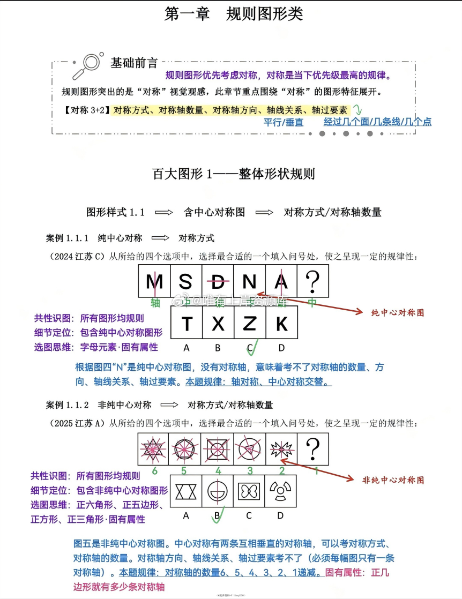

### B1 整体对称的手写观察提示

[来源B 手写批注第1张](https://k.sina.com.cn/article_2231624585_p8503e389027017kx0.html)

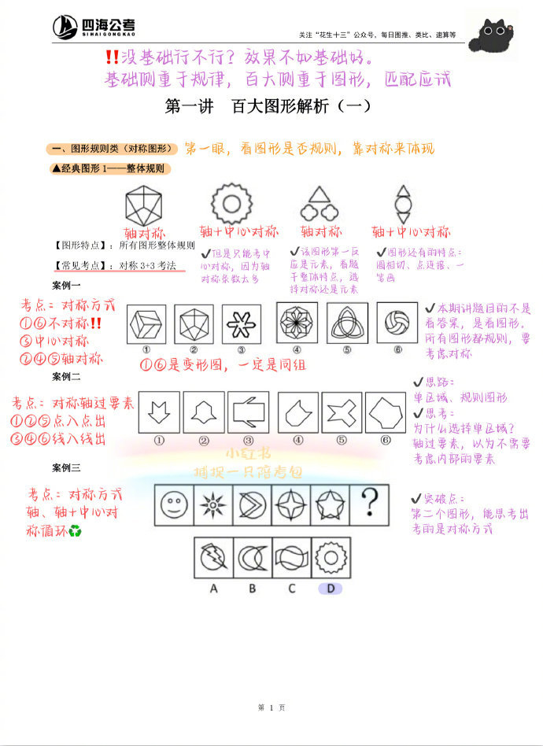

## 对称轴与局部结构

当对称形式相同，继续检查轴的数量、方向、轴线关系以及轴经过的点、线、面。遇到内外层、拼接结构或封闭区域，先明确观察对象，再比较对应部分。

### A2 轴过要素与轴线关系

[来源A 原笔记第2页](https://www.sina.cn/news/detail/5332595951013618.html)

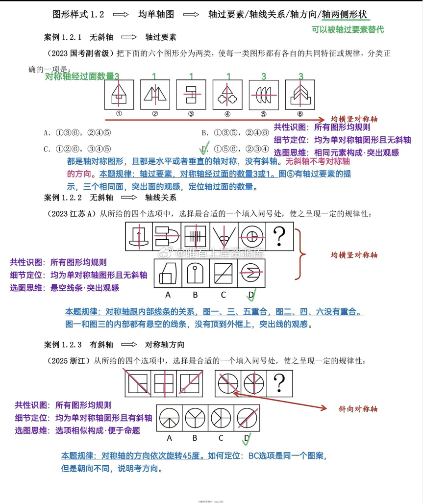

### A3 轴过轮廓与内外对称

[来源A 原笔记第3页](https://www.sina.cn/news/detail/5332595951013618.html)

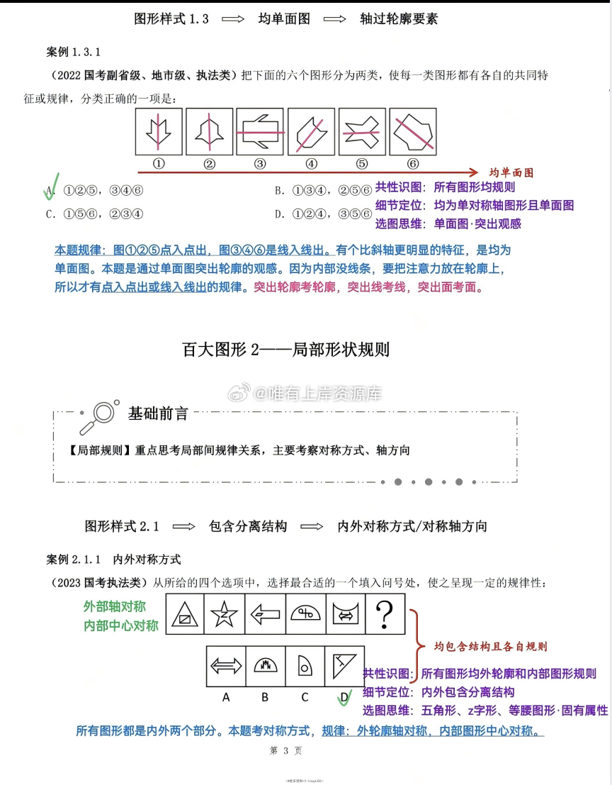

### A4 内外对称轴与拼接结构

[来源A 原笔记第4页](https://www.sina.cn/news/detail/5332595951013618.html)

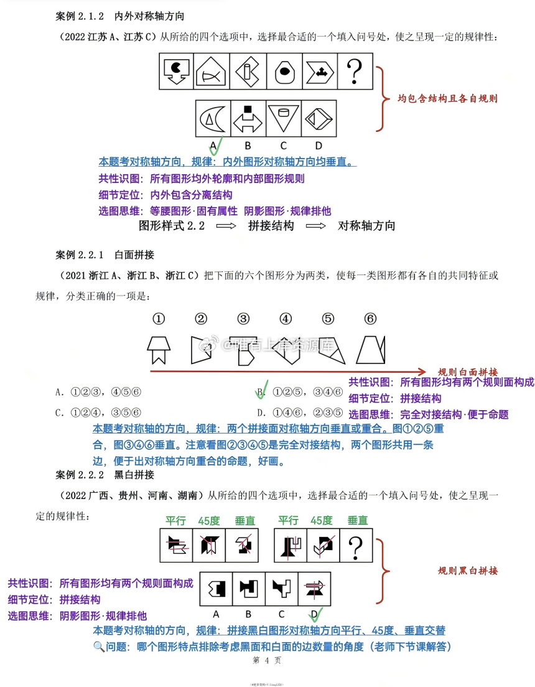

### A5 封闭结构中的局部对称

封闭图形既可能考面数量，也可能考外轮廓、最大面、阴影与白色面的对称关系，不能只因封闭就直接数面。

[来源A 原笔记第5页](https://www.sina.cn/news/detail/5332595951013618.html)

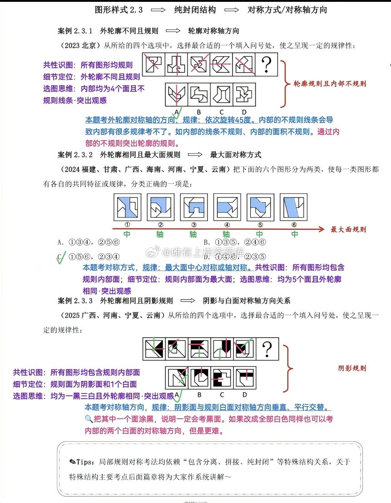

### B2 轴过面与局部对称的手写批注

[来源B 手写批注第2张](https://k.sina.com.cn/article_2231624585_p8503e389027017kx0.html)

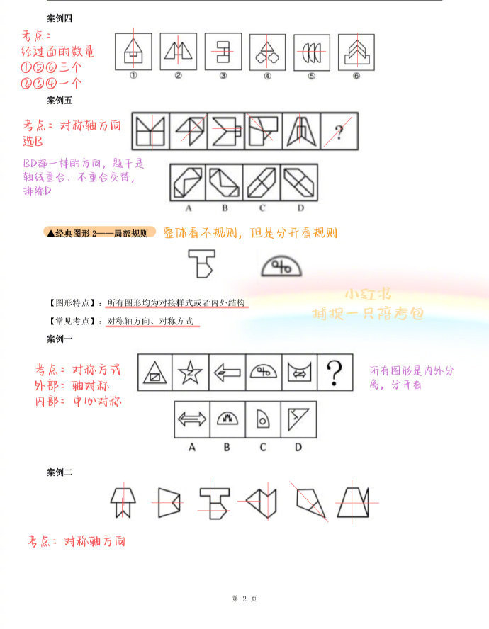

## 位置排列与黑白元素

规则轮廓中的阴影、黑白球可能通过排列形成对称，也可能考位置移动、元素连接或传递。分别检查黑色区域与白色区域，避免只追踪最显眼的部分。

### A6 阴影与黑白球排列中的对称

[来源A 原笔记第6页](https://www.sina.cn/news/detail/5332595951013618.html)

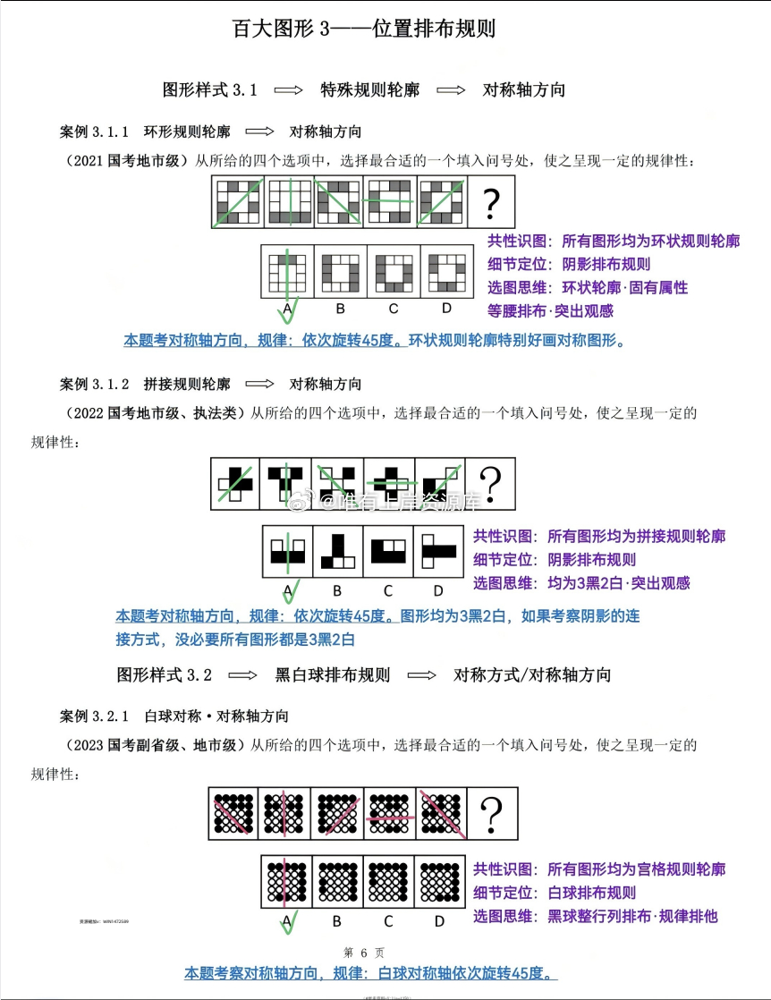

### A7 黑白球对称与轴过要素

[来源A 原笔记第7页](https://www.sina.cn/news/detail/5332595951013618.html)

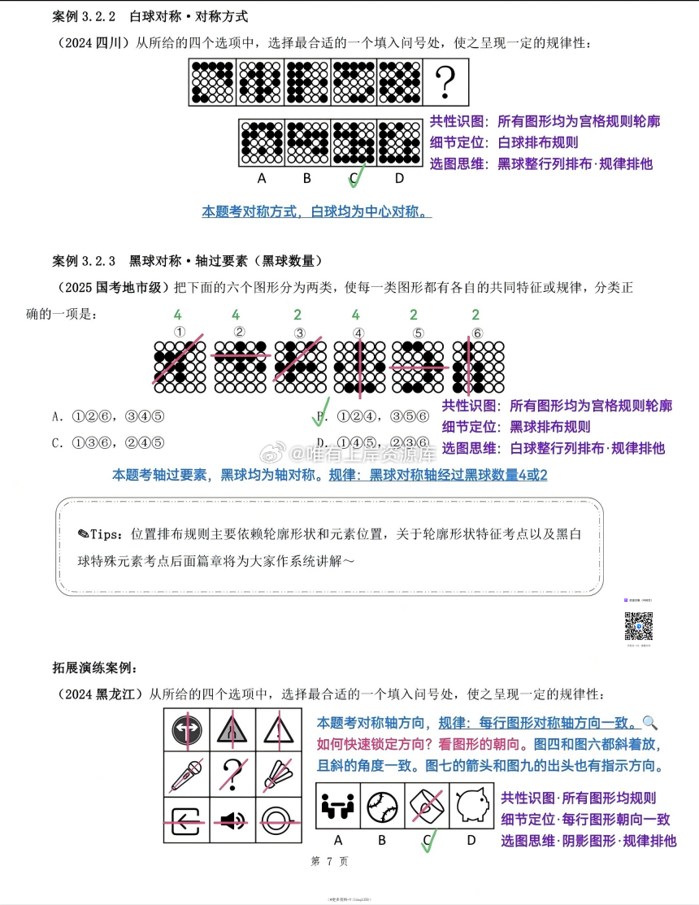

### C5 黑白分割与位置移动

本页同时涉及点连接、黑白分割、元素数量与位置传递。移动题要明确轨迹、方向和步长；把元素连接起来只是候选观察方法，仍需检验是否覆盖整组。

[来源C 原帖第5张](https://weibo.com/5669144718/5332470787738051)

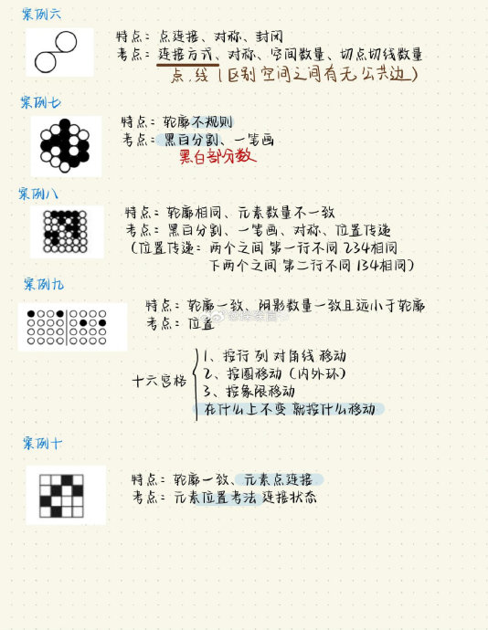

## 封闭图形与面数量形状

先固定统计对象是封闭区域、分离部分还是图形元素。如果数量不能区分，继续比较区域形状、位置及内外关系，避免为凑数列而改变口径。

### A9 封闭区域与面数量

[来源A 原笔记第9页](https://www.sina.cn/news/detail/5332595951013618.html)

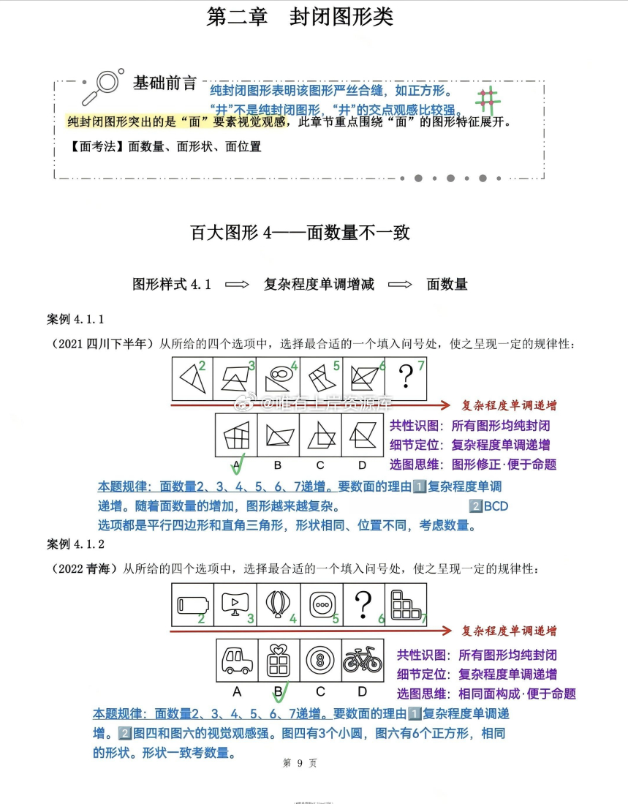

### C3 封闭图形中的数量形状与内外关系

本页上半部分含一笔画与交点例子，下半部分比较封闭区域的数量、形状和内外要素，也可结合下一模块阅读。

[来源C 原帖第3张](https://weibo.com/5669144718/5332470787738051)

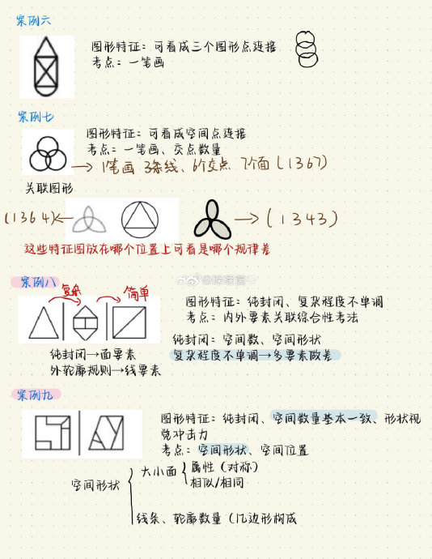

## 线条交点与笔画

一笔画先确认图形连通，再数奇点；奇点数为0或2时可以一笔画。对含线条的连通图，最少笔画数为 `max(1, 奇点数÷2)`；若图形不连通，应对各连通部分分别计算后相加。不要把笔记中的某个“典型图形”直接推广到所有变体。

### C2 相切出头与典型笔画

同时比较相切、出头、交点、空间数量与对称；统计交点时，应按题目实际线条连接情况判断。

[来源C 原帖第2张](https://weibo.com/5669144718/5332470787738051)

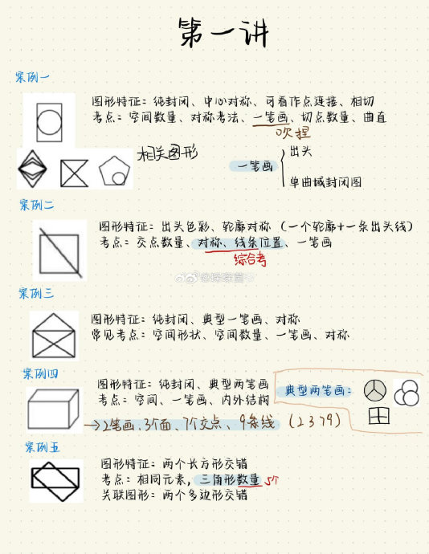

### C4 回旋曲线平行线与角数量

本页涵盖logo阴影、田字格、直角三角形、回旋曲线、平行线和扇形。它们提供观察线索，最终选择哪一个变量，应由题干整组关系决定。

[来源C 原帖第4张](https://weibo.com/5669144718/5332470787738051)

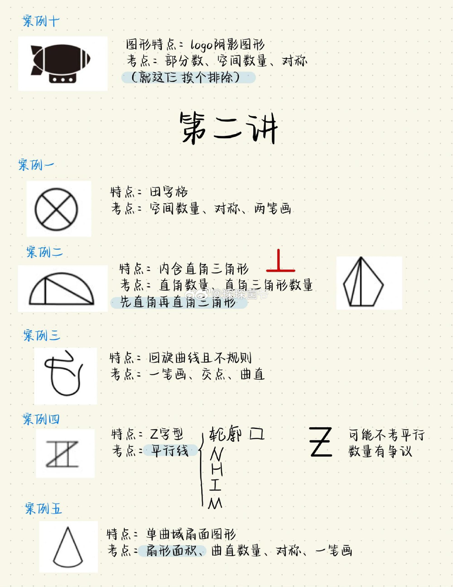

### C7 延伸线与轮廓内外要素

分别观察延伸线数量、伸出位置、与轮廓线的关系，以及轮廓内部的点、线、面。图中“圆内”等批注用于提醒观察范围，不是遇到圆形就固定套用的规则。

[来源C 原帖第7张](https://weibo.com/5669144718/5332470787738051)

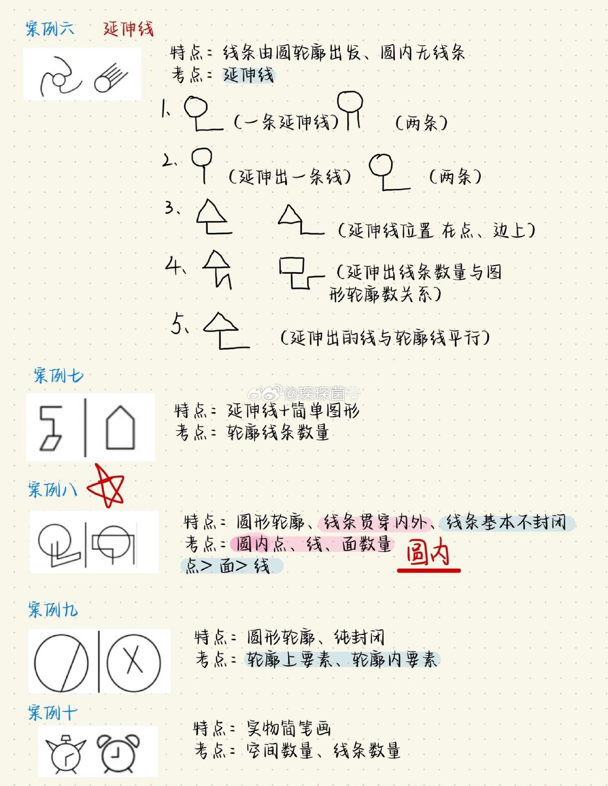

## 复合特征与分类验证

一幅图可能同时具有对称、数量和空间关系。先写出能够解释题干的候选规律，再用另一组图形或选项验证；数量关系不单调时，也不能随意增加运算来凑答案。

### C6 对称交点空间与复合观察

本页将中心排列、内外交点、三角形数量与封闭区域放在一起，可用于练习“先识别图形特征，再明确统计对象”。

[来源C 原帖第6张](https://weibo.com/5669144718/5332470787738051)

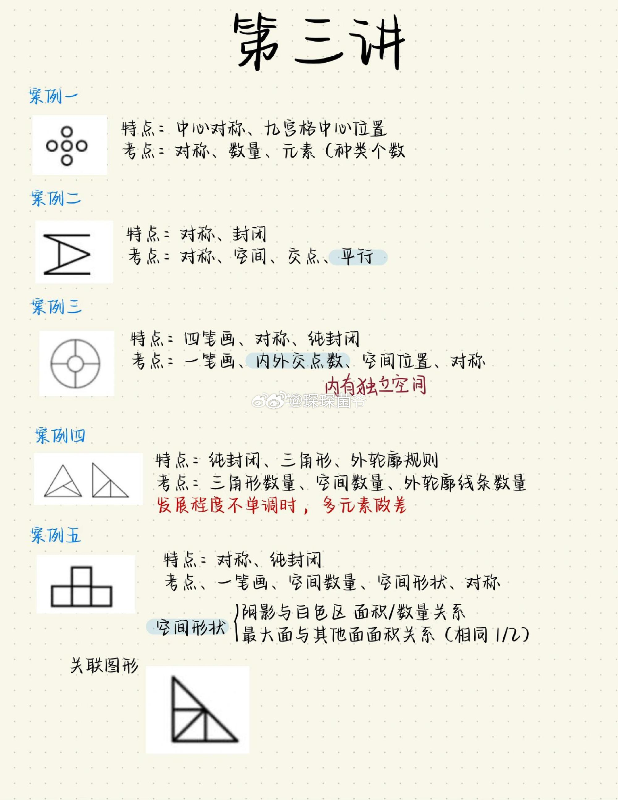

## 规则图形综合导图

这张导图汇总规则图形与对称专题，适合看完例题后回忆观察路径，不覆盖全部图推考点。

### A8 规则图形与对称观察路径

[来源A 原笔记第8页](https://www.sina.cn/news/detail/5332595951013618.html)

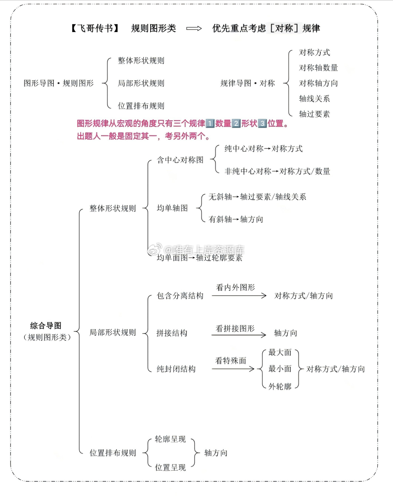

## 新增微博的来源封面

C组共7张公开配图，其中第1张是分享封面，第2至第7张为知识点笔记。标题中的“2027”是原帖版本标签；页面显示发布时间为2026年8月16日，不将它当成考试年份或官方课表。

[来源C 原帖第1张](https://weibo.com/5669144718/5332470787738051) · [新浪展示页](https://www.sina.cn/news/detail/5332470787738051.html)

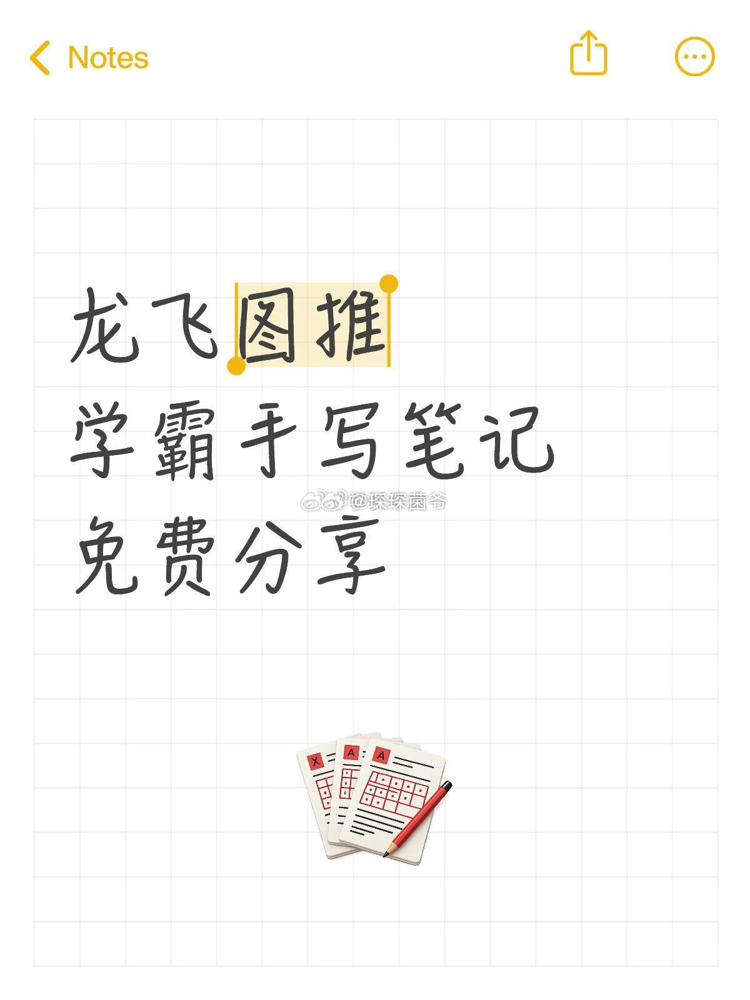

## 复习记录

每次只选一个模块，遮住笔记中的考点与批注，先自己说出图形特征、候选变量和验证方法，再对照原图。错题记录“漏掉的特征”和“下次先检查的对象”，避免只抄答案。
