# 资料C01 · 完整阅读文档

> 用户提供文档的完整整理版，共42页，100题及原文件参考答案、解析。仅页眉中性化，题目正文保持原样。历史解析不等于现行法律结论。

[题目部分](#questions) · [答案与解析](#answers) · [适用核查记录](../../专题/32天公安省考冲刺/2026-11-04.md)

## 阅读说明

原第1—25页为题目，第26—42页为答案解析。图表以页图为准，折叠文字用于搜索和复制。第14题旧解析证据不足；未逐题核查的其他旧法内容不标为已更新。

## 题目部分

### 原第1页

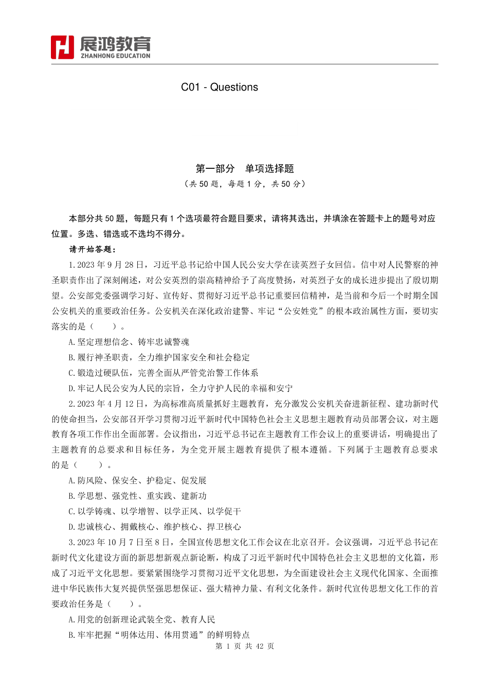

展开本页文字

第1 页共42 页
资料C01
第一部分
单项选择题
（共50 题，每题1 分，共50 分）
本部分共50 题，每题只有1 个选项最符合题目要求，请将其选出，并填涂在答题卡上的题号对应
位置。多选、错选或不选均不得分。
请开始答题：
1.2023 年9 月28 日，习近平总书记给中国人民公安大学在读英烈子女回信。信中对人民警察的神
圣职责作出了深刻阐述，对公安英烈的崇高精神给予了高度赞扬，对英烈子女的成长进步提出了殷切期
望。公安部党委强调学习好、宣传好、贯彻好习近平总书记重要回信精神，是当前和今后一个时期全国
公安机关的重要政治任务。公安机关在深化政治建警、牢记“公安姓党”的根本政治属性方面，要切实
落实的是（
）。
A.坚定理想信念、铸牢忠诚警魂
B.履行神圣职责，全力维护国家安全和社会稳定
C.锻造过硬队伍，完善全面从严管党治警工作体系
D.牢记人民公安为人民的宗旨，全力守护人民的幸福和安宁
2.2023 年4 月12 日，为高标准高质量抓好主题教育，充分激发公安机关奋进新征程、建功新时代
的使命担当，公安部召开学习贯彻习近平新时代中国特色社会主义思想主题教育动员部署会议，对主题
教育各项工作作出全面部署。会议指出，习近平总书记在主题教育工作会议上的重要讲话，明确提出了
主题教育的总要求和目标任务，为全党开展主题教育提供了根本遵循。下列属于主题教育总要求
的是（
）。
A.防风险、保安全、护稳定、促发展
B.学思想、强党性、重实践、建新功
C.以学铸魂、以学增智、以学正风、以学促干
D.忠诚核心、拥戴核心、维护核心、捍卫核心
3.2023 年10 月7 日至8 日，全国宣传思想文化工作会议在北京召开。会议强调，习近平总书记在
新时代文化建设方面的新思想新观点新论断，构成了习近平新时代中国特色社会主义思想的文化篇，形
成了习近平文化思想。要紧紧围绕学习贯彻习近平文化思想，为全面建设社会主义现代化国家、全面推
进中华民族伟大复兴提供坚强思想保证、强大精神力量、有利文化条件。新时代宣传思想文化工作的首
要政治任务是（
）。
A.用党的创新理论武装全党、教育人民
B.牢牢把握“明体达用、体用贯通”的鲜明特点

### 原第2页

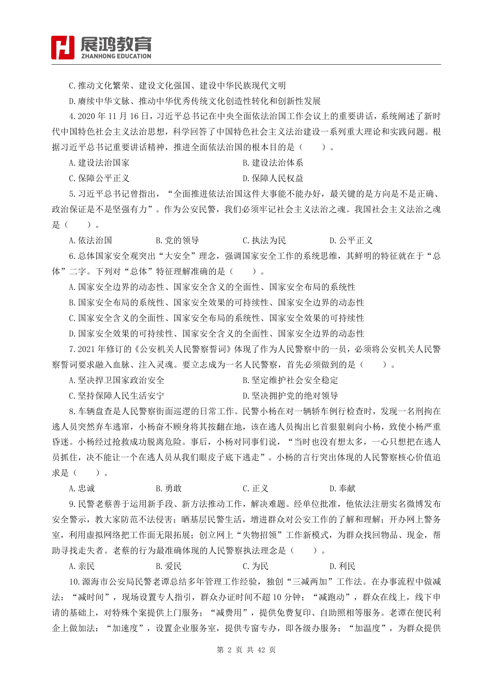

展开本页文字

第2 页共42 页
C.推动文化繁荣、建设文化强国、建设中华民族现代文明
D.赓续中华文脉、推动中华优秀传统文化创造性转化和创新性发展
4.2020 年11 月16 日，习近平总书记在中央全面依法治国工作会议上的重要讲话，系统阐述了新时
代中国特色社会主义法治思想，科学回答了中国特色社会主义法治建设一系列重大理论和实践问题。根
据习近平总书记重要讲话精神，推进全面依法治国的根本目的是（
）。
A.建设法治国家
B.建设法治体系
C.保障公平正义
D.保障人民权益
5.习近平总书记曾指出，“全面推进依法治国这件大事能不能办好，最关键的是方向是不是正确、
政治保证是不是坚强有力”。作为公安民警，我们必须牢记社会主义法治之魂。我国社会主义法治之魂
是（
）。
A.依法治国
B.党的领导
C.执法为民
D.公平正义
6.总体国家安全观突出“大安全”理念，强调国家安全工作的系统思维，其鲜明的特征就在于“总
体”二字。下列对“总体”特征理解准确的是（
）。
A.国家安全边界的动态性、国家安全含义的全面性、国家安全布局的系统性
B.国家安全布局的系统性、国家安全效果的可持续性、国家安全边界的动态性
C.国家安全含义的全面性、国家安全布局的系统性、国家安全效果的可持续性
D.国家安全效果的可持续性、国家安全含义的全面性、国家安全边界的动态性
7.2021 年修订的《公安机关人民警察誓词》体现了作为人民警察中的一员，必须将公安机关人民警
察誓词要求融入血脉、注入灵魂。要立志成为一名人民警察，首先必须做到的是（
）。
A.坚决捍卫国家政治安全
B.坚定维护社会安全稳定
C.坚持保障人民生活安宁
D.坚决拥护党的绝对领导
8.车辆盘查是人民警察街面巡逻的日常工作。民警小杨在对一辆轿车例行检查时，发现一名刑拘在
逃人员突然弃车逃窜，小杨奋不顾身将其按翻在地，该在逃人员掏出匕首狠狠刺向小杨，致使小杨严重
昏迷。小杨经过抢救成功脱离危险。事后，小杨对同事们说，“当时也没有想太多，一心只想把在逃人
员抓住，决不能让一个在逃人员从我们眼皮子底下逃走”。小杨的言行突出体现的人民警察核心价值追
求是（
）。
A.忠诚
B.勇敢
C.正义
D.奉献
9.民警老蔡善于运用新手段、新方法推动工作，解决难题。经单位批准，他依法注册实名微博发布
安全警示，教大家防范不法侵害；晒基层民警生活，增进群众对公安工作的了解和理解；开办网上警务
室，利用虚拟网络把工作面无限拓展；创立网上“失物招领”工作新模式，为群众找回物品、现金，帮
助寻找走失者。老蔡的行为最准确体现的人民警察执法理念是（
）。
A.亲民
B.爱民
C.为民
D.利民
10.源海市公安局民警老谭总结多年管理工作经验，独创“三减两加”工作法。在办事流程中做减
法：“减时间”，现场设置专人指引，群众办证时间不超10 分钟；“减跑动”，群众在线上，线下申
请的基础上，对特殊个案提供上门服务；“减费用”，提供免费复印、自助照相等服务。老谭在便民利
企上做加法：“加速度”，设置企业服务室，提供专窗专办，即各级办服务；“加温度”，为群众提供

### 原第3页

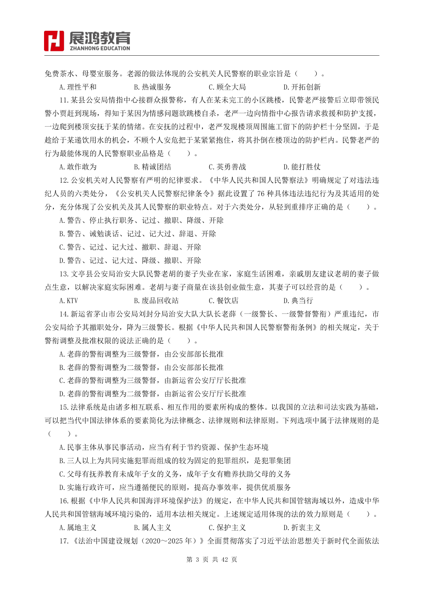

展开本页文字

第3 页共42 页
免费茶水、母婴室服务。老源的做法体现的公安机关人民警察的职业宗旨是（
）。
A.理性平和
B.热诚服务
C.顾全大局
D.开拓创新
11.某县公安局情指中心接群众报警称，有人在某未完工的小区跳楼，民警老严接警后立即带领民
警小贾赶到现场，得知于某因为情感问题欲跳楼自杀，老严一边向情指中心报告请求救援和防护支援，
一边爬到楼顶安抚于某的情绪。在安抚的过程中，老严发现楼顶周围施工留下的防护栏十分坚固，于是
趁给于某递饮用水的机会，不顾个人安危把于某紧紧抱住，将其扑倒在楼顶边的防护栏内。民警老严的
行为最能体现的人民警察职业品格是（
）。
A.敢作敢为
B.精诚团结
C.英勇善战
D.能打胜仗
12.公安机关对人民警察有严明的纪律要求。《中华人民共和国人民警察法》明确规定了对违法违
纪人员的六类处分，《公安机关人民警察纪律条令》据此设置了76 种具体违法违纪行为及其适用的处
分，充分体现了公安机关及其人民警察的职业特点。对于六类处分，从轻到重排序正确的是（
）。
A.警告、停止执行职务、记过、撤职、降级、开除
B.警告、诫勉谈话、记过、记大过、辞退、开除
C.警告、记过、记大过、撤职、辞退、开除
D.警告、记过、记大过、降级、撤职、开除
13.文亭县公安局治安大队民警老胡的妻子失业在家，家庭生活困难，亲戚朋友建议老胡的妻子做
点生意，以解决家庭实际困难。老胡与妻子商量在该县创业做生意，其妻子可以经营的是（
）。
A.KTV
B.废品回收站
C.餐饮店
D.典当行
14.新运省茅山市公安局刘封分局治安大队大队长老薛（一级警长、一级警督警衔）严重违纪，市
公安局给予其撤职处分，降为三级警长。根据《中华人民共和国人民警察警衔条例》的相关规定，关于
警衔调整及批准权限的说法正确的是（
）。
A.老薛的警衔调整为三级警督，由公安部部长批准
B.老薛的警衔调整为二级警督，由公安部部长批准
C.老薛的警衔调整为三级警督，由新运省公安厅厅长批准
D.老薛的警衔调整为二级警督，由新运省公安厅厅长批准
15.法律系统是由诸多相互联系、相互作用的要素所构成的整体。以我国的立法和司法实践为基础，
可以把当代中国法律体系的要素简化为法律概念、法律规则和法律原则。下列选项中属于法律规则的是
（
）。
A.民事主体从事民事活动，应当有利于节约资源、保护生态环境
B.三人以上为共同实施犯罪而组成的较为固定的犯罪组织，是犯罪集团
C.父母有抚养教育未成年子女的义务，成年子女有赡养扶助父母的义务
D.实施行政许可，应当遵循便民的原则，提高办事效率，提供优质服务
16.根据《中华人民共和国海洋环境保护法》的规定，在中华人民共和国管辖海域以外，造成中华
人民共和国管辖海域环境污染的，适用本法相关规定。上述规定适用体现的法的效力原则是（
）。
A.属地主义
B.属人主义
C.保护主义
D.折衷主义
17.《法治中国建设规划（2020～2025 年）》全面贯彻落实了习近平法治思想关于新时代全面依法

### 原第4页

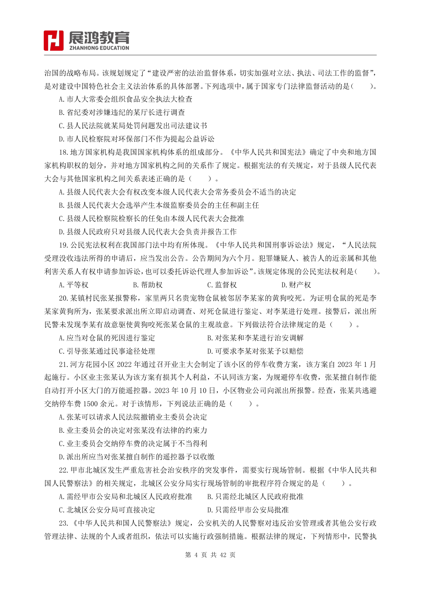

展开本页文字

第4 页共42 页
治国的战略布局。该规划规定了“建设严密的法治监督体系，切实加强对立法、执法、司法工作的监督”，
是对建设中国特色社会主义法治体系的具体部署。下列选项中，属于国家专门法律监督活动的是（
）。
A.市人大常委会组织食品安全执法大检查
B.省纪委对涉嫌违纪的某厅长进行调查
C.县人民法院就某局处罚问题发出司法建议书
D.市人民检察院对环保部门不作为提起公益诉讼
18.地方国家机构是我国国家机构体系的组成部分。《中华人民共和国宪法》确定了中央和地方国
家机构职权的划分，并对地方国家机构之间的关系作了规定。根据宪法的有关规定，对于县级人民代表
大会与其他国家机构之间关系表述正确的是（
）。
A.县级人民代表大会有权改变本级人民代表大会常务委员会不适当的决定
B.县级人民代表大会选举产生本级监察委员会的主任和副主任
C.县级人民检察院检察长的任免由本级人民代表大会批准
D.县级人民政府只对县级人民代表大会负责并报告工作
19.公民宪法权利在我国部门法中均有所体现。《中华人民共和国刑事诉讼法》规定，“人民法院
受理没收违法所得的申请后，应当发出公告。公告期间为六个月。犯罪嫌疑人、被告人的近亲属和其他
利害关系人有权申请参加诉讼，也可以委托诉讼代理人参加诉讼”。该规定体现的公民宪法权利是（
）。
A.平等权
B.帮助权
C.监督权
D.财产权
20.某镇村民张某报警称，家里两只名贵宠物仓鼠被邻居李某家的黄狗咬死。为证明仓鼠的死是李
某家黄狗所为，张某要求派出所立即启动调查、对死仓鼠进行鉴定、对李某进行处理。接警后，派出所
民警未发现李某有故意驱使黄狗咬死张某仓鼠的主观故意。下列做法符合法律规定的是（
）。
A.应当对仓鼠的死因进行鉴定
B.对张某和李某进行治安调解
C.引导张某通过民事途径处理
D.可要求李某对张某予以赔偿
21.河方花园小区2022 年通过召开业主大会制定了该小区的停车收费方案，该方案自2023 年1 月
起施行。小区业主张某认为该方案有损其个人利益，不认同该方案，为规避停车收费，张某擅自制作能
自动打开小区大门的万能遥控器。2023 年10 月10 日，小区物业公司向派出所报警。经查，张某共逃避
交纳停车费1500 余元。对于该情形，下列说法正确的是（
）。
A.张某可以请求人民法院撤销业主委员会决定
B.业主委员会的决定对张某没有法律的约束力
C.业主委员会交纳停车费的决定属于不当得利
D.派出所应当对张某擅自制作的遥控器予以收缴
22.甲市北城区发生严重危害社会治安秩序的突发事件，需要实行现场管制。根据《中华人民共和
国人民警察法》的相关规定，北城区公安分局实行现场管制的审批程序符合规定的是（
）。
A.需经甲市公安局和北城区人民政府批准
B.只需经北城区人民政府批准
C.北城区公安分局可直接决定
D.只需经甲市公安局批准
23.《中华人民共和国人民警察法》规定，公安机关的人民警察对违反治安管理或者其他公安行政
管理法律、法规的个人或者组织，依法可以实施行政强制措施。根据法律的规定，下列情形中，民警执

### 原第5页

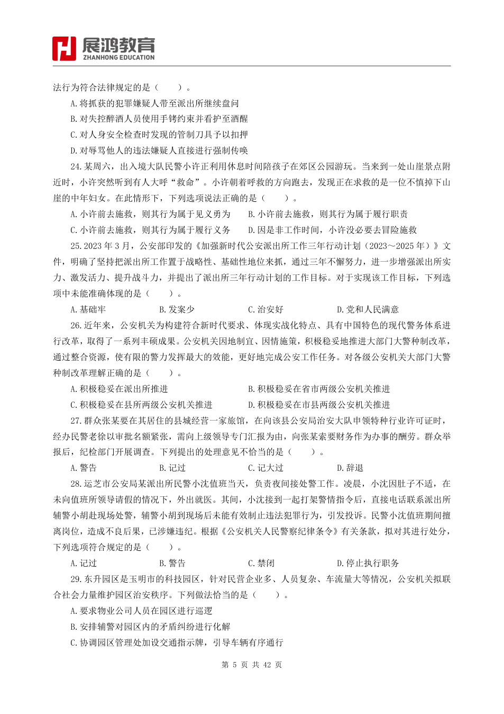

展开本页文字

第5 页共42 页
法行为符合法律规定的是（
）。
A.将抓获的犯罪嫌疑人带至派出所继续盘问
B.对失控醉酒人员使用手铐约束并看护至酒醒
C.对人身安全检查时发现的管制刀具予以扣押
D.对辱骂他人的违法嫌疑人直接进行强制传唤
24.某周六，出入境大队民警小许正利用休息时间陪孩子在郊区公园游玩。当来到一处山崖景点附
近时，小许突然听到有人大呼“救命”。小许朝着呼救的方向跑去，发现正在求救的是一位不慎掉下山
崖的中年妇女。在此情形下，下列选项说法正确的是（
）。
A.小许前去施救，则其行为属于见义勇为
B.小许前去施救，则其行为属于履行职责
C.小许前去施救，则其行为属于履行义务
D.因是非工作时间，小许没必要去冒险施救
25.2023 年3 月，公安部印发的《加强新时代公安派出所工作三年行动计划（2023～2025 年）》文
件，明确了坚持把派出所工作置于战略性、基础性地位来抓，通过三年不懈努力，进一步增强派出所实
力、激发活力、提升战斗力，并提出了派出所三年行动计划的工作目标。对于实现该工作目标，下列选
项中未能准确体现的是（
）。
A.基础牢
B.发案少
C.治安好
D.党和人民满意
26.近年来，公安机关为构建符合新时代要求、体现实战化特点、具有中国特色的现代警务体系进
行改革，取得了一系列丰硕成果。公安机关因地制宜、因情施策，积极稳妥地推进大部门大警种制改革，
通过整合资源，使有限的警力发挥最大的效能，更好地完成公安工作任务。对各级公安机关大部门大警
种制改革理解正确的是（
）。
A.积极稳妥在派出所推进
B.积极稳妥在省市两级公安机关推进
C.积极稳妥在县所两级公安机关推进
D.积极稳妥在市县两级公安机关推进
27.群众张某要在其居住的县城经营一家旅馆，在向该县公安局治安大队申领特种行业许可证时，
经办民警老徐以审批名额紧张，需向上级领导专门汇报为由，向张某索要财务作为办事的酬劳。群众举
报后，纪检部门开展调查。下列提出的处理意见不恰当的是（
）。
A.警告
B.记过
C.记大过
D.辞退
28.运芝市公安局某派出所民警小沈值班当天，负责夜间接处警工作。凌晨，小沈因肚子不适，在
未向值班所领导请假的情况下，外出就医。其间，小沈接到一起打架警情指令后，直接电话联系派出所
辅警小胡赴现场处警，辅警小胡到现场后未能有效制止违法犯罪行为，引发投诉。民警小沈值班期间擅
离岗位，造成不良后果，已涉嫌违纪。根据《公安机关人民警察纪律条令》有关条款，拟对其进行处分，
下列选项符合规定的是（
）。
A.记过
B.警告
C.禁闭
D.停止执行职务
29.东升园区是玉明市的科技园区，针对民营企业多、人员复杂、车流量大等情况，公安机关拟联
合社会力量维护园区治安秩序。下列做法恰当的是（
）。
A.要求物业公司人员在园区进行巡逻
B.安排辅警对园区内的矛盾纠纷进行化解
C.协调园区管理处加设交通指示牌，引导车辆有序通行

### 原第6页

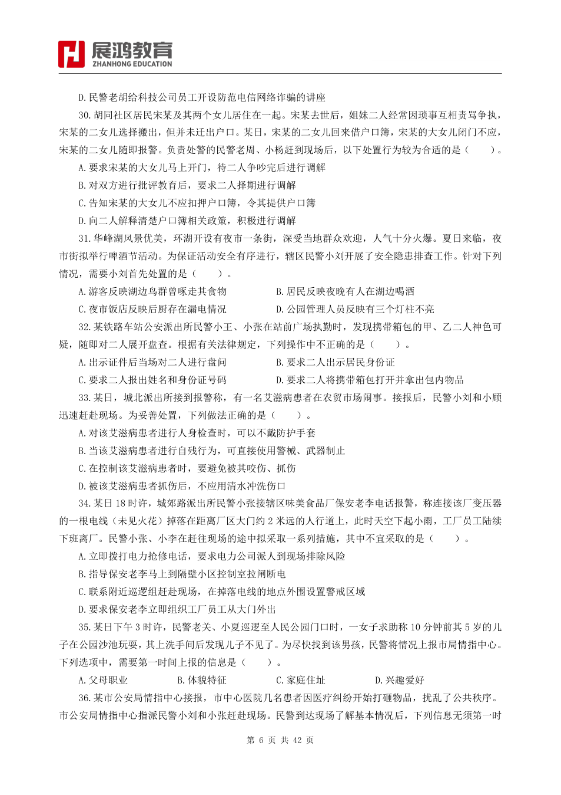

展开本页文字

第6 页共42 页
D.民警老胡给科技公司员工开设防范电信网络诈骗的讲座
30.胡同社区居民宋某及其两个女儿居住在一起。宋某去世后，姐妹二人经常因琐事互相责骂争执，
宋某的二女儿选择搬出，但并未迁出户口。某日，宋某的二女儿回来借户口簿，宋某的大女儿闭门不应，
宋某的二女儿随即报警。负责处警的民警老周、小杨赶到现场后，以下处置行为较为合适的是（
）。
A.要求宋某的大女儿马上开门，待二人争吵完后进行调解
B.对双方进行批评教育后，要求二人择期进行调解
C.告知宋某的大女儿不应扣押户口簿，令其提供户口簿
D.向二人解释清楚户口簿相关政策，积极进行调解
31.华峰湖风景优美，环湖开设有夜市一条街，深受当地群众欢迎，人气十分火爆。夏日来临，夜
市街拟举行啤酒节活动。为保证活动安全有序进行，辖区民警小刘开展了安全隐患排查工作。针对下列
情况，需要小刘首先处置的是（
）。
A.游客反映湖边鸟群曾啄走其食物
B.居民反映夜晚有人在湖边喝酒
C.夜市饭店反映后厨存在漏电情况
D.公园管理人员反映有三个灯柱不亮
32.某铁路车站公安派出所民警小王、小张在站前广场执勤时，发现携带箱包的甲、乙二人神色可
疑，随即对二人展开盘查。根据有关法律规定，下列操作中不正确的是（
）。
A.出示证件后当场对二人进行盘问
B.要求二人出示居民身份证
C.要求二人报出姓名和身份证号码
D.要求二人将携带箱包打开并拿出包内物品
33.某日，城北派出所接到报警称，有一名艾滋病患者在农贸市场闹事。接报后，民警小刘和小顾
迅速赶赴现场。为妥善处置，下列做法正确的是（
）。
A.对该艾滋病患者进行人身检查时，可以不戴防护手套
B.当该艾滋病患者进行自残行为，可直接使用警械、武器制止
C.在控制该艾滋病患者时，要避免被其咬伤、抓伤
D.被该艾滋病患者抓伤后，不应用清水冲洗伤口
34.某日18 时许，城郊路派出所民警小张接辖区味美食品厂保安老李电话报警，称连接该厂变压器
的一根电线（未见火花）掉落在距离厂区大门约2 米远的人行道上，此时天空下起小雨，工厂员工陆续
下班离厂。民警小张、小李在赶往现场的途中拟采取一系列措施，其中不宜采取的是（
）。
A.立即拨打电力抢修电话，要求电力公司派人到现场排除风险
B.指导保安老李马上到隔壁小区控制室拉闸断电
C.联系附近巡逻组赶赴现场，在掉落电线的地点外围设置警戒区域
D.要求保安老李立即组织工厂员工从大门外出
35.某日下午3 时许，民警老关、小夏巡逻至人民公园门口时，一女子求助称10 分钟前其5 岁的儿
子在公园沙池玩耍，其上洗手间后发现儿子不见了。为尽快找到该男孩，民警将情况上报市局情指中心。
下列选项中，需要第一时间上报的信息是（
）。
A.父母职业
B.体貌特征
C.家庭住址
D.兴趣爱好
36.某市公安局情指中心接报，市中心医院几名患者因医疗纠纷开始打砸物品，扰乱了公共秩序。
市公安局情指中心指派民警小刘和小张赶赴现场。民警到达现场了解基本情况后，下列信息无须第一时

### 原第7页

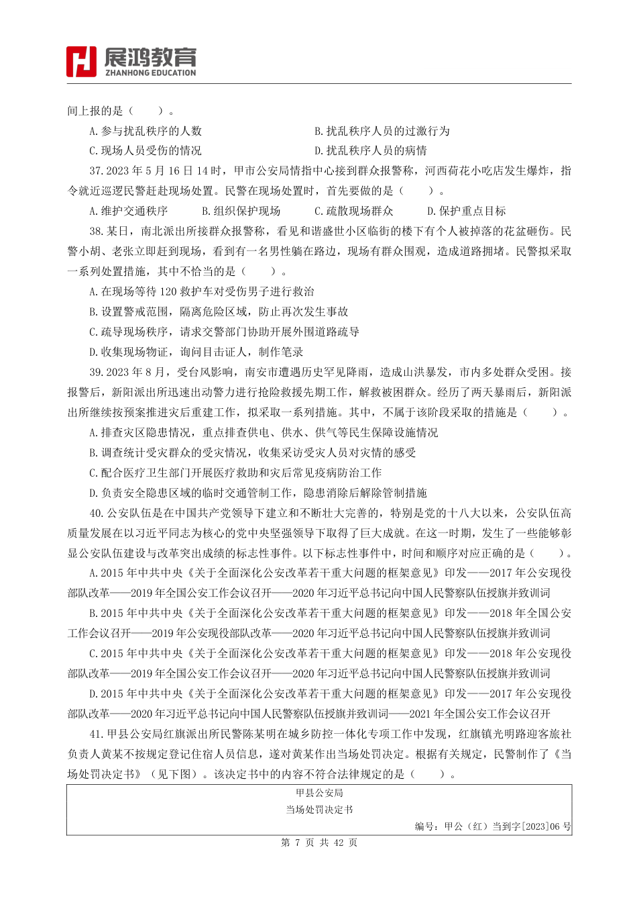

展开本页文字

第7 页共42 页
间上报的是（
）。
A.参与扰乱秩序的人数
B.扰乱秩序人员的过激行为
C.现场人员受伤的情况
D.扰乱秩序人员的病情
37.2023 年5 月16 日14 时，甲市公安局情指中心接到群众报警称，河西荷花小吃店发生爆炸，指
令就近巡逻民警赶赴现场处置。民警在现场处置时，首先要做的是（
）。
A.维护交通秩序
B.组织保护现场
C.疏散现场群众
D.保护重点目标
38.某日，南北派出所接群众报警称，看见和谐盛世小区临街的楼下有个人被掉落的花盆砸伤。民
警小胡、老张立即赶到现场，看到有一名男性躺在路边，现场有群众围观，造成道路拥堵。民警拟采取
一系列处置措施，其中不恰当的是（
）。
A.在现场等待120 救护车对受伤男子进行救治
B.设置警戒范围，隔离危险区域，防止再次发生事故
C.疏导现场秩序，请求交警部门协助开展外围道路疏导
D.收集现场物证，询问目击证人，制作笔录
39.2023 年8 月，受台风影响，南安市遭遇历史罕见降雨，造成山洪暴发，市内多处群众受困。接
报警后，新阳派出所迅速出动警力进行抢险救援先期工作，解救被困群众。经历了两天暴雨后，新阳派
出所继续按预案推进灾后重建工作，拟采取一系列措施。其中，不属于该阶段采取的措施是（
）。
A.排查灾区隐患情况，重点排查供电、供水、供气等民生保障设施情况
B.调查统计受灾群众的受灾情况，收集采访受灾人员对灾情的感受
C.配合医疗卫生部门开展医疗救助和灾后常见疫病防治工作
D.负责安全隐患区域的临时交通管制工作，隐患消除后解除管制措施
40.公安队伍是在中国共产党领导下建立和不断壮大完善的，特别是党的十八大以来，公安队伍高
质量发展在以习近平同志为核心的党中央坚强领导下取得了巨大成就。在这一时期，发生了一些能够彰
显公安队伍建设与改革突出成绩的标志性事件。以下标志性事件中，时间和顺序对应正确的是（
）。
A.2015 年中共中央《关于全面深化公安改革若干重大问题的框架意见》印发——2017 年公安现役
部队改革——2019 年全国公安工作会议召开——2020 年习近平总书记向中国人民警察队伍授旗并致训词
B.2015 年中共中央《关于全面深化公安改革若干重大问题的框架意见》印发——2018 年全国公安
工作会议召开——2019 年公安现役部队改革——2020 年习近平总书记向中国人民警察队伍授旗并致训词
C.2015 年中共中央《关于全面深化公安改革若干重大问题的框架意见》印发——2018 年公安现役
部队改革——2019 年全国公安工作会议召开——2020 年习近平总书记向中国人民警察队伍授旗并致训词
D.2015 年中共中央《关于全面深化公安改革若干重大问题的框架意见》印发——2017 年公安现役
部队改革——2020 年习近平总书记向中国人民警察队伍授旗并致训词——2021 年全国公安工作会议召开
41.甲县公安局红旗派出所民警陈某明在城乡防控一体化专项工作中发现，红旗镇光明路迎客旅社
负责人黄某不按规定登记住宿人员信息，遂对黄某作出当场处罚决定。根据有关规定，民警制作了《当
场处罚决定书》（见下图）。该决定书中的内容不符合法律规定的是（
）。
甲县公安局
当场处罚决定书
编号：甲公（红）当到字[2023]06 号

### 原第8页

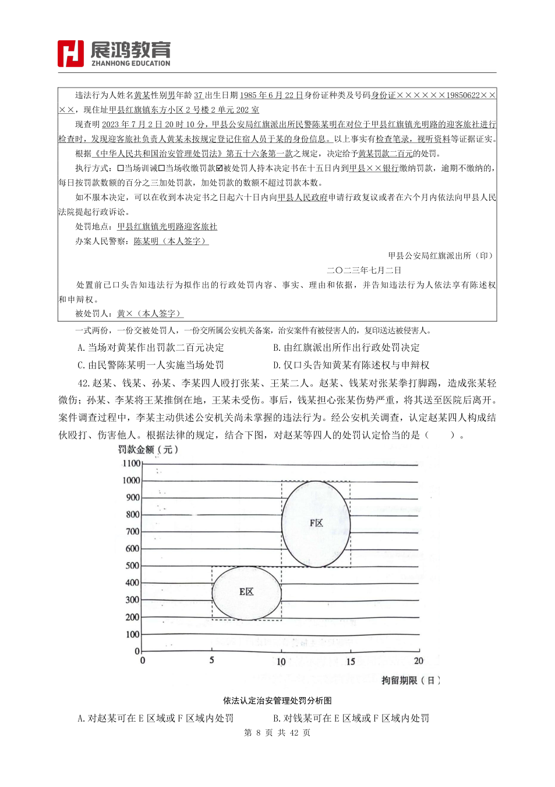

展开本页文字

第8 页共42 页
违法行为人姓名黄某性别男年龄37 出生日期1985 年6 月22 日身份证种类及号码身份证××××××19850622××
××，现住址甲县红旗镇东方小区2 号楼2 单元202 室
现查明2023 年7 月2 日20 时10 分，甲县公安局红旗派出所民警陈某明在对位于甲县红旗镇光明路的迎客旅社进行
检查时，发现迎客旅社负责人黄某未按规定登记住宿人员于某的身份信息。以上事实有检查笔录，视听资料等证据证实。
根据《中华人民共和国治安管理处罚法》第五十六条第一款之规定，决定给予黄某罚款二百元的处罚。
执行方式：当场训诫当场收缴罚款被处罚人持本决定书在十五日内到甲县××银行缴纳罚款，逾期不缴纳的，
每日按罚款数额的百分之三加处罚款，加处罚款的数额不超过罚款本数。
如不服本决定，可以在收到本决定书之日起六十日内向甲县人民政府申请行政复议或者在六个月内依法向甲县人民
法院提起行政诉讼。
处罚地点：甲县红旗镇光明路迎客旅社
办案人民警察：陈某明（本人签字）
甲县公安局红旗派出所（印）
二〇二三年七月二日
处置前已口头告知违法行为拟作出的行政处罚内容、事实、理由和依据，并告知违法行为人依法享有陈述权
和申辩权。
被处罚人：黄×（本人签字）
一式两份，一份交被处罚人，一份交所属公安机关备案，治安案件有被侵害人的，复印送达被侵害人。
A.当场对黄某作出罚款二百元决定
B.由红旗派出所作出行政处罚决定
C.由民警陈某明一人实施当场处罚
D.仅口头告知黄某有陈述权与申辩权
42.赵某、钱某、孙某、李某四人殴打张某、王某二人。赵某、钱某对张某拳打脚踢，造成张某轻
微伤；孙某、李某将王某推倒在地，王某未受伤。事后，钱某担心张某伤势严重，将其送至医院后离开。
案件调查过程中，李某主动供述公安机关尚未掌握的违法行为。经公安机关调查，认定赵某四人构成结
伙殴打、伤害他人。根据法律的规定，结合下图，对赵某等四人的处罚认定恰当的是（
）。
依法认定治安管理处罚分析图
A.对赵某可在E 区域或F 区域内处罚
B.对钱某可在E 区域或F 区域内处罚

### 原第9页

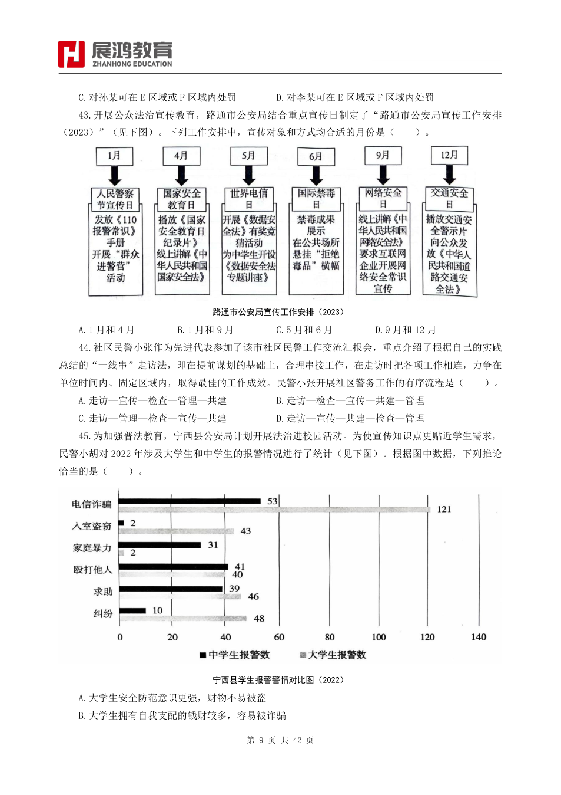

展开本页文字

第9 页共42 页
C.对孙某可在E 区域或F 区域内处罚
D.对李某可在E 区域或F 区域内处罚
43.开展公众法治宣传教育，路通市公安局结合重点宣传日制定了“路通市公安局宣传工作安排
（2023）”（见下图）。下列工作安排中，宣传对象和方式均合适的月份是（
）。
路通市公安局宣传工作安排（2023）
A.1 月和4 月
B.1 月和9 月
C.5 月和6 月
D.9 月和12 月
44.社区民警小张作为先进代表参加了该市社区民警工作交流汇报会，重点介绍了根据自己的实践
总结的“一线串”走访法，即在提前谋划的基础上，合理串接工作，在走访时把各项工作相连，力争在
单位时间内、固定区域内，取得最佳的工作成效。民警小张开展社区警务工作的有序流程是（
）。
A.走访—宣传—检查—管理—共建
B.走访—检查—宣传—共建—管理
C.走访—管理—检查—宣传—共建
D.走访—宣传—共建—检查—管理
45.为加强普法教育，宁西县公安局计划开展法治进校园活动。为使宣传知识点更贴近学生需求，
民警小胡对2022 年涉及大学生和中学生的报警情况进行了统计（见下图）。根据图中数据，下列推论
恰当的是（
）。
宁西县学生报警警情对比图（2022）
A.大学生安全防范意识更强，财物不易被盗
B.大学生拥有自我支配的钱财较多，容易被诈骗

### 原第10页

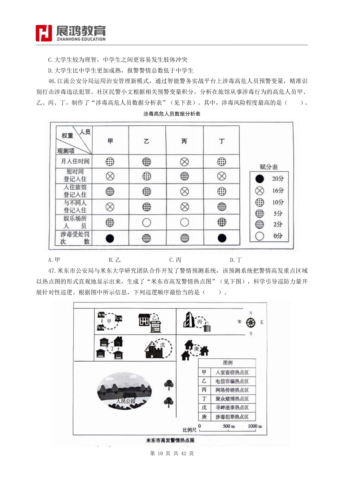

展开本页文字

第10 页共42 页
C.大学生较为理智，中学生之间更容易发生肢体冲突
D.大学生比中学生更加成熟，报警警情总数低于中学生
46.江流公安分局运用治安管理新模式，通过智能警务实战平台上涉毒高危人员预警变量，精准识
别打击涉毒违法犯罪。社区民警小文根据相关预警变量积分，分析在旅馆从事涉毒行为的高危人员甲、
乙、丙、丁，制作了“涉毒高危人员数据分析表”（见下表）。其中，涉毒风险程度最高的是（
）。
涉毒高危人员数据分析表
A.甲
B.乙
C.丙
D.丁
47.米东市公安局与米东大学研究团队合作开发了警情预测系统，该预测系统把警情高发重点区域
以热点图的形式直观地显示出来，生成了“米东市高发警情热点图”（见下图），科学引导巡防力量开
展针对性巡逻。根据图中所示信息，下列巡逻顺序最恰当的是（
）。

### 原第11页

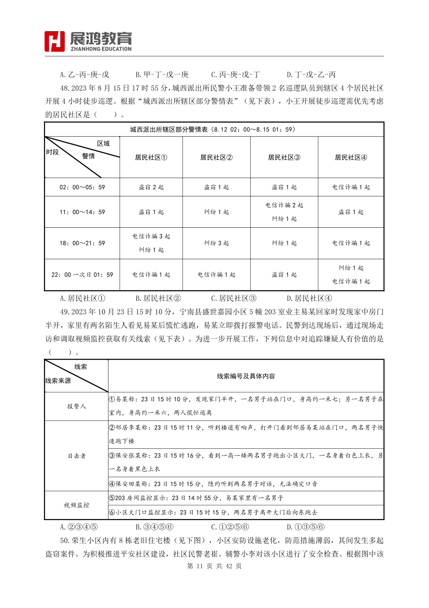

展开本页文字

第11 页共42 页
A.乙-丙-庚-戊
B.甲-丁-戊一庚
C.丙-庚-戊-丁
D.丁-戊-乙-丙
48.2023 年8 月15 日17 时55 分，城西派出所民警小王准备带领2 名巡逻队员到辖区4 个居民社区
开展4 小时徒步巡逻。根据“城西派出所辖区部分警情表”（见下表），小王开展徒步巡逻需优先考虑
的居民社区是（
）。
城西派出所辖区部分警情表（8.12 02：00～8.15 01：59）
时段
警情
区域
居民社区①
居民社区②
居民社区③
居民社区④
02：00～05：59
盗窃2 起
盗窃1 起
盗窃1 起
电信诈骗1 起
11：00～14：59
盗窃1 起
纠纷1 起
电信诈骗2 起
纠纷1 起
盗窃1 起
18：00～21：59
电信诈骗3 起
纠纷1 起
纠纷3 起
纠纷1 起
电信诈骗1 起
22：00 一次日01：59
电信诈骗1 起
电信诈骗1 起
盗窃1 起
纠纷1 起
电信诈骗1 起
A.居民社区①
B.居民社区②
C.居民社区③
D.居民社区④
49.2023 年10 月23 日15 时10 分，宁南县盛世嘉园小区5 幢203 室业主易某回家时发现家中房门
半开，家里有两名陌生人看见易某后慌忙逃跑，易某立即拨打报警电话。民警到达现场后，通过现场走
访和调取视频监控获取有关线索（见下表）。为进一步开展工作，下列信息中对追踪嫌疑人有价值的是
（
）。
1111
线索来源
线索
线索编号及具体内容
报警人
①易某称：23 日15 时10 分，发现家门半开，一名男子站在门口，身高约一米七；另一名男子在
室内，身高约一米六，两人慌忙逃离
目击者
②邻居李某称：23 日15 时11 分，听到楼道有响声，打开门看到邻居易某站在门口，两名男子快
速跑下楼
③保安张某称：23 日15 时16 分，看到一高一矮两名男子跑出小区大门，一名身着白色上衣，另
一名身着黑色上衣
④保安田某称：23 日15 时15 分，隐约听到两名男子对话，无法确定口音
视频监控
⑤203 房间监控显示：23 日14 时55 分，易某家里有一名男子
⑥小区大门口监控显示：23 日15 时15 分，两名男子离开大门后向东跑去
A.②③④⑤
B.③④⑤⑥
C.①②⑤⑥
D.①③⑤⑥
50.荣生小区内有8 栋老旧住宅楼（见下图），小区安防设施老化，防范措施薄弱，其间发生多起
盗窃案件。为积极推进平安社区建设，社区民警老崔、辅警小李对该小区进行了安全检查。根据图中该

### 原第12页

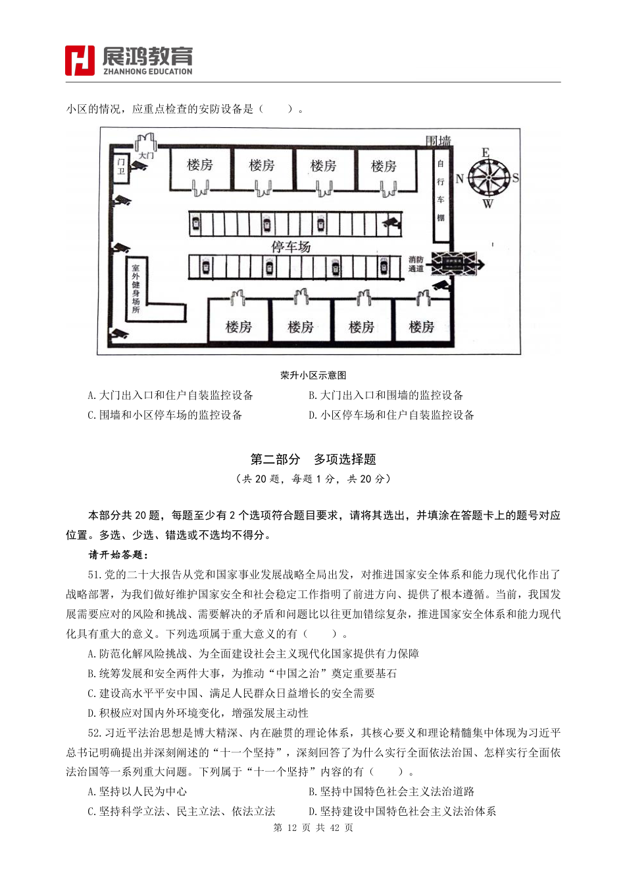

展开本页文字

第12 页共42 页
小区的情况，应重点检查的安防设备是（
）。
荣升小区示意图
A.大门出入口和住户自装监控设备
B.大门出入口和围墙的监控设备
C.围墙和小区停车场的监控设备
D.小区停车场和住户自装监控设备
第二部分
多项选择题
（共20 题，每题1 分，共20 分）
本部分共20 题，每题至少有2 个选项符合题目要求，请将其选出，并填涂在答题卡上的题号对应
位置。多选、少选、错选或不选均不得分。
请开始答题：
51.党的二十大报告从党和国家事业发展战略全局出发，对推进国家安全体系和能力现代化作出了
战略部署，为我们做好维护国家安全和社会稳定工作指明了前进方向、提供了根本遵循。当前，我国发
展需要应对的风险和挑战、需要解决的矛盾和问题比以往更加错综复杂，推进国家安全体系和能力现代
化具有重大的意义。下列选项属于重大意义的有（
）。
A.防范化解风险挑战、为全面建设社会主义现代化国家提供有力保障
B.统筹发展和安全两件大事，为推动“中国之治”奠定重要基石
C.建设高水平平安中国、满足人民群众日益增长的安全需要
D.积极应对国内外环境变化，增强发展主动性
52.习近平法治思想是博大精深、内在融贯的理论体系，其核心要义和理论精髓集中体现为习近平
总书记明确提出并深刻阐述的“十一个坚持”，深刻回答了为什么实行全面依法治国、怎样实行全面依
法治国等一系列重大问题。下列属于“十一个坚持”内容的有（
）。
A.坚持以人民为中心
B.坚持中国特色社会主义法治道路
C.坚持科学立法、民主立法、依法立法
D.坚持建设中国特色社会主义法治体系

### 原第13页

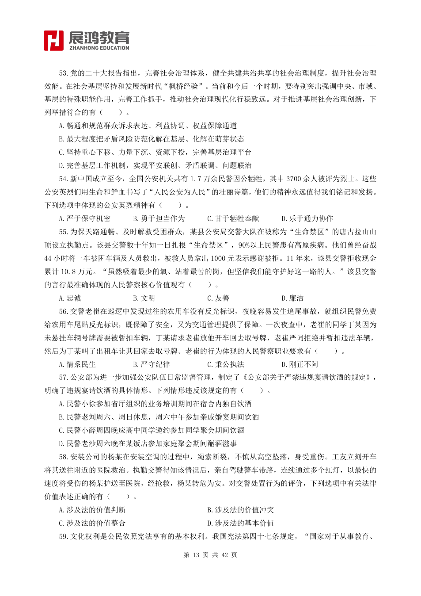

展开本页文字

第13 页共42 页
53.党的二十大报告指出，完善社会治理体系，健全共建共治共享的社会治理制度，提升社会治理
效能。在社会基层坚持和发展新时代“枫桥经验”。当前和今后一个时期，要特别突出强调中央、市域、
基层的特殊职能作用，完善工作抓手，推动社会治理现代化行稳致远。对于推进基层社会治理创新，下
列举措符合的有（
）。
A.畅通和规范群众诉求表达、利益协调、权益保障通道
B.最大程度把矛盾风险防范化解在基层、化解在萌芽状态
C.坚持重心下移、力量下沉、资源下投，完善基层治理平台
D.完善基层工作机制，实现平安联创、矛盾联调、问题联治
54.新中国成立至今，全国公安机关共有1.7 万余民警因公牺牲，其中3700 余人被评为烈士。这些
公安英烈们用生命和鲜血书写了“人民公安为人民”的壮丽诗篇，他们的精神永远值得我们铭记和发扬。
下列选项中体现的公安英烈精神有（
）。
A.严于保守机密
B.勇于担当作为
C.甘于牺牲奉献
D.乐于通力协作
55.为保天路通畅、及时解救受困群众，某县公安局交警大队在被称为“生命禁区”的唐古拉山山
顶设立执勤点。该县交警数十年如一日扎根“生命禁区”，90%以上民警患有高原疾病。他们曾经奋战
44 小时将一车被困车辆及人员救出，被救人员拿出1000 元表示感谢被拒。11 年来，该县交警拒收现金
累计10.8 万元。“虽然吸着最少的氧、站着最苦的岗，但坚信我们能守护好这一路的人。”该县交警
的言行最准确体现的人民警察核心价值观有（
）。
A.忠诚
B.文明
C.友善
D.廉洁
56.交警老崔在巡逻中发现过往的农用车没有反光标识，夜晚容易发生追尾事故，就组织民警免费
给农用车尾贴反光标识，既保障了安全，又为交通管理提供了保障。一次夜查中，老崔的同学丁某因为
未悬挂车辆号牌需要被暂扣车辆，丁某请求老崔放他开车回去取号牌，老崔严词拒绝并暂扣违法车辆，
然后为丁某叫了出租车让其回家去取号牌。老崔的行为体现的人民警察职业要求有（
）。
A.情系民生
B.严守纪律
C.秉公执法
D.刚正不阿
57.公安部为进一步加强公安队伍日常监督管理，制定了《公安部关于严禁违规宴请饮酒的规定》，
明确了违规宴请饮酒的具体情形。下列情形违反该规定的有（
）。
A.民警小徐参加省厅组织的业务培训期间在宿舍内独自饮酒
B.民警老刘周六、周日休息，周六中午参加亲戚婚宴期间饮酒
C.民警小薛周四晚应高中同学邀约参加同学聚会期间饮酒
D.民警老沙周六晚在某饭店参加家庭聚会期间酗酒滋事
58.安装公司的杨某在安装空调的过程中，绳索断裂，不慎从高空坠落，身受重伤。工友立刻开车
将其送往附近的医院救治。执勤交警得知该情况后，亲自驾驶警车带路，连续通过多个红灯，以最快的
速度将受伤的杨某护送至医院，经抢救，杨某转危为安。对交警处置行为的评价，下列选项中有关法律
价值表述正确的有（
）。
A.涉及法的价值判断
B.涉及法的价值冲突
C.涉及法的价值整合
D.涉及法的基本价值
59.文化权利是公民依照宪法享有的基本权利。我国宪法第四十七条规定，“国家对于从事教育、

### 原第14页

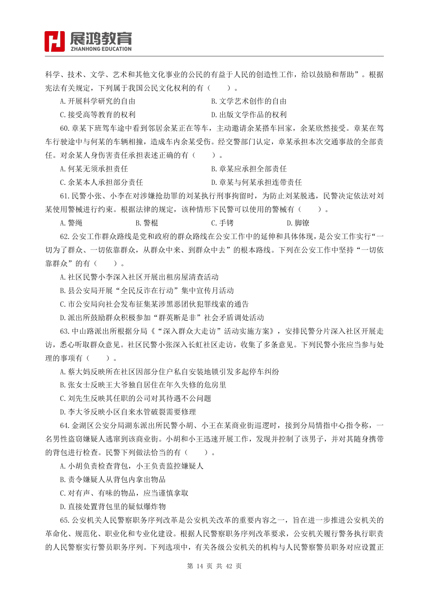

展开本页文字

第14 页共42 页
科学、技术、文学、艺术和其他文化事业的公民的有益于人民的创造性工作，给以鼓励和帮助”。根据
宪法有关规定，下列属于我国公民文化权利的有（
）。
A.开展科学研究的自由
B.文学艺术创作的自由
C.接受高等教育的权利
D.出版文学作品的权利
60.章某下班驾车途中看到邻居余某正在等车，主动邀请余某搭车回家，余某欣然接受。章某在驾
车行驶途中与何某的车辆相撞，造成车内余某受伤。经交警部门认定，章某承担本次交通事故的全部责
任。对余某人身伤害责任承担表述正确的有（
）。
A.何某无须承担责任
B.章某应承担全部责任
C.余某本人承担部分责任
D.章某与何某承担连带责任
61.民警小张、小李在对涉嫌抢劫罪的刘某执行刑事拘留时，为防止刘某脱逃，民警决定依法对刘
某使用警械进行约束。根据法律的规定，该种情形下民警可以使用的警械有（
）。
A.警绳
B.警棍
C.手铐
D.脚镣
62.公安工作群众路线是党和政府的群众路线在公安工作中的延伸和具体体现，是公安工作实行“一
切为了群众、一切依靠群众，从群众中来、到群众中去”的根本路线。下列在公安工作中坚持“一切依
靠群众”的有（
）。
A.社区民警小李深入社区开展出租房屋清查活动
B.县公安局开展“全民反诈在行动”集中宣传月活动
C.市公安局向社会发布征集某涉黑恶团伙犯罪线索的通告
D.派出所鼓励群众积极参加“群英断是非”社会矛盾调处活动
63.中山路派出所根据分局《“深入群众大走访”活动实施方案》，安排民警分片深入社区开展走
访，悉心听取群众意见。社区民警小张深入长虹社区走访，收集了多条意见。下列民警小张应当参与处
理的事项有（
）。
A.蔡大妈反映所在社区因部分住户私自安装地锁引发多起停车纠纷
B.张女士反映王大爷独自居住在年久失修的危房里
C.刘先生反映其任职的公司对其待遇不公问题
D.李大爷反映小区自来水管破裂需要修理
64.金湖区公安分局湖东派出所民警小胡、小王在某商业街巡逻时，接到分局情指中心指令称，一
名男性盗窃嫌疑人逃窜到该商业街。小胡和小王迅速开展工作，发现并控制了该男子，并对其随身携带
的背包进行检查。民警下列做法恰当的有（
）。
A.小胡负责检查背包，小王负责监控嫌疑人
B.责令嫌疑人从背包内拿出物品
C.对有声、有味的物品，应当谨慎拿取
D.直接处置背包里的疑似爆炸物
65.公安机关人民警察职务序列改革是公安机关改革的重要内容之一，旨在进一步推进公安机关的
革命化、规范化、职业化和专业化建设。根据人民警察职务序列改革要求，公安机关履行警务执行职责
的人民警察实行警员职务序列。下列选项中，有关各级公安机关的机构与人民警察警员职务对应设置正

### 原第15页

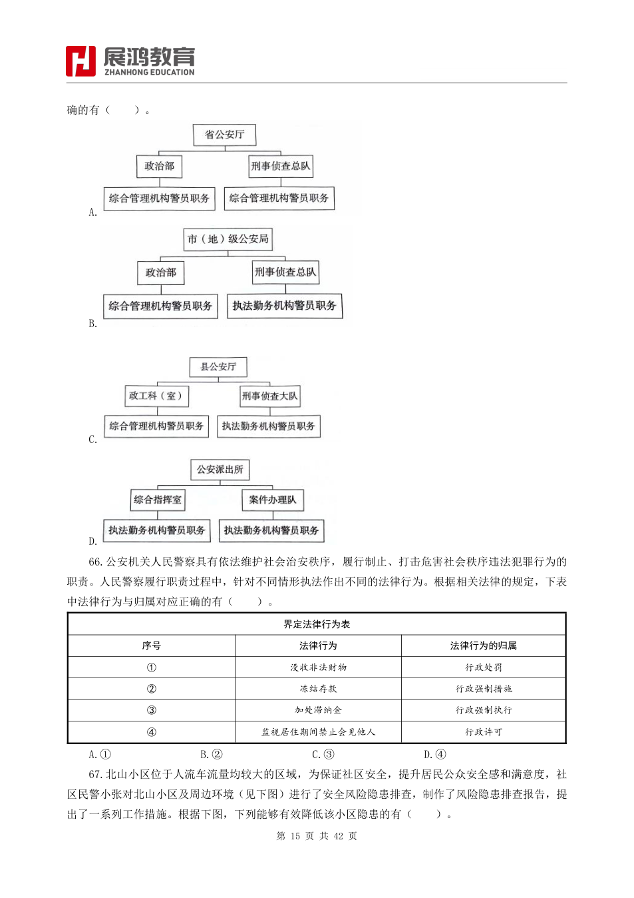

展开本页文字

第15 页共42 页
确的有（
）。
A.
B.
C.
D.
66.公安机关人民警察具有依法维护社会治安秩序，履行制止、打击危害社会秩序违法犯罪行为的
职责。人民警察履行职责过程中，针对不同情形执法作出不同的法律行为。根据相关法律的规定，下表
中法律行为与归属对应正确的有（
）。
界定法律行为表
序号
法律行为
法律行为的归属
①
没收非法财物
行政处罚
②
冻结存款
行政强制措施
③
加处滞纳金
行政强制执行
④
监视居住期间禁止会见他人
行政许可
A.①
B.②
C.③
D.④
67.北山小区位于人流车流量均较大的区域，为保证社区安全，提升居民公众安全感和满意度，社
区民警小张对北山小区及周边环境（见下图）进行了安全风险隐患排查，制作了风险隐患排查报告，提
出了一系列工作措施。根据下图，下列能够有效降低该小区隐患的有（
）。

### 原第16页

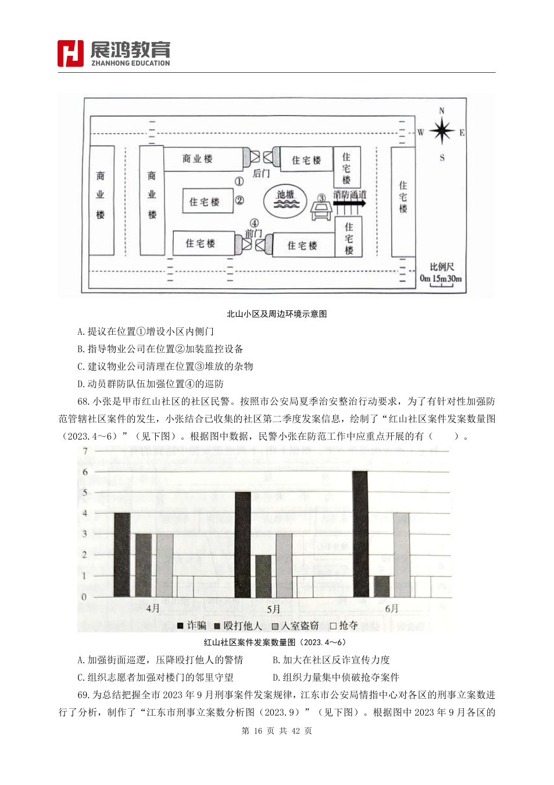

展开本页文字

第16 页共42 页
北山小区及周边环境示意图
A.提议在位置①增设小区内侧门
B.指导物业公司在位置②加装监控设备
C.建议物业公司清理在位置③堆放的杂物
D.动员群防队伍加强位置④的巡防
68.小张是甲市红山社区的社区民警。按照市公安局夏季治安整治行动要求，为了有针对性加强防
范管辖社区案件的发生，小张结合已收集的社区第二季度发案信息，绘制了“红山社区案件发案数量图
（2023.4～6）”（见下图）。根据图中数据，民警小张在防范工作中应重点开展的有（
）。
红山社区案件发案数量图（2023.4～6）
A.加强街面巡逻，压降殴打他人的警情
B.加大在社区反诈宣传力度
C.组织志愿者加强对楼门的邻里守望
D.组织力量集中侦破抢夺案件
69.为总结把握全市2023 年9 月刑事案件发案规律，江东市公安局情指中心对各区的刑事立案数进
行了分析，制作了“江东市刑事立案数分析图（2023.9）”（见下图）。根据图中2023 年9 月各区的

### 原第17页

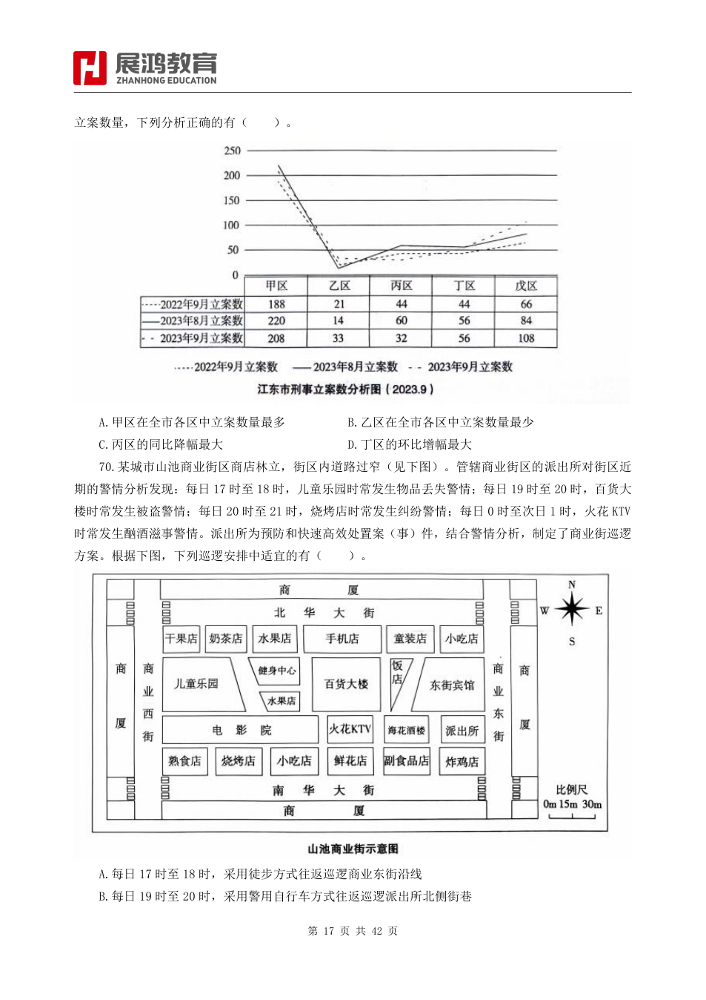

展开本页文字

第17 页共42 页
立案数量，下列分析正确的有（
）。
A.甲区在全市各区中立案数量最多
B.乙区在全市各区中立案数量最少
C.丙区的同比降幅最大
D.丁区的环比增幅最大
70.某城市山池商业街区商店林立，街区内道路过窄（见下图）。管辖商业街区的派出所对街区近
期的警情分析发现：每日17 时至18 时，儿童乐园时常发生物品丢失警情；每日19 时至20 时，百货大
楼时常发生被盗警情；每日20 时至21 时，烧烤店时常发生纠纷警情；每日0 时至次日1 时，火花KTV
时常发生酗酒滋事警情。派出所为预防和快速高效处置案（事）件，结合警情分析，制定了商业街巡逻
方案。根据下图，下列巡逻安排中适宜的有（
）。
A.每日17 时至18 时，采用徒步方式往返巡逻商业东街沿线
B.每日19 时至20 时，采用警用自行车方式往返巡逻派出所北侧街巷

### 原第18页

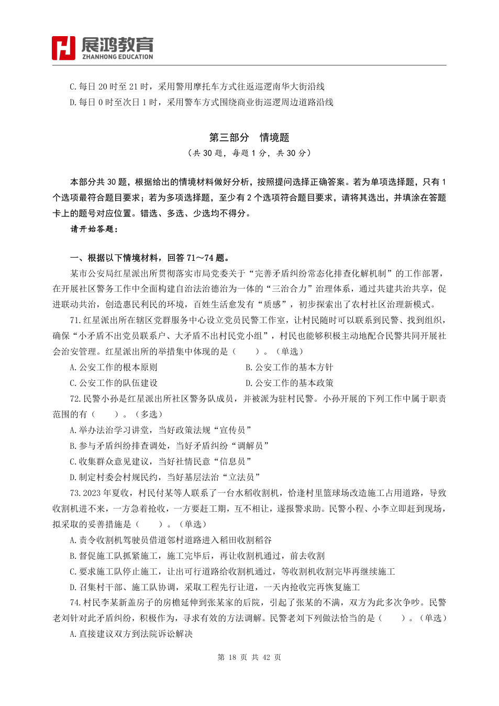

展开本页文字

第18 页共42 页
C.每日20 时至21 时，采用警用摩托车方式往返巡逻南华大街沿线
D.每日0 时至次日1 时，采用警车方式围绕商业街巡逻周边道路沿线
第三部分
情境题
（共30 题，每题1 分，共30 分）
本部分共30 题，根据给出的情境材料做好分析，按照提问选择正确答案。若为单项选择题，只有1
个选项最符合题目要求；若为多项选择题，至少有2 个选项符合题目要求，请将其选出，并填涂在答题
卡上的题号对应位置。错选、多选、少选均不得分。
请开始答题：
一、根据以下情境材料，回答71～74 题。
某市公安局红星派出所贯彻落实市局党委关于“完善矛盾纠纷常态化排查化解机制”的工作部署，
在开展社区警务工作中全面构建自治法治德治为一体的“三治合力”治理体系，通过共建共治共享，促
进联动共治，创造惠民利民的环境，百姓生活愈发有“质感”，初步探索出了农村社区治理新模式。
71.红星派出所在辖区党群服务中心设立党员民警工作室，让村民随时可以联系到民警、找到组织，
确保“小矛盾不出党员联系户、大矛盾不出村民党小组”，村民也能够积极主动地配合民警共同开展社
会治安管理。红星派出所的举措集中体现的是（
）。（单选）
A.公安工作的根本原则
B.公安工作的基本方针
C.公安工作的队伍建设
D.公安工作的基本政策
72.民警小孙是红星派出所社区警务队成员，并被派为驻村民警。小孙开展的下列工作中属于职责
范围的有（
）。（多选）
A.举办法治学习讲堂，当好政策法规“宣传员”
B.参与矛盾纠纷排查调处，当好矛盾纠纷“调解员”
C.收集群众意见建议，当好社情民意“信息员”
D.制定村委会村规民约，当好基层法治“立法员”
73.2023 年夏收，村民付某等人联系了一台水稻收割机，恰逢村里篮球场改造施工占用道路，导致
收割机进不来，一方急着抢收，一方要赶工期，互不相让，遂报警求助。民警小程、小李立即赶到现场，
拟采取的妥善措施是（
）。（单选）
A.责令收割机驾驶员借道邻村道路进入稻田收割稻谷
B.督促施工队抓紧施工，施工完毕后，再让收割机通过，前去收割
C.要求施工队停止施工，让出可行道路给收割机通过，等收割机收割完毕再继续施工
D.召集村干部、施工队协调，采取工程先行让道，一天内抢收完再恢复施工
74.村民李某新盖房子的房檐延伸到张某家的后院，引起了张某的不满，双方为此多次争吵。民警
老刘针对此矛盾纠纷，积极作为，寻求有效的方法调解。民警老刘下列做法恰当的是（
）。（单选）
A.直接建议双方到法院诉讼解决

### 原第19页

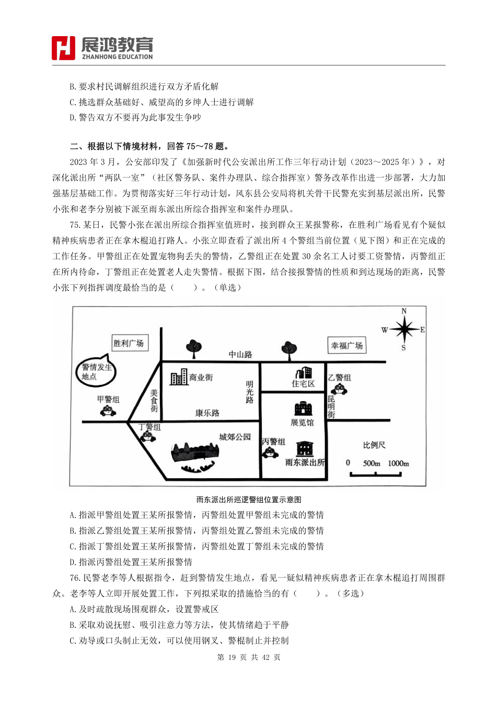

展开本页文字

第19 页共42 页
B.要求村民调解组织进行双方矛盾化解
C.挑选群众基础好、威望高的乡绅人士进行调解
D.警告双方不要再为此事发生争吵
二、根据以下情境材料，回答75～78 题。
2023 年3 月，公安部印发了《加强新时代公安派出所工作三年行动计划（2023～2025 年）》，对
深化派出所“两队一室”（社区警务队、案件办理队、综合指挥室）警务改革作出进一步部署，大力加
强基层基础工作。为贯彻落实好三年行动计划，风东县公安局将机关骨干民警充实到基层派出所，民警
小张和老李分别被下派至雨东派出所综合指挥室和案件办理队。
75.某日，民警小张在派出所综合指挥室值班时，接到群众王某报警称，在胜利广场看见有个疑似
精神疾病患者正在拿木棍追打路人。小张立即查看了派出所4 个警组当前位置（见下图）和正在完成的
工作任务。甲警组正在处置宠物狗丢失的警情，乙警组正在处置30 余名工人讨要工资警情，丙警组正
在所内待命，丁警组正在处置老人走失警情。根据下图，结合接报警情的性质和到达现场的距离，民警
小张下列指挥调度最恰当的是（
）。（单选）
雨东派出所巡逻警组位置示意图
A.指派甲警组处置王某所报警情，丙警组处置甲警组未完成的警情
B.指派乙警组处置王某所报警情，丙警组处置乙警组未完成的警情
C.指派丁警组处置王某所报警情，丙警组处置丁警组未完成的警情
D.指派丙警组处置王某所报警情
76.民警老李等人根据指令，赶到警情发生地点，看见一疑似精神疾病患者正在拿木棍追打周围群
众。老李等人立即开展处置工作，下列拟采取的措施恰当的有（
）。（多选）
A.及时疏散现场围观群众，设置警戒区
B.采取劝说抚慰、吸引注意力等方法，使其情绪趋于平静
C.劝导或口头制止无效，可以使用钢叉、警棍制止并控制

### 原第20页

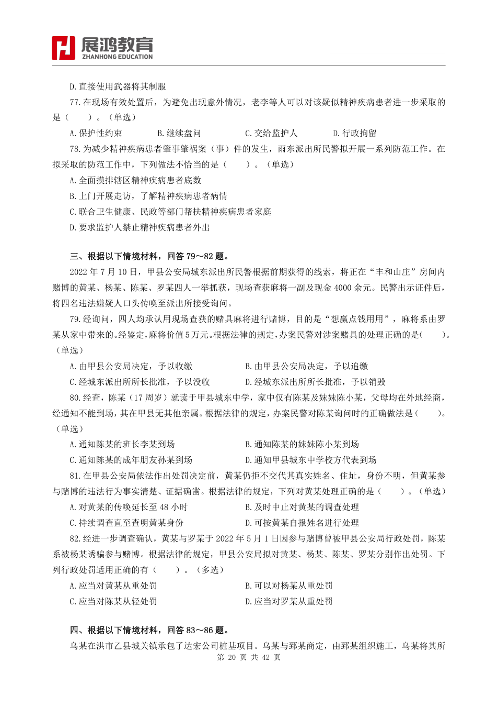

展开本页文字

第20 页共42 页
D.直接使用武器将其制服
77.在现场有效处置后，为避免出现意外情况，老李等人可以对该疑似精神疾病患者进一步采取的
是（
）。（单选）
A.保护性约束
B.继续盘问
C.交给监护人
D.行政拘留
78.为减少精神疾病患者肇事肇祸案（事）件的发生，雨东派出所民警拟开展一系列防范工作。在
拟采取的防范工作中，下列做法不恰当的是（
）。（单选）
A.全面摸排辖区精神疾病患者底数
B.上门开展走访，了解精神疾病患者病情
C.联合卫生健康、民政等部门帮扶精神疾病患者家庭
D.要求监护人禁止精神疾病患者外出
三、根据以下情境材料，回答79～82 题。
2022 年7 月10 日，甲县公安局城东派出所民警根据前期获得的线索，将正在“丰和山庄”房间内
赌博的黄某、杨某、陈某、罗某四人一举抓获，现场查获麻将一副及现金4000 余元。民警出示证件后，
将四名违法嫌疑人口头传唤至派出所接受询问。
79.经询问，四人均承认用现场查获的赌具麻将进行赌博，目的是“想赢点钱用用”，麻将系由罗
某从家中带来的。经鉴定，麻将价值5 万元。根据法律的规定，办案民警对涉案赌具的处理正确的是（
）。
（单选）
A.由甲县公安局决定，予以收缴
B.由甲县公安局决定，予以追缴
C.经城东派出所所长批准，予以没收
D.经城东派出所所长批准，予以销毁
80.经查，陈某（17 周岁）就读于甲县城东中学，家中仅有陈某及妹妹陈小某，父母均在外地经商，
经通知不能到场，其在甲县无其他亲属。根据法律的规定，办案民警对陈某询问时的正确做法是（
）。
（单选）
A.通知陈某的班长李某到场
B.通知陈某的妹妹陈小某到场
C.通知陈某的成年朋友孙某到场
D.通知甲县城东中学校方代表到场
81.在甲县公安局依法作出处罚决定前，黄某仍拒不交代其真实姓名、住址，身份不明，但黄某参
与赌博的违法行为事实清楚、证据确凿。根据法律的规定，下列对黄某处理正确的是（
）。（单选）
A.对黄某的传唤延长至48 小时
B.及时中止对黄某的调查处理
C.持续调查直至查明黄某身份
D.可按黄某自报姓名进行处理
82.经进一步调查确认，黄某与罗某于2022 年5 月1 日因参与赌博曾被甲县公安局行政处罚，陈某
系被杨某诱骗参与赌博。根据法律的规定，甲县公安局拟对黄某、杨某、陈某、罗某分别作出处罚。下
列行政处罚适用正确的有（
）。（多选）
A.应当对黄某从重处罚
B.可以对杨某从重处罚
C.应当对陈某从轻处罚
D.应当对罗某从重处罚
四、根据以下情境材料，回答83～86 题。
乌某在洪市乙县城关镇承包了达宏公司桩基项目。乌某与郅某商定，由郅某组织施工，乌某将其所

### 原第21页

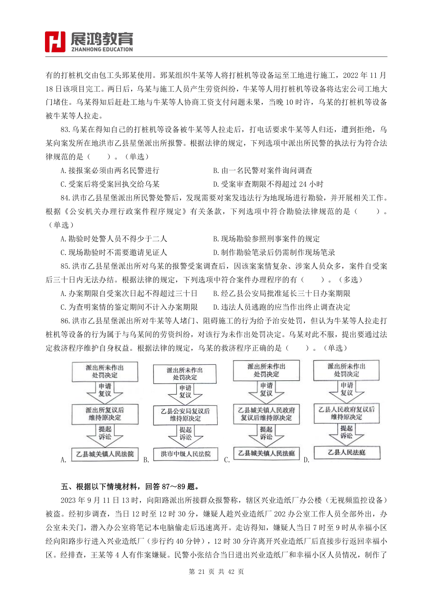

展开本页文字

第21 页共42 页
有的打桩机交由包工头郅某使用。郅某组织牛某等人将打桩机等设备运至工地进行施工，2022 年11 月
18 日该项目完工。两日后，乌某与施工人员产生劳资纠纷，牛某等人用打桩机等设备将达宏公司工地大
门堵住。乌某得知后赶赴工地与牛某等人协商工资支付问题未果，当晚10 时许，乌某的打桩机等设备
被牛某等人拉走。
83.乌某在得知自己的打桩机等设备被牛某等人拉走后，打电话要求牛某等人归还，遭到拒绝，乌
某向案发所在地洪市乙县星堡派出所报警。根据法律的规定，下列选项中派出所民警的执法行为符合法
律规范的是（
）。（单选）
A.接报案必须由两名民警进行
B.由一名民警对案件询问调查
C.受案后将受案回执交给乌某
D.受案审查期限不得超过24 小时
84.洪市乙县星堡派出所民警处警后，发现需要对案发违法行为地现场进行勘验，并开展相关工作。
根据《公安机关办理行政案件程序规定》有关条款，下列选项中符合勘验法律规范的是（
）。
（单选）
A.勘验时处警人员不得少于二人
B.现场勘验参照刑事案件的规定
C.现场勘验时不需要邀请见证人
D.制作勘验笔录后仍需制作现场笔录
85.洪市乙县星堡派出所对乌某的报警受案调查后，因该案案情复杂、涉案人员众多，案件自受案
后三十日内无法办结。根据法律的规定，下列选项中符合案件办理程序的有（
）。（多选）
A.办案期限自受案次日起不得超过三十日
B.经乙县公安局批准延长三十日办案期限
C.为查明案情的鉴定期间不计入办案期限
D.违法人员逃跑的应当作出终止调查决定
86.洪市乙县星堡派出所对牛某等人堵门、阻碍施工的行为给予治安处罚，但认为牛某等人拉走打
桩机等设备的行为属于与乌某间的劳资纠纷，对该行为未作出处罚决定。乌某对此不服，提出要通过法
定救济程序维护自身权益。根据法律的规定，乌某的救济程序正确的是（
）。（单选）
A.
B.
C.
D.
五、根据以下情境材料，回答87～89 题。
2023 年9 月11 日13 时，向阳路派出所接群众报警称，辖区兴业造纸厂办公楼（无视频监控设备）
被盗。经初步调查，当日12 时至12 时30 分，嫌疑人趁兴业造纸厂202 办公室工作人员全部外出，办
公室未关门，潜入办公室将笔记本电脑偷走后迅速离开。走访得知，嫌疑人当日7 时至9 时从幸福小区
经向阳路步行进入兴业造纸厂（步行约40 分钟），12 时30 分许离开兴业造纸厂后直接步行返回幸福小
区。经排查，王某等4 人有作案嫌疑。民警小张结合当日进出兴业造纸厂和幸福小区人员情况，制作了

### 原第22页

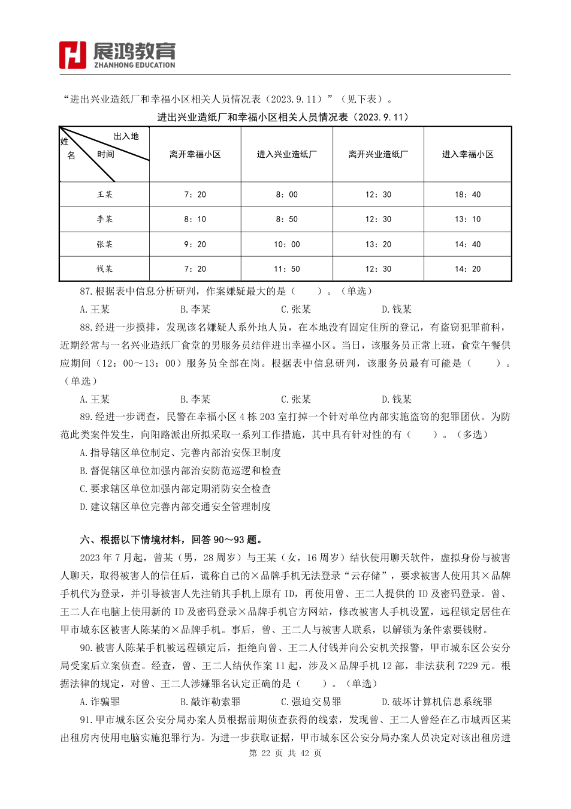

展开本页文字

第22 页共42 页
“进出兴业造纸厂和幸福小区相关人员情况表（2023.9.11）”（见下表）。
进出兴业造纸厂和幸福小区相关人员情况表（2023.9.11）
姓
名
1
时间
出入地
离开幸福小区
进入兴业造纸厂
离开兴业造纸厂
进入幸福小区
王某
7：20
8：00
12：30
18：40
李某
8：10
8：50
12：30
13：10
张某
9：20
10：00
13：20
14：40
钱某
7：20
11：50
12：30
14：20
87.根据表中信息分析研判，作案嫌疑最大的是（
）。（单选）
A.王某
B.李某
C.张某
D.钱某
88.经进一步摸排，发现该名嫌疑人系外地人员，在本地没有固定住所的登记，有盗窃犯罪前科，
近期经常与一名兴业造纸厂食堂的男服务员结伴进出幸福小区。当日，该服务员正常上班，食堂午餐供
应期间（12：00～13：00）服务员全部在岗。根据表中信息研判，该服务员最有可能是（
）。
（单选）
A.王某
B.李某
C.张某
D.钱某
89.经进一步调查，民警在幸福小区4 栋203 室打掉一个针对单位内部实施盗窃的犯罪团伙。为防
范此类案件发生，向阳路派出所拟采取一系列工作措施，其中具有针对性的有（
）。（多选）
A.指导辖区单位制定、完善内部治安保卫制度
B.督促辖区单位加强内部治安防范巡逻和检查
C.要求辖区单位加强内部定期消防安全检查
D.建议辖区单位完善内部交通安全管理制度
六、根据以下情境材料，回答90～93 题。
2023 年7 月起，曾某（男，28 周岁）与王某（女，16 周岁）结伙使用聊天软件，虚拟身份与被害
人聊天，取得被害人的信任后，谎称自己的×品牌手机无法登录“云存储”，要求被害人使用其×品牌
手机代为登录，并引导被害人先注销其手机上原有ID，再使用曾、王二人提供的ID 及密码登录。曾、
王二人在电脑上使用新的ID 及密码登录×品牌手机官方网站，修改被害人手机设置，远程锁定居住在
甲市城东区被害人陈某的×品牌手机。事后，曾、王二人与被害人联系，以解锁为条件索要钱财。
90.被害人陈某手机被远程锁定后，拒绝向曾、王二人付钱并向公安机关报警，甲市城东区公安分
局受案后立案侦查。经查，曾、王二人结伙作案11 起，涉及×品牌手机12 部，非法获利7229 元。根
据法律的规定，对曾、王二人涉嫌罪名认定正确的是（
）。（单选）
A.诈骗罪
B.敲诈勒索罪
C.强迫交易罪
D.破坏计算机信息系统罪
91.甲市城东区公安分局办案人员根据前期侦查获得的线索，发现曾、王二人曾经在乙市城西区某
出租房内使用电脑实施犯罪行为。为进一步获取证据，甲市城东区公安分局办案人员决定对该出租房进

### 原第23页

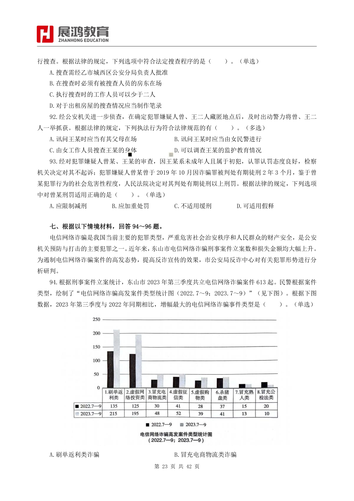

展开本页文字

第23 页共42 页
行搜查。根据法律的规定，下列选项中符合法定搜查程序的是（
）。（单选）
A.搜查需经乙市城西区公安分局负责人批准
B.在搜查时必须有被搜查人员的房东在场
C.执行搜查时的工作人员可以少于二人
D.对于出租房屋的搜查情况应当制作笔录
92.经公安机关进一步侦查，在确定犯罪嫌疑人曾、王二人藏匿地点后，及时出动警力将曾、王二
人一举抓获。根据法律的规定，下列执法行为符合法律规范的有（
）。（多选）
A.讯问王某时应当有其父母在场
B.讯问王某时应当由女民警进行
C.由女工作人员搜查王某的身体
D.可以调查王某的监护教育情况
93.经对犯罪嫌疑人曾某、王某的审查，因王某系未成年人且属于初犯，认罪认罚态度良好，检察
机关决定对其不起诉；犯罪嫌疑人曾某曾于2019 年10 月因诈骗罪被判处有期徒刑2 年3 个月，鉴于曾
某犯罪行为的社会危害性程度，人民法院决定对其判处有期徒刑以上刑罚。根据法律的规定，下列选项
中对曾某刑罚适用正确的是（
）。（单选）
A.应限制减刑
B.应加重处罚
C.不适用缓刑
D.可适用假释
七、根据以下情境材料，回答94～96 题。
电信网络诈骗是我国当前主要的犯罪类型，严重危害社会治安秩序和人民群众的财产安全，是公安
机关预防与打击的主要犯罪之一。近年来，东山市电信网络诈骗刑事案件立案数和损失金额均大幅上升。
为遏制电信网络诈骗案件的高发态势，提高反诈宣传的效果，市公安局反诈中心对有关犯罪形势进行分
析研判。
94.根据刑事案件立案统计，东山市2023 年第三季度共立电信网络诈骗案件613 起。民警根据案件
类型，绘制了“电信网络诈骗高发案件类型统计图（2022.7～9；2023.7～9）”（见下图）。根据下图
数据，2023 年第三季度与2022 年同期相比，增幅最大的电信网络诈骗事件类型是（
）。（单选）
A.刷单返利类诈骗
B.冒充电商物流类诈骗

### 原第24页

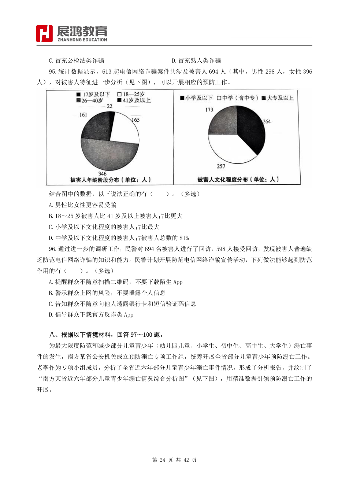

展开本页文字

第24 页共42 页
C.冒充公检法类诈骗
D.冒充熟人类诈骗
95.统计数据显示，613 起电信网络诈骗案件共涉及被害人694 人（其中，男性298 人，女性396
人），对被害人特征进一步分析（见下图），可以开展相应的预防工作。
结合图中的数据，以下说法正确的有（
）。（多选）
A.男性比女性更容易受骗
B.18～25 岁被害人比41 岁及以上被害人占比更大
C.小学及以下文化程度的被害人占比最大
D.中学及以下文化程度的被害人占被害人总数的81%
96.通过进一步的调研工作，民警对694 名被害人进行了回访，598 人接受回访，发现被害人普遍缺
乏防范电信网络诈骗的知识和能力。民警计划开展防范电信网络诈骗宣传活动，下列做法能够起到防范
作用的有（
）。（多选）
A.提醒群众不随意扫描二维码，不要下载陌生App
B.警示群众上网的风险，不要泄露个人信息
C.告知群众不随意向他人透露银行卡和短信验证码信息
D.倡导群众下载官方反诈类App
八、根据以下情境材料，回答97～100 题。
为最大限度防范和减少部分儿童青少年（幼儿园儿童、小学生、初中生、高中生、大学生）溺亡事
件的发生，南方某省公安机关成立预防溺亡专项工作组，统筹开展全省部分儿童青少年预防溺亡工作。
老李作为专项小组成员，分析了全省近六年部分儿童青少年溺亡事件情况，形成了分析报告，并绘制了
“南方某省近六年部分儿童青少年溺亡情况综合分析图”（见下图），用精准数据引领预防溺亡工作的
开展。

### 原第25页

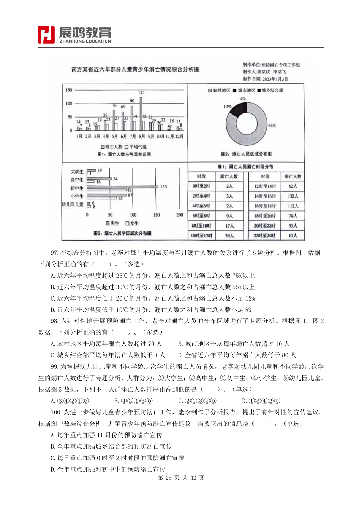

展开本页文字

第25 页共42 页
97.在综合分析图中，老李对每月平均温度与当月溺亡人数的关系进行了专题分析。根据图1 数据，
下列分析正确的有（
）。（多选）
A.近六年平均温度超过25℃的月份，溺亡人数之和占溺亡总人数75%以上
B.近六年平均温度超过30℃的月份，溺亡人数之和占溺亡总人数55%以上
C.近六年平均温度低于20℃的月份，溺亡人数之和占溺亡总人数不足12%
D.近六年平均温度低于10℃的月份，溺亡人数之和占溺亡总人数不足8%
98.为针对性地开展预防溺亡工作，老李对溺亡人员的分布区域进行了专题分析。根据图1、图2
数据，下列分析正确的有（
）。（多选）
A.农村地区平均每年溺亡人数超过70 人
B.城市地区平均每年溺亡人数超过10 人
C.城乡结合部平均每年溺亡人数低于3 人
D.全省近六年平均每年溺亡人数低于80 人
99.为掌握幼儿园儿童和不同学龄层次学生的溺亡人员情况，老李对幼儿园儿童和不同学龄层次学
生的溺亡人数进行了专题分析，人群分为：①大学生；②高中生；③初中生；④小学生；⑤幼儿园儿童。
根据图3 数据，下列不同人群溺亡人数排序由高到低的是（
）。（单选）
A.③④②①⑤
B.④②①③⑤
C.②①③④⑤
D.①③④②⑤
100.为进一步做好儿童青少年预防溺亡工作，老李制作了分析报告，提出了有针对性的宣传建议。
根据图中数据综合分析，儿童青少年预防溺亡宣传建议中需要突出的信息是（
）。（单选）
A.每年重点加强11 月份的预防溺亡宣传
B.全年重点加强城乡结合部的预防溺亡宣传
C.每日重点加强0 时至2 时时段的预防溺亡宣传
D.全年重点加强对初中生的预防溺亡宣传

## 答案与解析

### 原第26页

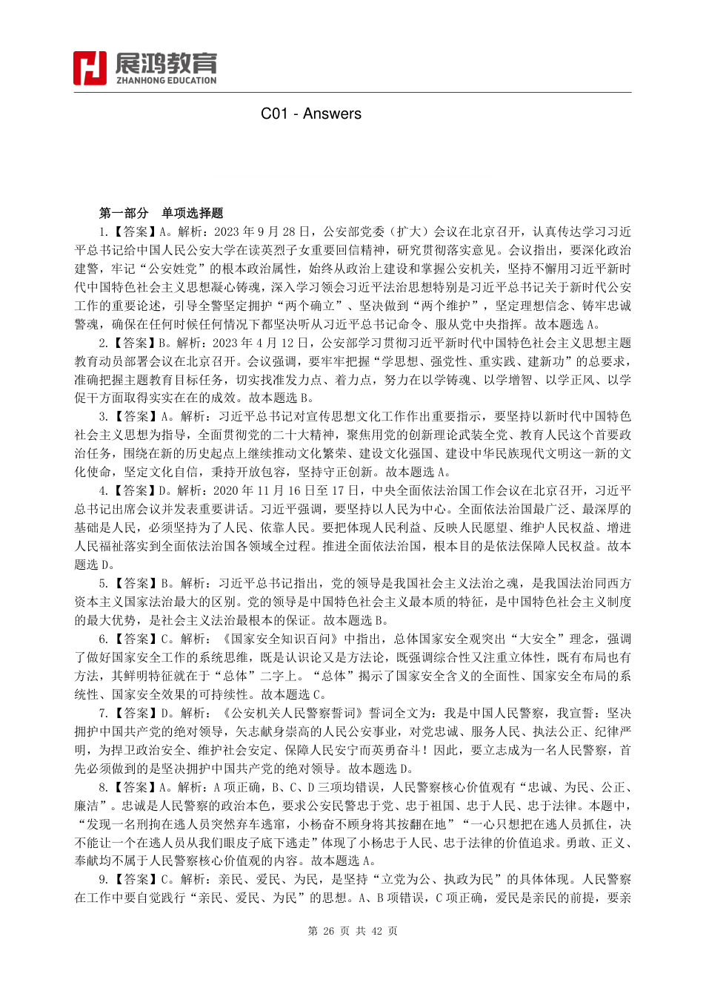

展开本页文字

第26 页共42 页
资料C01
第一部分
单项选择题
1.【答案】A。解析：2023 年9 月28 日，公安部党委（扩大）会议在北京召开，认真传达学习习近
平总书记给中国人民公安大学在读英烈子女重要回信精神，研究贯彻落实意见。会议指出，要深化政治
建警，牢记“公安姓党”的根本政治属性，始终从政治上建设和掌握公安机关，坚持不懈用习近平新时
代中国特色社会主义思想凝心铸魂，深入学习领会习近平法治思想特别是习近平总书记关于新时代公安
工作的重要论述，引导全警坚定拥护“两个确立”、坚决做到“两个维护”，坚定理想信念、铸牢忠诚
警魂，确保在任何时候任何情况下都坚决听从习近平总书记命令、服从党中央指挥。故本题选A。
2.【答案】B。解析：2023 年4 月12 日，公安部学习贯彻习近平新时代中国特色社会主义思想主题
教育动员部署会议在北京召开。会议强调，要牢牢把握“学思想、强党性、重实践、建新功”的总要求，
准确把握主题教育目标任务，切实找准发力点、着力点，努力在以学铸魂、以学增智、以学正风、以学
促干方面取得实实在在的成效。故本题选B。
3.【答案】A。解析：习近平总书记对宣传思想文化工作作出重要指示，要坚持以新时代中国特色
社会主义思想为指导，全面贯彻党的二十大精神，聚焦用党的创新理论武装全党、教育人民这个首要政
治任务，围绕在新的历史起点上继续推动文化繁荣、建设文化强国、建设中华民族现代文明这一新的文
化使命，坚定文化自信，秉持开放包容，坚持守正创新。故本题选A。
4.【答案】D。解析：2020 年11 月16 日至17 日，中央全面依法治国工作会议在北京召开，习近平
总书记出席会议并发表重要讲话。习近平强调，要坚持以人民为中心。全面依法治国最广泛、最深厚的
基础是人民，必须坚持为了人民、依靠人民。要把体现人民利益、反映人民愿望、维护人民权益、增进
人民福祉落实到全面依法治国各领域全过程。推进全面依法治国，根本目的是依法保障人民权益。故本
题选D。
5.【答案】B。解析：习近平总书记指出，党的领导是我国社会主义法治之魂，是我国法治同西方
资本主义国家法治最大的区别。党的领导是中国特色社会主义最本质的特征，是中国特色社会主义制度
的最大优势，是社会主义法治最根本的保证。故本题选B。
6.【答案】C。解析：《国家安全知识百问》中指出，总体国家安全观突出“大安全”理念，强调
了做好国家安全工作的系统思维，既是认识论又是方法论，既强调综合性又注重立体性，既有布局也有
方法，其鲜明特征就在于“总体”二字上。“总体”揭示了国家安全含义的全面性、国家安全布局的系
统性、国家安全效果的可持续性。故本题选C。
7.【答案】D。解析：《公安机关人民警察誓词》誓词全文为：我是中国人民警察，我宣誓：坚决
拥护中国共产党的绝对领导，矢志献身崇高的人民公安事业，对党忠诚、服务人民、执法公正、纪律严
明，为捍卫政治安全、维护社会安定、保障人民安宁而英勇奋斗！因此，要立志成为一名人民警察，首
先必须做到的是坚决拥护中国共产党的绝对领导。故本题选D。
8.【答案】A。解析：A 项正确，B、C、D 三项均错误，人民警察核心价值观有“忠诚、为民、公正、
廉洁”。忠诚是人民警察的政治本色，要求公安民警忠于党、忠于祖国、忠于人民、忠于法律。本题中，
“发现一名刑拘在逃人员突然弃车逃窜，小杨奋不顾身将其按翻在地”“一心只想把在逃人员抓住，决
不能让一个在逃人员从我们眼皮子底下逃走”体现了小杨忠于人民、忠于法律的价值追求。勇敢、正义、
奉献均不属于人民警察核心价值观的内容。故本题选A。
9.【答案】C。解析：亲民、爱民、为民，是坚持“立党为公、执政为民”的具体体现。人民警察
在工作中要自觉践行“亲民、爱民、为民”的思想。A、B 项错误，C 项正确，爱民是亲民的前提，要亲

### 原第27页

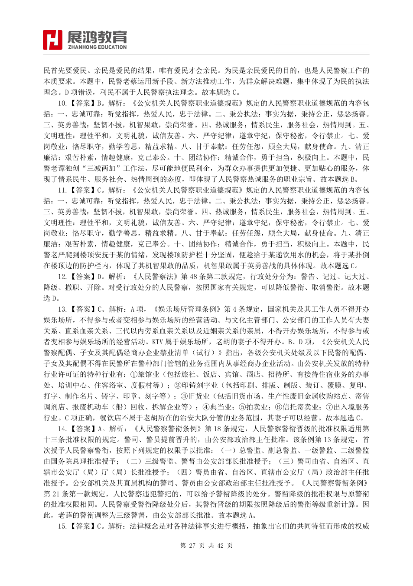

展开本页文字

第27 页共42 页
民首先要爱民。亲民是爱民的结果，唯有爱民才会亲民。为民是亲民爱民的目的，也是人民警察工作的
本质要求。本题中，民警老蔡运用新手段、新方法推动工作，为群众解决难题，集中体现了为民的执法
理念。D 项错误，利民不属于人民警察执法理念。故本题选C。
10.【答案】B。解析：《公安机关人民警察职业道德规范》规定的人民警察职业道德规范的内容包
括：一、忠诚可靠：听党指挥，热爱人民，忠于法律。二、秉公执法：事实为据，秉持公正，惩恶扬善。
三、英勇善战：坚韧不拔，机智果敢，崇尚荣誉。四、热诚服务：情系民生，服务社会，热情周到。五、
文明理性：理性平和，文明礼貌，诚信友善。六、严守纪律：遵章守纪，保守秘密，令行禁止。七、爱
岗敬业：恪尽职守，勤学善思，精益求精。八、甘于奉献：任劳任怨，顾全大局，献身使命。九、清正
廉洁：艰苦朴素，情趣健康，克己奉公。十、团结协作：精诚合作，勇于担当，积极向上。本题中，民
警老谭独创“三减两加”工作法，尽可能地便民利企，为群众办事提供更加便捷、更加贴心的服务，体
现了情系民生、服务社会、热情周到的态度，即体现了人民警察热诚服务的职业宗旨。故本题选B。
11.【答案】C。解析：《公安机关人民警察职业道德规范》规定的人民警察职业道德规范的内容包
括：一、忠诚可靠：听党指挥，热爱人民，忠于法律。二、秉公执法：事实为据，秉持公正，惩恶扬善。
三、英勇善战：坚韧不拔，机智果敢，崇尚荣誉。四、热诚服务：情系民生，服务社会，热情周到。五、
文明理性：理性平和，文明礼貌，诚信友善。六、严守纪律：遵章守纪，保守秘密，令行禁止。七、爱
岗敬业：恪尽职守，勤学善思，精益求精。八、甘于奉献：任劳任怨，顾全大局，献身使命。九、清正
廉洁：艰苦朴素，情趣健康，克己奉公。十、团结协作：精诚合作，勇于担当，积极向上。本题中，民
警老严爬到楼顶安抚于某的情绪，发现楼顶防护栏十分坚固，便趁给于某递饮用水的机会，将于某扑倒
在楼顶边的防护栏内，体现了其机智果敢的品质，机智果敢属于英勇善战的具体体现。故本题选C。
12.【答案】D。解析：《人民警察法》第48 条第二款规定，行政处分分为：警告、记过、记大过、
降级、撤职、开除。对受行政处分的人民警察，按照国家有关规定，可以降低警衔、取消警衔。故本题
选D。
13.【答案】C。解析：A 项，《娱乐场所管理条例》第4 条规定，国家机关及其工作人员不得开办
娱乐场所，不得参与或者变相参与娱乐场所的经营活动。与文化主管部门、公安部门的工作人员有夫妻
关系、直系血亲关系、三代以内旁系血亲关系以及近姻亲关系的亲属，不得开办娱乐场所，不得参与或
者变相参与娱乐场所的经营活动。KTV 属于娱乐场所，老胡的妻子不得开办。B、D 项，《公安机关人民
警察配偶、子女及其配偶经商办企业禁业清单（试行）》指出，各级公安机关处级及以下民警的配偶、
子女及其配偶不得在民警所在警种部门管辖的业务范围内从事经商办企业活动。由公安机关发放的特种
行业许可证的特种行业有：①旅馆业（包括旅社、饭店、宾馆、酒店、招待所、有接待住宿业务的办事
处、培训中心、住客浴室、度假村等）；②印铸刻字业（包括印刷、排版、制版、装订、覆膜、复印、
打字、制作名片、铸字、印章、刻字等）；③旧货业（包括旧货市场、生产性废旧金属收购站点、寄售
调剂店、报废机动车（船）回收、拆解企业等）；④典当业；⑤拍卖业；⑥信托寄卖业；⑦出入境服务
行业。C 项正确，餐饮店不属于老胡所在的治安大队分管的业务范围，其妻子可以经营。故本题选C。
14.【答案】A。解析：《人民警察警衔条例》第18 条规定，人民警察警衔晋级的批准权限适用第
十三条批准权限的规定。警司、警员提前晋升的，由公安部政治部主任批准。该条例第13 条规定，首
次授予人民警察警衔，按照下列规定的权限予以批准：（一）总警监、副总警监、一级警监、二级警监
由国务院总理批准授予；（二）三级警监、警督由公安部部长批准授予；（三）警司由省、自治区、直
辖市公安厅（局）厅（局）长批准授予；（四）警员由省、自治区、直辖市公安厅（局）政治部主任批
准授予。公安部机关及其直属机构的警司、警员由公安部政治部主任批准授予。《人民警察警衔条例》
第21 条第一款规定，人民警察违犯警纪的，可以给予警衔降级的处分。警衔降级的批准权限与原警衔
的批准权限相同。人民警察受警衔降级处分后，其警衔晋级的期限按照降级后的警衔等级重新计算。因
此，老薛的警衔调整为三级警督，由公安部部长批准。故本题选A。
15.【答案】C。解析：法律概念是对各种法律事实进行概括，抽象出它们的共同特征而形成的权威

### 原第28页

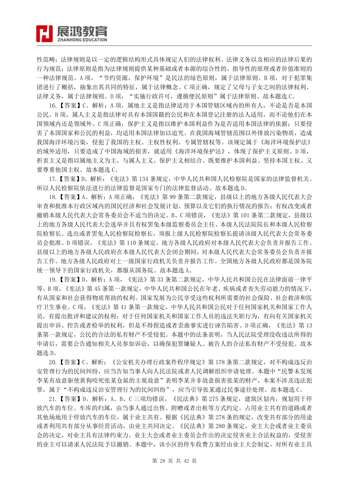

展开本页文字

第28 页共42 页
性范畴；法律规则是以一定的逻辑结构形式具体规定人们的法律权利、法律义务以及相应的法律后果的
行为规范；法律原则是指为法律规则提供某种基础或者本源的综合性的、指导性的原理或者价值准则的
一种法律规范。A 项，“节约资源，保护环境”是民法的绿色原则，属于法律原则。B 项，对于犯罪集
团进行了概括，抽象出其共同的特征，属于法律概念。C 项正确，规定了父母与子女之间的法律权利、
法律义务，属于法律规则。D 项，“实施行政许可，遵循便民原则”属于法律原则。故本题选C。
16.【答案】C。解析：A 项，属地主义是指法律适用于本国管辖区域内的所有人，不论是否是本国
公民。B 项，属人主义是指法律对具有本国国籍的公民和在本国登记注册的法人适用，而不论他们在本
国领域内还是领域外。C 项正确，保护主义是指以维护本国利益作为是否适用本国法律的依据；只要侵
害了本国国家和公民的利益，均适用本国法律加以追究。在我国海域管辖范围以外排放污染物质，造成
我国海洋环境污染，侵犯了我国的主权、主权性权利、专属管辖权等。该规定属于《海洋环境保护法》
的域外适用，只要造成了中国海域的损害，就适用《海洋环境保护法》，体现了保护主义原则。D 项，
折衷主义是指以属地主义为主，与属人主义、保护主义相结合。既要维护本国利益、坚持本国主权、又
要尊重他国主权。故本题选C。
17.【答案】D。解析：《宪法》第134 条规定，中华人民共和国人民检察院是国家的法律监督机关。
所以人民检察院依法进行的法律监督是国家专门的法律监督活动。故本题选D。
18.【答案】A。解析：A 项正确，《宪法》第99 条第二款规定，县级以上的地方各级人民代表大会
审查和批准本行政区域内的国民经济和社会发展计划、预算以及它们的执行情况的报告；有权改变或者
撤销本级人民代表大会常务委员会不适当的决定。B、C 项错误，《宪法》第101 条第二款规定，县级以
上的地方各级人民代表大会选举并且有权罢免本级监察委员会主任、本级人民法院院长和本级人民检察
院检察长。选出或者罢免人民检察院检察长，须报上级人民检察院检察长提请该级人民代表大会常务委
员会批准。D 项错误，《宪法》第110 条规定，地方各级人民政府对本级人民代表大会负责并报告工作。
县级以上的地方各级人民政府在本级人民代表大会闭会期间，对本级人民代表大会常务委员会负责并报
告工作。地方各级人民政府对上一级国家行政机关负责并报告工作。全国地方各级人民政府都是国务院
统一领导下的国家行政机关，都服从国务院。故本题选A。
19.【答案】D。解析：A 项，《宪法》第33 条第二款规定，中华人民共和国公民在法律面前一律平
等。B 项，《宪法》第45 条第一款规定，中华人民共和国公民在年老、疾病或者丧失劳动能力的情况下，
有从国家和社会获得物质帮助的权利。国家发展为公民享受这些权利所需要的社会保险、社会救济和医
疗卫生事业。C 项，《宪法》第41 条第一款规定，中华人民共和国公民对于任何国家机关和国家工作人
员，有提出批评和建议的权利；对于任何国家机关和国家工作人员的违法失职行为，有向有关国家机关
提出申诉、控告或者检举的权利，但是不得捏造或者歪曲事实进行诬告陷害。D 项正确，《宪法》第13
条第一款规定，公民的合法的私有财产不受侵犯。本题中的法条表明，当人民法院受理没收违法所得的
申请后，需要公告通知相关人员参加诉讼，以确保犯罪嫌疑人、被告人的合法私有财产不受侵犯。故本
题选D。
20.【答案】C。解析：《公安机关办理行政案件程序规定》第178 条第二款规定，对不构成违反治
安管理行为的民间纠纷，应当告知当事人向人民法院或者人民调解组织申请处理。本题中“民警未发现
李某有故意驱使黄狗咬死张某仓鼠的主观故意”表明李某并非故意损害张某的财产，本案不涉及违法犯
罪，属于“不构成违反治安管理行为的民间纠纷”，应当引导张某通过民事途径处理。故本题选C。
21.【答案】D。解析：A、B、C 三项均错误，《民法典》第275 条规定，建筑区划内，规划用于停
放汽车的车位、车库的归属，由当事人通过出售、附赠或者出租等方式约定。占用业主共有的道路或者
其他场地用于停放汽车的车位，属于业主共有。根据《民法典》第278 条的规定，改变共有部分的用途
或者利用共有部分从事经营活动，由业主共同决定。《民法典》第280 条规定，业主大会或者业主委员
会的决定，对业主具有法律约束力。业主大会或者业主委员会作出的决定侵害业主合法权益的，受侵害
的业主可以请求人民法院予以撤销。本题中，该小区的停车收费方案经由业主大会制定，对所有业主具

### 原第29页

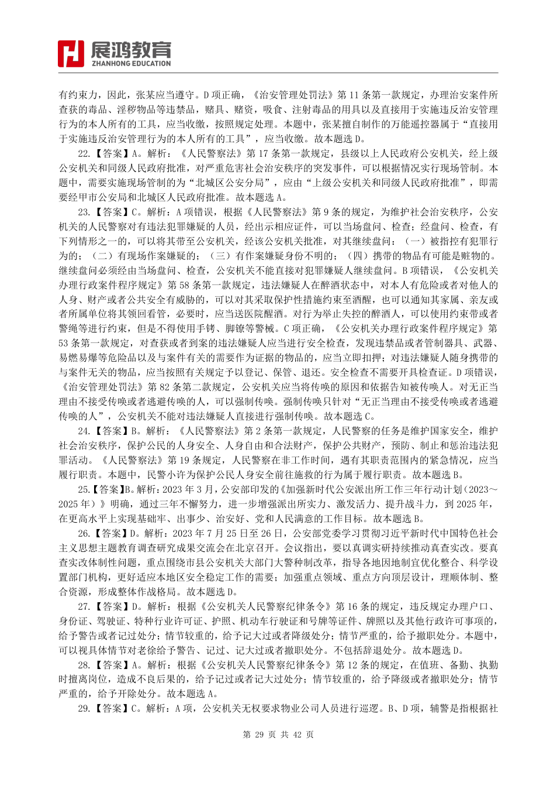

展开本页文字

第29 页共42 页
有约束力，因此，张某应当遵守。D 项正确，《治安管理处罚法》第11 条第一款规定，办理治安案件所
查获的毒品、淫秽物品等违禁品，赌具、赌资，吸食、注射毒品的用具以及直接用于实施违反治安管理
行为的本人所有的工具，应当收缴，按照规定处理。本题中，张某擅自制作的万能遥控器属于“直接用
于实施违反治安管理行为的本人所有的工具”，应当收缴。故本题选D。
22.【答案】A。解析：《人民警察法》第17 条第一款规定，县级以上人民政府公安机关，经上级
公安机关和同级人民政府批准，对严重危害社会治安秩序的突发事件，可以根据情况实行现场管制。本
题中，需要实施现场管制的为“北城区公安分局”，应由“上级公安机关和同级人民政府批准”，即需
要经甲市公安局和北城区人民政府批准。故本题选A。
23.【答案】C。解析：A 项错误，根据《人民警察法》第9 条的规定，为维护社会治安秩序，公安
机关的人民警察对有违法犯罪嫌疑的人员，经出示相应证件，可以当场盘问、检查；经盘问、检查，有
下列情形之一的，可以将其带至公安机关，经该公安机关批准，对其继续盘问：（一）被指控有犯罪行
为的；（二）有现场作案嫌疑的；（三）有作案嫌疑身份不明的；（四）携带的物品有可能是赃物的。
继续盘问必须经由当场盘问、检查，公安机关不能直接对犯罪嫌疑人继续盘问。B 项错误，《公安机关
办理行政案件程序规定》第58 条第一款规定，违法嫌疑人在醉酒状态中，对本人有危险或者对他人的
人身、财产或者公共安全有威胁的，可以对其采取保护性措施约束至酒醒，也可以通知其家属、亲友或
者所属单位将其领回看管，必要时，应当送医院醒酒。对行为举止失控的醉酒人，可以使用约束带或者
警绳等进行约束，但是不得使用手铐、脚镣等警械。C 项正确，《公安机关办理行政案件程序规定》第
53 条第一款规定，对查获或者到案的违法嫌疑人应当进行安全检查，发现违禁品或者管制器具、武器、
易燃易爆等危险品以及与案件有关的需要作为证据的物品的，应当立即扣押；对违法嫌疑人随身携带的
与案件无关的物品，应当按照有关规定予以登记、保管、退还。安全检查不需要开具检查证。D 项错误，
《治安管理处罚法》第82 条第二款规定，公安机关应当将传唤的原因和依据告知被传唤人。对无正当
理由不接受传唤或者逃避传唤的人，可以强制传唤。强制传唤只针对“无正当理由不接受传唤或者逃避
传唤的人”，公安机关不能对违法嫌疑人直接进行强制传唤。故本题选C。
24.【答案】B。解析：《人民警察法》第2 条第一款规定，人民警察的任务是维护国家安全，维护
社会治安秩序，保护公民的人身安全、人身自由和合法财产，保护公共财产，预防、制止和惩治违法犯
罪活动。《人民警察法》第19 条规定，人民警察在非工作时间，遇有其职责范围内的紧急情况，应当
履行职责。本题中，民警小许为保护公民人身安全前往施救的行为属于履行职责。故本题选B。
25.【答案】B。解析：2023 年3 月，公安部印发的《加强新时代公安派出所工作三年行动计划（2023～
2025 年）》明确，通过三年不懈努力，进一步增强派出所实力、激发活力、提升战斗力，到2025 年，
在更高水平上实现基础牢、出事少、治安好、党和人民满意的工作目标。故本题选B。
26.【答案】D。解析：2023 年7 月25 日至26 日，公安部党委学习贯彻习近平新时代中国特色社会
主义思想主题教育调查研究成果交流会在北京召开。会议指出，要以真调实研持续推动真查实改。要真
查实改体制性问题，重点围绕市县公安机关大部门大警种制改革，指导各地因地制宜优化整合、科学设
置部门机构，更好适应本地区安全稳定工作的需要；加强重点领域、重点方向顶层设计，理顺体制、整
合资源，形成整体作战格局。故本题选D。
27.【答案】D。解析：根据《公安机关人民警察纪律条令》第16 条的规定，违反规定办理户口、
身份证、驾驶证、特种行业许可证、护照、机动车行驶证和号牌等证件、牌照以及其他行政许可事项的，
给予警告或者记过处分；情节较重的，给予记大过或者降级处分；情节严重的，给予撤职处分。本题中，
可以视具体情节对老徐给予警告、记过、记大过或者撤职处分。不包括辞退处分。故本题选D。
28.【答案】A。解析：根据《公安机关人民警察纪律条令》第12 条的规定，在值班、备勤、执勤
时擅离岗位，造成不良后果的，给予记过或者记大过处分；情节较重的，给予降级或者撤职处分；情节
严重的，给予开除处分。故本题选A。
29.【答案】C。解析：A 项，公安机关无权要求物业公司人员进行巡逻。B、D 项，辅警是指根据社

### 原第30页

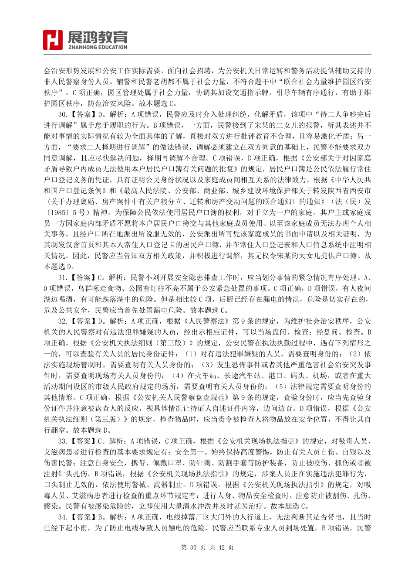

展开本页文字

第30 页共42 页
会治安形势发展和公安工作实际需要，面向社会招聘，为公安机关日常运转和警务活动提供辅助支持的
非人民警察身份人员。辅警和民警老胡都不属于社会力量，不符合题干中“联合社会力量维护园区治安
秩序”。C 项正确，园区管理处属于社会力量，协调其加设交通指示牌，引导车辆有序通行，有助于维
护园区秩序，防范治安风险。故本题选C。
30.【答案】D。解析：A 项错误，民警应及时介入处理纠纷，化解矛盾，该项中“待二人争吵完后
进行调解”属于怠于履职的行为。B 项错误，一方面，民警接到了宋某的二女儿的报警，听其表述并不
能对事情的实际情况有较为全面具体的了解，直接对双方进行批评教育不合理，且容易激化矛盾；另一
方面，“要求二人择期进行调解”的做法错误，调解必须建立在双方同意的基础上，民警不能要求双方
同意调解，且应尽快解决问题，择期再调解不合理。C 项错误，D 项正确，根据《公安部关于对因家庭
矛盾导致户内成员无法使用本户居民户口簿有关问题的批复》的规定，居民户口簿是公民依法履行常住
户口登记义务的凭证，具有证明公民身份状况以及家庭成员间相互关系的法律效力。根据《中华人民共
和国户口登记条例》和《最高人民法院、公安部、商业部、城乡建设环境保护部关于转发陕西省西安市
〈关于办理离婚、房产案件中有关户粮分立、迁转和房产变动问题的联合通知〉的通知》（法（民）发
〔1985〕5 号）精神，为保障公民依法使用居民户口簿的权利，对于立为一户的家庭，其户主或家庭成
员一方因家庭内部矛盾不愿将本户居民户口簿交与其他家庭成员使用、以至该家庭成员无法办理个人相
关事务，且经户口所在地派出所说服无效的，公安派出所可凭该家庭成员的书面申请以及相关证明，为
其制发仅含首页和其本人常住人口登记卡的居民户口簿，并在常住人口登记表和人口信息系统中注明相
关情况。因此，民警应当告知双方相关政策，并积极进行调解，其无权令宋某的大女儿提供户口簿。故
本题选D。
31.【答案】C。解析：民警小刘开展安全隐患排查工作时，应当划分事情的紧急情况有序处理。A、
D 项错误，鸟群啄走食物、公园有灯柱不亮不属于公安紧急处置的事项。C 项正确，D 项错误，有人夜间
湖边喝酒，有可能跌落湖中的危险。但是相比较C 项，后厨已经存在漏电的情况，危险是切实存在的，
危及公共安全，民警应当首先处置漏电危险。故本题选C。
32.【答案】D。解析：A 项正确，根据《人民警察法》第9 条的规定，为维护社会治安秩序，公安
机关的人民警察对有违法犯罪嫌疑的人员，经出示相应证件，可以当场盘问、检查；经盘问、检查。B
项正确，根据《公安机关执法细则（第三版）》的规定，公安民警在执法执勤过程中，遇有下列情形之
一的，可以查验有关人员的居民身份证件：（1）对有违法犯罪嫌疑的人员，需要查明身份的；（2）依
法实施现场管制时，需要查明有关人员身份的；（3）发生恐怖事件或者其他严重危害社会治安突发事
件时，需要查明现场有关人员身份的；（4）在火车站、长途汽车站、港口、码头、机场，或者在重大
活动期间设区的市级人民政府规定的场所，需要查明有关人员身份的；（5）法律规定需要查明身份的
其他情形。C 项正确，根据《公安机关人民警察盘查规范》第9 条的规定，查验身份时，应当先查验身
份证件并注意被盘查人的反应，视具体情况让持证人自述证件内容，边问边查。D 项错误，根据《公安
机关执法细则（第三版）》的规定，检查物品时，应当责令被检查人将物品放在安全位置，不得让其自
行翻拿。故本题选D。
33.【答案】C。解析：A 项错误，C 项正确，根据《公安机关现场执法指引》的规定，对吸毒人员、
艾滋病患者进行检查的基本要求规定有：安全第一。始终保持高度警惕，防止有关人员自伤、自残以及
伤害民警；注意自身安全，携带、佩戴口罩、防针刺、防割手套等防护装备，防止被咬伤、抓伤或者被
注射针头扎伤。B 项错误，根据《公安机关现场执法指引》的规定，涉案人员正在实施违法犯罪行为，
口头制止无效的，依法使用警械、武器制止。D 项错误。根据《公安机关现场执法指引》的规定，对吸
毒人员、艾滋病患者进行检查的重点环节规定有：进行人身、物品安全检查时，注意防止被割伤、扎伤、
感染。民警有被感染危险的，立即使用大量清水冲洗并及时就医治疗。故本题选C。
34.【答案】B。解析：A 项正确，电线掉落厂区大门外的人行道上，无法判断其是否带电，且当时
已经下起小雨，为了防止电线导致人员触电的危险，民警应当联系专业人员到场处置。B 项错误，民警

### 原第31页

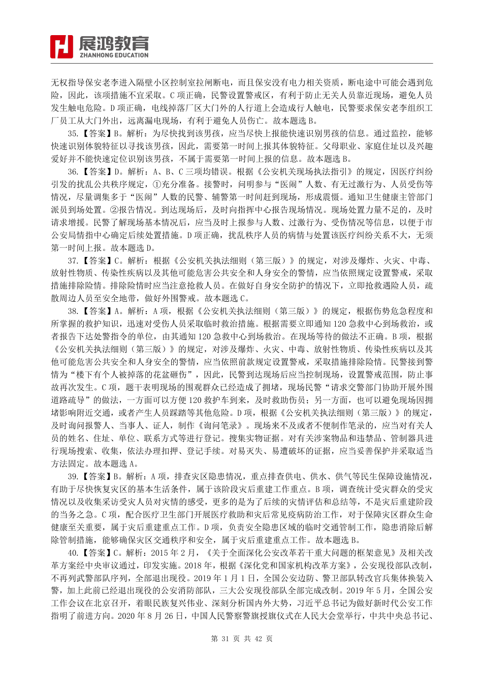

展开本页文字

第31 页共42 页
无权指导保安老李进入隔壁小区控制室拉闸断电，而且保安没有电力相关资质，断电途中可能会遇到危
险，因此，该项措施不宜采取。C 项正确，民警设置警戒区，有利于防止无关人员靠近现场，避免人员
发生触电危险。D 项正确，电线掉落厂区大门外的人行道上会造成行人触电，民警要求保安老李组织工
厂员工从大门外出，远离漏电现场，有利于避免人员伤亡。故本题选B。
35.【答案】B。解析：为尽快找到该男孩，应当尽快上报能快速识别男孩的信息。通过监控，能够
快速识别体貌特征以寻找该男孩，因此，需要第一时间上报其体貌特征。父母职业、家庭住址以及兴趣
爱好并不能快速定位识别该男孩，不属于需要第一时间上报的信息。故本题选B。
36.【答案】D。解析：A、B、C 三项均错误。根据《公安机关现场执法指引》的规定，因医疗纠纷
引发的扰乱公共秩序规定，①充分准备。接警时，问明参与“医闹”人数、有无过激行为、人员受伤等
情况，尽量调集多于“医闹”人数的民警、辅警第一时间赶到现场，形成震慑。通知卫生健康主管部门
派员到场处置。②报告情况。到达现场后，及时向指挥中心报告现场情况。现场处置力量不足的，及时
请求增援。民警了解现场基本情况后，应当及时上报参与人数、过激行为、受伤情况等信息，以便于市
公安局情指中心确定后续处置措施。D 项正确，扰乱秩序人员的病情与处置该医疗纠纷关系不大，无须
第一时间上报。故本题选D。
37.【答案】C。解析：根据《公安机关执法细则（第三版）》的规定，对涉及爆炸、火灾、中毒、
放射性物质、传染性疾病以及其他可能危害公共安全和人身安全的警情，应当依照规定设置警戒，采取
措施排除险情。排除险情时应当注意抢救人员。在做好自身安全防护的情况下，立即抢救遇险人员，疏
散周边人员至安全地带，做好外围警戒。故本题选C。
38.【答案】A。解析：A 项，根据《公安机关执法细则（第三版）》的规定，根据伤势危急程度和
所掌握的救护知识，迅速对受伤人员采取临时救治措施。根据需要立即通知120 急救中心到场救治，或
者报告下达处警指令的单位，由其通知120 急救中心到场救治。在现场等待的做法不正确。B 项，根据
《公安机关执法细则（第三版）》的规定，对涉及爆炸、火灾、中毒、放射性物质、传染性疾病以及其
他可能危害公共安全和人身安全的警情，应当依照前款规定设置警戒，采取措施排除险情。民警接到警
情为“楼下有个人被掉落的花盆砸伤”，因此，民警到达现场后应当控制现场，设置警戒范围，防止事
故再次发生。C 项，题干表明现场的围观群众已经造成了拥堵，现场民警“请求交警部门协助开展外围
道路疏导”的做法，一方面可以方便120 救护车到来，及时救助伤员；另一方面，也可以避免现场因拥
堵影响附近交通，或者产生人员踩踏等其他危险。D 项，根据《公安机关执法细则（第三版）》的规定，
及时询问报警人、当事人、证人，制作《询问笔录》。现场来不及或者不便制作笔录的，应当对有关人
员的姓名、住址、单位、联系方式等进行登记。搜集实物证据。对有关涉案物品和违禁品、管制器具进
行现场搜索、收集，依法办理扣押、登记手续。对易灭失、易遭破坏的证据，应当妥善保护并采取适当
方法固定。故本题选A。
39.【答案】B。解析：A 项，排查灾区隐患情况，重点排查供电、供水、供气等民生保障设施情况，
有助于尽快恢复灾区的基本生活条件，属于该阶段灾后重建工作重点。B 项，调查统计受灾群众的受灾
情况以及收集采访受灾人员对灾情的感受，更多的是为了后续的灾情评估和总结等，不是灾后重建阶段
的当务之急。C 项，配合医疗卫生部门开展医疗救助和灾后常见疫病防治工作，对于保障灾区群众生命
健康至关重要，属于灾后重建重点工作。D 项，负责安全隐患区域的临时交通管制工作，隐患消除后解
除管制措施，能够确保灾区交通秩序和安全，属于灾后重建重点工作。故本题选B。
40.【答案】C。解析：2015 年2 月，《关于全面深化公安改革若干重大问题的框架意见》及相关改
革方案经中央审议通过，印发实施。2018 年，根据《深化党和国家机构改革方案》，公安现役部队改制，
不再列武警部队序列，全部退出现役。2019 年1 月1 日，全国公安边防、警卫部队转改官兵集体换装入
警，加上此前已经退出现役的公安消防部队，三大公安现役部队全部完成改制。2019 年5 月，全国公安
工作会议在北京召开，着眼民族复兴伟业、深刻分析国内外大势，习近平总书记为做好新时代公安工作
指明了前进方向。2020 年8 月26 日，中国人民警察警旗授旗仪式在人民大会堂举行，中共中央总书记、

### 原第32页

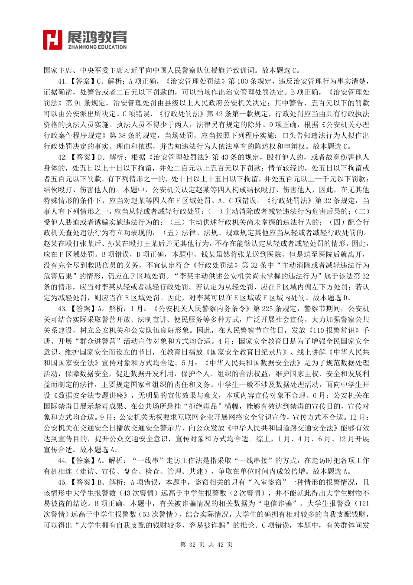

展开本页文字

第32 页共42 页
国家主席、中央军委主席习近平向中国人民警察队伍授旗并致训词。故本题选C。
41.【答案】C。解析：A 项正确，《治安管理处罚法》第100 条规定，违反治安管理行为事实清楚，
证据确凿，处警告或者二百元以下罚款的，可以当场作出治安管理处罚决定。B 项正确，《治安管理处
罚法》第91 条规定，治安管理处罚由县级以上人民政府公安机关决定；其中警告、五百元以下的罚款
可以由公安派出所决定。C 项错误，《行政处罚法》第42 条第一款规定，行政处罚应当由具有行政执法
资格的执法人员实施。执法人员不得少于两人，法律另有规定的除外。D 项正确，根据《公安机关办理
行政案件程序规定》第38 条的规定，当场处罚，应当按照下列程序实施：口头告知违法行为人拟作出
行政处罚决定的事实、理由和依据，并告知违法行为人依法享有的陈述权和申辩权。故本题选C。
42.【答案】D。解析：根据《治安管理处罚法》第43 条的规定，殴打他人的，或者故意伤害他人
身体的，处五日以上十日以下拘留，并处二百元以上五百元以下罚款；情节较轻的，处五日以下拘留或
者五百元以下罚款。有下列情形之一的，处十日以上十五日以下拘留，并处五百元以上一千元以下罚款：
结伙殴打、伤害他人的。本题中，公安机关认定赵某等四人构成结伙殴打、伤害他人，因此，在无其他
特殊情形的条件下，应当对赵某等四人在F 区域处罚。A、C 项错误，《行政处罚法》第32 条规定，当
事人有下列情形之一，应当从轻或者减轻行政处罚：（一）主动消除或者减轻违法行为危害后果的；（二）
受他人胁迫或者诱骗实施违法行为的；（三）主动供述行政机关尚未掌握的违法行为的；（四）配合行
政机关查处违法行为有立功表现的；（五）法律、法规、规章规定其他应当从轻或者减轻行政处罚的。
赵某在殴打张某后、孙某在殴打王某后并无其他行为，不存在能够认定从轻或者减轻处罚的情形，因此，
应在F 区域处罚。B 项错误，D 项正确，本题中，钱某虽然将张某送到医院，但是送至医院后就离开，
没有完全尽到救助伤员的义务，不宜认定符合《行政处罚法》第32 条中“主动消除或者减轻违法行为
危害后果”的情形，仍应在F 区域处罚。“李某主动供述公安机关尚未掌握的违法行为”属于该法第32
条的情形，应当对李某从轻或者减轻行政处罚。若认定为从轻处罚，应在F 区域内偏左下方处罚；若认
定为减轻处罚，则应当在E 区域处罚。因此，对李某可以在E 区域或F 区域内处罚。故本题选D。
43.【答案】A。解析：1 月：《公安机关人民警察内务条令》第225 条规定，警察节期间，公安机
关可结合实际采取警营开放、法制宣讲、便民服务等多种方式，广泛开展社会宣传，大力加强警察公共
关系建设，树立公安机关和公安队伍良好形象。因此，在人民警察节宣传日，发放《110 报警常识》手
册、开展“群众进警营”活动宣传对象和方式均合适。4 月：国家安全教育日是为了增强全民国家安全
意识、维护国家安全而设立的节日，在教育日播放《国家安全教育日纪录片》、线上讲解《中华人民共
和国国家安全法》宣传对象和方式均合适。5 月：《中华人民共和国数据安全法》是为了规范数据处理
活动，保障数据安全，促进数据开发利用，保护个人、组织的合法权益，维护国家主权、安全和发展利
益而制定的法律，主要规定国家和组织的责任和义务。中学生一般不涉及数据处理活动，面向中学生开
设《数据安全法专题讲座》，无明显的宣传效果与意义，本项内容宣传对象不合理。6 月：公安机关在
国际禁毒日展示禁毒成果、在公共场所悬挂“拒绝毒品”横幅，能够有效达到禁毒的宣传目的，宣传对
象和方式均合适。9 月：公安机关无权要求互联网企业开展网络安全常识宣传，宣传方式不合适。12 月：
公安机关在交通安全日播放交通安全警示片、向公众发放《中华人民共和国道路交通安全法》能够有效
达到宣传目的，提升公众交通安全意识，宣传对象和方式均合适。综上，1 月、4 月、6 月、12 月开展
宣传合适。故本题选A。
44.【答案】A。解析：“一线串”走访工作法是指采取“一线串接”的方式，在走访时把各项工作
有机相连（走访、宣传、盘查、检查、管理、共建），争取在单位时间内成效倍增。故本题选A。
45.【答案】B。解析：A 项错误，本题中，盗窃相关的只有“入室盗窃”一种情形的报警情况，且
该情形中大学生报警数（43 次警情）远高于中学生报警数（2 次警情），并不能就此得出大学生财物不
易被盗的结论。B 项正确，本题中，有关被诈骗情况的相关数据为“电信诈骗”，大学生报警数（121
次警情）远高于中学生报警数（53 次警情），结合实际情况，大学生的确拥有相对较多的自我支配钱财，
可以得出“大学生拥有自我支配的钱财较多，容易被诈骗”的推论。C 项错误，本题中，有关群体间发

### 原第33页

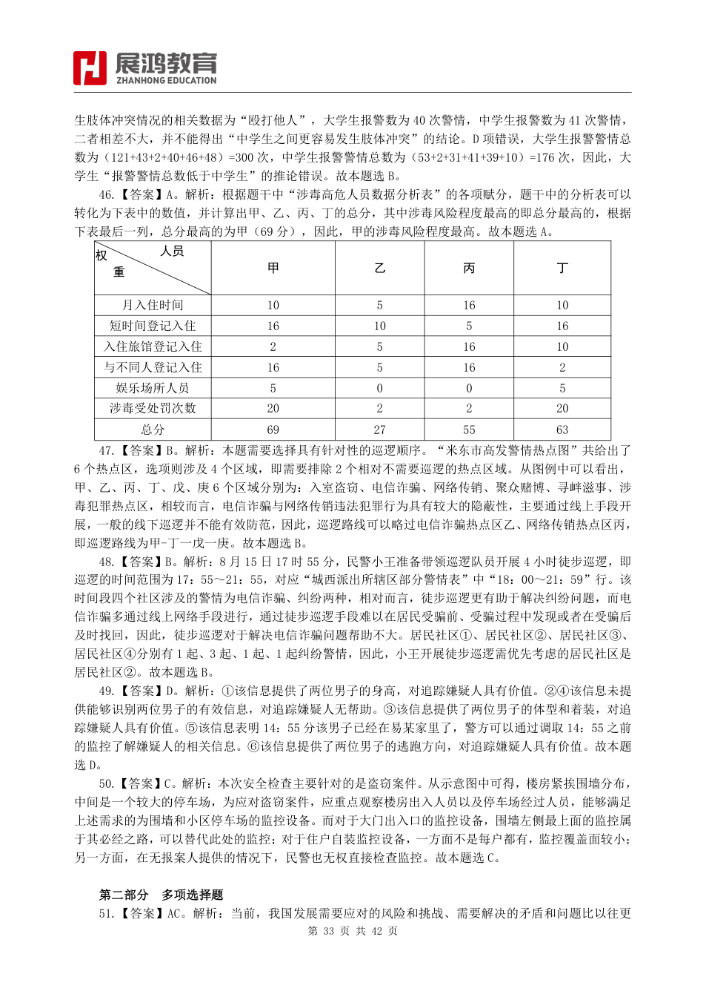

展开本页文字

第33 页共42 页
生肢体冲突情况的相关数据为“殴打他人”，大学生报警数为40 次警情，中学生报警数为41 次警情，
二者相差不大，并不能得出“中学生之间更容易发生肢体冲突”的结论。D 项错误，大学生报警警情总
数为（121+43+2+40+46+48）=300 次，中学生报警警情总数为（53+2+31+41+39+10）=176 次，因此，大
学生“报警警情总数低于中学生”的推论错误。故本题选B。
46.【答案】A。解析：根据题干中“涉毒高危人员数据分析表”的各项赋分，题干中的分析表可以
转化为下表中的数值，并计算出甲、乙、丙、丁的总分，其中涉毒风险程度最高的即总分最高的，根据
下表最后一列，总分最高的为甲（69 分），因此，甲的涉毒风险程度最高。故本题选A。
权
重
人员
甲
乙
丙
丁
月入住时间
10
5
16
10
短时间登记入住
16
10
5
16
入住旅馆登记入住
2
5
16
10
与不同人登记入住
16
5
16
2
娱乐场所人员
5
0
0
5
涉毒受处罚次数
20
2
2
20
总分
69
27
55
63
47.【答案】B。解析：本题需要选择具有针对性的巡逻顺序。“米东市高发警情热点图”共给出了
6 个热点区，选项则涉及4 个区域，即需要排除2 个相对不需要巡逻的热点区域。从图例中可以看出，
甲、乙、丙、丁、戊、庚6 个区域分别为：入室盗窃、电信诈骗、网络传销、聚众赌博、寻衅滋事、涉
毒犯罪热点区，相较而言，电信诈骗与网络传销违法犯罪行为具有较大的隐蔽性，主要通过线上手段开
展，一般的线下巡逻并不能有效防范，因此，巡逻路线可以略过电信诈骗热点区乙、网络传销热点区丙，
即巡逻路线为甲-丁一戊一庚。故本题选B。
48.【答案】B。解析：8 月15 日17 时55 分，民警小王准备带领巡逻队员开展4 小时徒步巡逻，即
巡逻的时间范围为17：55～21：55，对应“城西派出所辖区部分警情表”中“18：00～21：59”行。该
时间段四个社区涉及的警情为电信诈骗、纠纷两种，相对而言，徒步巡逻更有助于解决纠纷问题，而电
信诈骗多通过线上网络手段进行，通过徒步巡逻手段难以在居民受骗前、受骗过程中发现或者在受骗后
及时找回，因此，徒步巡逻对于解决电信诈骗问题帮助不大。居民社区①、居民社区②、居民社区③、
居民社区④分别有1 起、3 起、1 起、1 起纠纷警情，因此，小王开展徒步巡逻需优先考虑的居民社区是
居民社区②。故本题选B。
49.【答案】D。解析：①该信息提供了两位男子的身高，对追踪嫌疑人具有价值。②④该信息未提
供能够识别两位男子的有效信息，对追踪嫌疑人无帮助。③该信息提供了两位男子的体型和着装，对追
踪嫌疑人具有价值。⑤该信息表明14：55 分该男子已经在易某家里了，警方可以通过调取14：55 之前
的监控了解嫌疑人的相关信息。⑥该信息提供了两位男子的逃跑方向，对追踪嫌疑人具有价值。故本题
选D。
50.【答案】C。解析：本次安全检查主要针对的是盗窃案件。从示意图中可得，楼房紧挨围墙分布，
中间是一个较大的停车场，为应对盗窃案件，应重点观察楼房出入人员以及停车场经过人员，能够满足
上述需求的为围墙和小区停车场的监控设备。而对于大门出入口的监控设备，围墙左侧最上面的监控属
于其必经之路，可以替代此处的监控；对于住户自装监控设备，一方面不是每户都有，监控覆盖面较小；
另一方面，在无报案人提供的情况下，民警也无权直接检查监控。故本题选C。
第二部分
多项选择题
51.【答案】AC。解析：当前，我国发展需要应对的风险和挑战、需要解决的矛盾和问题比以往更

### 原第34页

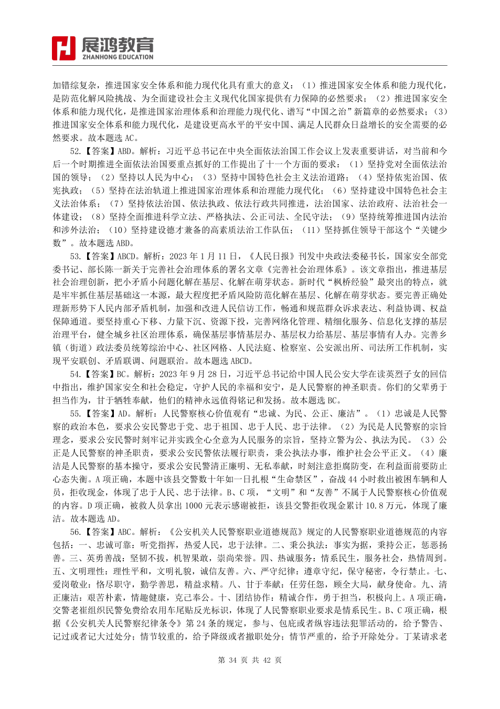

展开本页文字

第34 页共42 页
加错综复杂，推进国家安全体系和能力现代化具有重大的意义：（1）推进国家安全体系和能力现代化，
是防范化解风险挑战、为全面建设社会主义现代化国家提供有力保障的必然要求；（2）推进国家安全
体系和能力现代化，是推进国家治理体系和治理能力现代化、谱写“中国之治”新篇章的必然要求；（3）
推进国家安全体系和能力现代化，是建设更高水平的平安中国、满足人民群众日益增长的安全需要的必
然要求。故本题选AC。
52.【答案】ABD。解析：习近平总书记在中央全面依法治国工作会议上发表重要讲话，对当前和今
后一个时期推进全面依法治国要重点抓好的工作提出了十一个方面的要求：（1）坚持党对全面依法治
国的领导；（2）坚持以人民为中心；（3）坚持中国特色社会主义法治道路；（4）坚持依宪治国、依
宪执政；（5）坚持在法治轨道上推进国家治理体系和治理能力现代化；（6）坚持建设中国特色社会主
义法治体系；（7）坚持依法治国、依法执政、依法行政共同推进，法治国家、法治政府、法治社会一
体建设；（8）坚持全面推进科学立法、严格执法、公正司法、全民守法；（9）坚持统筹推进国内法治
和涉外法治；（10）坚持建设德才兼备的高素质法治工作队伍；（11）坚持抓住领导干部这个“关键少
数”。故本题选ABD。
53.【答案】ABCD。解析：2023 年1 月11 日，《人民日报》刊发中央政法委秘书长，国家安全部党
委书记、部长陈一新关于完善社会治理体系的署名文章《完善社会治理体系》。该文章指出，推进基层
社会治理创新，把小矛盾小问题化解在基层、化解在萌芽状态。新时代“枫桥经验”最突出的特点，就
是牢牢抓住基层基础这一本源，最大程度把矛盾风险防范化解在基层、化解在萌芽状态。要完善正确处
理新形势下人民内部矛盾机制，加强和改进人民信访工作，畅通和规范群众诉求表达、利益协调、权益
保障通道。要坚持重心下移、力量下沉、资源下投，完善网络化管理、精细化服务、信息化支撑的基层
治理平台，健全城乡社区治理体系，确保基层事情基层办、基层权力给基层、基层事情有人办。完善乡
镇（街道）政法委员统筹综治中心、社区网格、人民法庭、检察室、公安派出所、司法所工作机制，实
现平安联创、矛盾联调、问题联治。故本题选ABCD。
54.【答案】BC。解析：2023 年9 月28 日，习近平总书记给中国人民公安大学在读英烈子女的回信
中指出，维护国家安全和社会稳定，守护人民的幸福和安宁，是人民警察的神圣职责。你们的父辈勇于
担当作为，甘于牺牲奉献，他们的精神永远值得铭记和发扬。故本题选BC。
55.【答案】AD。解析：人民警察核心价值观有“忠诚、为民、公正、廉洁”。（1）忠诚是人民警
察的政治本色，要求公安民警忠于党、忠于祖国、忠于人民、忠于法律。（2）为民是人民警察的宗旨
理念，要求公安民警时刻牢记并实践全心全意为人民服务的宗旨，坚持立警为公、执法为民。（3）公
正是人民警察的神圣职责，要求公安民警依法履行职责，秉公执法办事，维护社会公平正义。（4）廉
洁是人民警察的基本操守，要求公安民警清正廉明、无私奉献，时刻注意拒腐防变，在利益面前要防止
心态失衡。A 项正确，本题中该县交警数十年如一日扎根“生命禁区”，奋战44 小时救出被困车辆和人
员，拒收现金，体现了忠于人民、忠于法律。B、C 项，“文明”和“友善”不属于人民警察核心价值观
的内容。D 项正确，被救人员拿出1000 元表示感谢被拒，该县交警拒收现金累计10.8 万元，体现了廉
洁。故本题选AD。
56.【答案】ABC。解析：《公安机关人民警察职业道德规范》规定的人民警察职业道德规范的内容
包括：一、忠诚可靠：听党指挥，热爱人民，忠于法律。二、秉公执法：事实为据，秉持公正，惩恶扬
善。三、英勇善战：坚韧不拔，机智果敢，崇尚荣誉。四、热诚服务：情系民生，服务社会，热情周到。
五、文明理性：理性平和，文明礼貌，诚信友善。六、严守纪律：遵章守纪，保守秘密，令行禁止。七、
爱岗敬业：恪尽职守，勤学善思，精益求精。八、甘于奉献：任劳任怨，顾全大局，献身使命。九、清
正廉洁：艰苦朴素，情趣健康，克己奉公。十、团结协作：精诚合作，勇于担当，积极向上。A 项正确，
交警老崔组织民警免费给农用车尾贴反光标识，体现了人民警察职业要求是情系民生。B、C 项正确，根
据《公安机关人民警察纪律条令》第24 条的规定，参与、包庇或者纵容违法犯罪活动的，给予警告、
记过或者记大过处分；情节较重的，给予降级或者撤职处分；情节严重的，给予开除处分。丁某请求老

### 原第35页

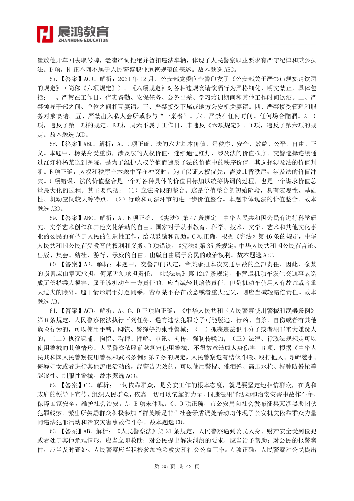

展开本页文字

第35 页共42 页
崔放他开车回去取号牌，老崔严词拒绝并暂扣违法车辆，体现了人民警察职业要求有严守纪律和秉公执
法。D 项，刚正不阿不属于人民警察职业道德规范的表述。故本题选ABC。
57.【答案】ACD。解析：2021 年12 月，公安部党委向全警印发了《公安部关于严禁违规宴请饮酒
的规定》（简称《六项规定》）。《六项规定》对各种违规宴请饮酒行为严格细化、明文禁止，具体包
括：一、严禁在工作日、值班备勤、安保任务、公务出差、学习培训期间和其他工作时间饮酒。二、严
禁领导干部之间、单位之间相互宴请。三、严禁接受下属或地方公安机关宴请。四、严禁接受管理和服
务对象宴请。五、严禁出入私人会所或参与“一桌餐”。六、严禁在任何时间、任何场合酗酒。A、C
项，违反了第一项的规定。B 项，周六不属于工作日，未违反《六项规定》。D 项，违反了第六项的规
定。故本题选ACD。
58.【答案】ABD。解析：A、D 项正确，法的六大基本价值，是秩序、安全、效益、公平、自由、正
义。本题中，杨某身受重伤，涉及法的人权价值；连续通过红灯，涉及法的价值秩序。交警选择连续通
过红灯将杨某送到医院，是为了维护人权价值而违反了法的价值中的秩序价值，其选择涉及法的价值判
断。B 项正确，人权和秩序在本题中存在冲突时，为了保证人权优先，需要违背秩序，涉及法的价值冲
突。C 项错误，法的价值整合是一个对各种具体的价值目标加以统筹协调的过程，也是一个谋求价值总
量最大化的过程。其主要包括：（1）立法阶段的整合。这是价值整合的初始阶段，具有宏观性、基础
性、机动空间较大等特点。（2）行政和司法环节的进一步价值整合。本题未体现法的价值整合。故本
题选ABD。
59.【答案】ABC。解析：A、B 项正确，《宪法》第47 条规定，中华人民共和国公民有进行科学研
究、文学艺术创作和其他文化活动的自由。国家对于从事教育、科学、技术、文学、艺术和其他文化事
业的公民的有益于人民的创造性工作，给以鼓励和帮助。C 项正确，根据《宪法》第46 条的规定，中华
人民共和国公民有受教育的权利和义务。D 项错误，《宪法》第35 条规定，中华人民共和国公民有言论、
出版、集会、结社、游行、示威的自由。出版自由属于公民的政治权利。故本题选ABC。
60.【答案】AB。解析：本题中，交警部门认定，章某承担本次交通事故的全部责任，因此，余某
的损害应由章某承担，何某无须承担责任。《民法典》第1217 条规定，非营运机动车发生交通事故造
成无偿搭乘人损害，属于该机动车一方责任的，应当减轻其赔偿责任，但是机动车使用人有故意或者重
大过失的除外。题干情形属于好意同乘，若章某不存在故意或者重大过失，则应当减轻赔偿责任。故本
题选AB。
61.【答案】ACD。解析：A、C、D 三项均正确，《中华人民共和国人民警察使用警械和武器条例》
第8 条规定，人民警察依法执行下列任务，遇有违法犯罪分子可能脱逃、行凶、自杀、自伤或者有其他
危险行为的，可以使用手铐、脚镣、警绳等约束性警械：（一）抓获违法犯罪分子或者犯罪重大嫌疑人
的；（二）执行逮捕、拘留、看押、押解、审讯、拘传、强制传唤的；（三）法律、行政法规规定可以
使用警械的其他情形。人民警察依照前款规定使用警械，不得故意造成人身伤害。B 项，根据《中华人
民共和国人民警察使用警械和武器条例》第7 条的规定，人民警察遇有结伙斗殴、殴打他人、寻衅滋事、
侮辱妇女或者进行其他流氓活动的，经警告无效的，可以使用警棍、催泪弹、高压水枪、特种防暴枪等
驱逐性、制服性警械。故本题选ACD。
62.【答案】CD。解析：一切依靠群众，是公安工作的根本态度，就是要坚定地相信群众，在党和
政府的领导下宣传、组织人民群众，依靠一切可以依靠的力量，同违法犯罪活动和治安灾害事故作斗争，
保障国家安全，维护社会治安。A、B 项未体现。C、D 项正确，市公安局向社会发布征集某涉黑恶团伙
犯罪线索、派出所鼓励群众积极参加“群英断是非”社会矛盾调处活动均体现了公安机关依靠群众力量
同违法犯罪活动和治安灾害事故作斗争。故本题选CD。
63.【答案】AB。解析：《人民警察法》第21 条规定，人民警察遇到公民人身、财产安全受到侵犯
或者处于其他危难情形，应当立即救助；对公民提出解决纠纷的要求，应当给予帮助；对公民的报警案
件，应当及时查处。人民警察应当积极参加抢险救灾和社会公益工作。A 项正确，人民警察对公民提出

### 原第36页

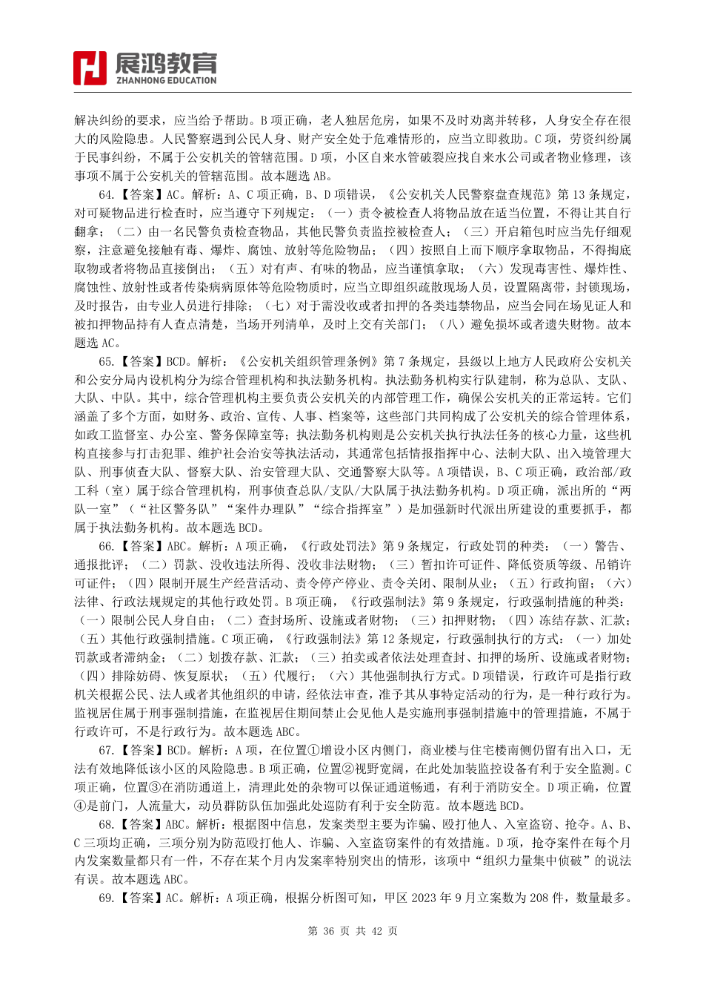

展开本页文字

第36 页共42 页
解决纠纷的要求，应当给予帮助。B 项正确，老人独居危房，如果不及时劝离并转移，人身安全存在很
大的风险隐患。人民警察遇到公民人身、财产安全处于危难情形的，应当立即救助。C 项，劳资纠纷属
于民事纠纷，不属于公安机关的管辖范围。D 项，小区自来水管破裂应找自来水公司或者物业修理，该
事项不属于公安机关的管辖范围。故本题选AB。
64.【答案】AC。解析：A、C 项正确，B、D 项错误，《公安机关人民警察盘查规范》第13 条规定，
对可疑物品进行检查时，应当遵守下列规定：（一）责令被检查人将物品放在适当位置，不得让其自行
翻拿；（二）由一名民警负责检查物品，其他民警负责监控被检查人；（三）开启箱包时应当先仔细观
察，注意避免接触有毒、爆炸、腐蚀、放射等危险物品；（四）按照自上而下顺序拿取物品，不得掏底
取物或者将物品直接倒出；（五）对有声、有味的物品，应当谨慎拿取；（六）发现毒害性、爆炸性、
腐蚀性、放射性或者传染病病原体等危险物质时，应当立即组织疏散现场人员，设置隔离带，封锁现场，
及时报告，由专业人员进行排除；（七）对于需没收或者扣押的各类违禁物品，应当会同在场见证人和
被扣押物品持有人查点清楚，当场开列清单，及时上交有关部门；（八）避免损坏或者遗失财物。故本
题选AC。
65.【答案】BCD。解析：《公安机关组织管理条例》第7 条规定，县级以上地方人民政府公安机关
和公安分局内设机构分为综合管理机构和执法勤务机构。执法勤务机构实行队建制，称为总队、支队、
大队、中队。其中，综合管理机构主要负责公安机关的内部管理工作，确保公安机关的正常运转。它们
涵盖了多个方面，如财务、政治、宣传、人事、档案等，这些部门共同构成了公安机关的综合管理体系，
如政工监督室、办公室、警务保障室等；执法勤务机构则是公安机关执行执法任务的核心力量，这些机
构直接参与打击犯罪、维护社会治安等执法活动，其通常包括情报指挥中心、法制大队、出入境管理大
队、刑事侦查大队、督察大队、治安管理大队、交通警察大队等。A 项错误，B、C 项正确，政治部/政
工科（室）属于综合管理机构，刑事侦查总队/支队/大队属于执法勤务机构。D 项正确，派出所的“两
队一室”（“社区警务队”“案件办理队”“综合指挥室”）是加强新时代派出所建设的重要抓手，都
属于执法勤务机构。故本题选BCD。
66.【答案】ABC。解析：A 项正确，《行政处罚法》第9 条规定，行政处罚的种类：（一）警告、
通报批评；（二）罚款、没收违法所得、没收非法财物；（三）暂扣许可证件、降低资质等级、吊销许
可证件；（四）限制开展生产经营活动、责令停产停业、责令关闭、限制从业；（五）行政拘留；（六）
法律、行政法规规定的其他行政处罚。B 项正确，《行政强制法》第9 条规定，行政强制措施的种类：
（一）限制公民人身自由；（二）查封场所、设施或者财物；（三）扣押财物；（四）冻结存款、汇款；
（五）其他行政强制措施。C 项正确，《行政强制法》第12 条规定，行政强制执行的方式：（一）加处
罚款或者滞纳金；（二）划拨存款、汇款；（三）拍卖或者依法处理查封、扣押的场所、设施或者财物；
（四）排除妨碍、恢复原状；（五）代履行；（六）其他强制执行方式。D 项错误，行政许可是指行政
机关根据公民、法人或者其他组织的申请，经依法审查，准予其从事特定活动的行为，是一种行政行为。
监视居住属于刑事强制措施，在监视居住期间禁止会见他人是实施刑事强制措施中的管理措施，不属于
行政许可，不是行政行为。故本题选ABC。
67.【答案】BCD。解析：A 项，在位置①增设小区内侧门，商业楼与住宅楼南侧仍留有出入口，无
法有效地降低该小区的风险隐患。B 项正确，位置②视野宽阔，在此处加装监控设备有利于安全监测。C
项正确，位置③在消防通道上，清理此处的杂物可以保证通道畅通，有利于消防安全。D 项正确，位置
④是前门，人流量大，动员群防队伍加强此处巡防有利于安全防范。故本题选BCD。
68.【答案】ABC。解析：根据图中信息，发案类型主要为诈骗、殴打他人、入室盗窃、抢夺。A、B、
C 三项均正确，三项分别为防范殴打他人、诈骗、入室盗窃案件的有效措施。D 项，抢夺案件在每个月
内发案数量都只有一件，不存在某个月内发案率特别突出的情形，该项中“组织力量集中侦破”的说法
有误。故本题选ABC。
69.【答案】AC。解析：A 项正确，根据分析图可知，甲区2023 年9 月立案数为208 件，数量最多。

### 原第37页

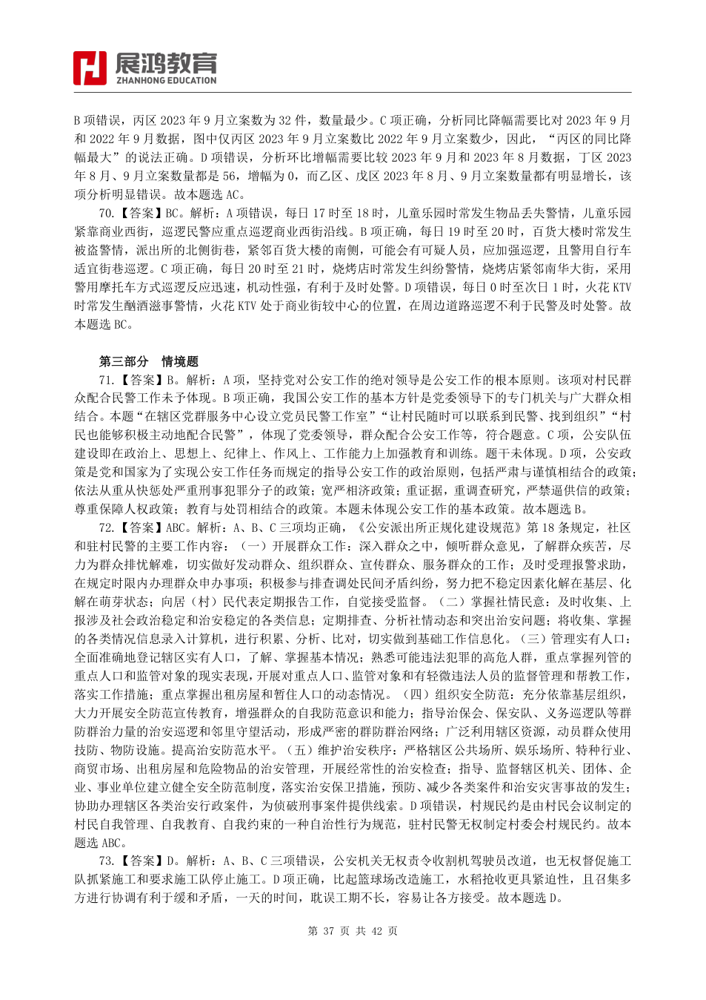

展开本页文字

第37 页共42 页
B 项错误，丙区2023 年9 月立案数为32 件，数量最少。C 项正确，分析同比降幅需要比对2023 年9 月
和2022 年9 月数据，图中仅丙区2023 年9 月立案数比2022 年9 月立案数少，因此，“丙区的同比降
幅最大”的说法正确。D 项错误，分析环比增幅需要比较2023 年9 月和2023 年8 月数据，丁区2023
年8 月、9 月立案数量都是56，增幅为0，而乙区、戊区2023 年8 月、9 月立案数量都有明显增长，该
项分析明显错误。故本题选AC。
70.【答案】BC。解析：A 项错误，每日17 时至18 时，儿童乐园时常发生物品丢失警情，儿童乐园
紧靠商业西街，巡逻民警应重点巡逻商业西街沿线。B 项正确，每日19 时至20 时，百货大楼时常发生
被盗警情，派出所的北侧街巷，紧邻百货大楼的南侧，可能会有可疑人员，应加强巡逻，且警用自行车
适宜街巷巡逻。C 项正确，每日20 时至21 时，烧烤店时常发生纠纷警情，烧烤店紧邻南华大街，采用
警用摩托车方式巡逻反应迅速，机动性强，有利于及时处警。D 项错误，每日0 时至次日1 时，火花KTV
时常发生酗酒滋事警情，火花KTV 处于商业街较中心的位置，在周边道路巡逻不利于民警及时处警。故
本题选BC。
第三部分
情境题
71.【答案】B。解析：A 项，坚持党对公安工作的绝对领导是公安工作的根本原则。该项对村民群
众配合民警工作未予体现。B 项正确，我国公安工作的基本方针是党委领导下的专门机关与广大群众相
结合。本题“在辖区党群服务中心设立党员民警工作室”“让村民随时可以联系到民警、找到组织”“村
民也能够积极主动地配合民警”，体现了党委领导，群众配合公安工作等，符合题意。C 项，公安队伍
建设即在政治上、思想上、纪律上、作风上、工作能力上加强教育和训练。题干未体现。D 项，公安政
策是党和国家为了实现公安工作任务而规定的指导公安工作的政治原则，包括严肃与谨慎相结合的政策；
依法从重从快惩处严重刑事犯罪分子的政策；宽严相济政策；重证据，重调查研究，严禁逼供信的政策；
尊重保障人权政策；教育与处罚相结合的政策。本题未体现公安工作的基本政策。故本题选B。
72.【答案】ABC。解析：A、B、C 三项均正确，《公安派出所正规化建设规范》第18 条规定，社区
和驻村民警的主要工作内容：（一）开展群众工作：深入群众之中，倾听群众意见，了解群众疾苦，尽
力为群众排忧解难，切实做好发动群众、组织群众、宣传群众、服务群众的工作；及时受理报警求助，
在规定时限内办理群众申办事项；积极参与排查调处民间矛盾纠纷，努力把不稳定因素化解在基层、化
解在萌芽状态；向居（村）民代表定期报告工作，自觉接受监督。（二）掌握社情民意：及时收集、上
报涉及社会政治稳定和治安稳定的各类信息；定期排查、分析社情动态和突出治安问题；将收集、掌握
的各类情况信息录入计算机，进行积累、分析、比对，切实做到基础工作信息化。（三）管理实有人口：
全面准确地登记辖区实有人口，了解、掌握基本情况；熟悉可能违法犯罪的高危人群，重点掌握列管的
重点人口和监管对象的现实表现，开展对重点人口、监管对象和有轻微违法人员的监督管理和帮教工作，
落实工作措施；重点掌握出租房屋和暂住人口的动态情况。（四）组织安全防范：充分依靠基层组织，
大力开展安全防范宣传教育，增强群众的自我防范意识和能力；指导治保会、保安队、义务巡逻队等群
防群治力量的治安巡逻和邻里守望活动，形成严密的群防群治网络；广泛利用辖区资源，动员群众使用
技防、物防设施。提高治安防范水平。（五）维护治安秩序：严格辖区公共场所、娱乐场所、特种行业、
商贸市场、出租房屋和危险物品的治安管理，开展经常性的治安检查；指导、监督辖区机关、团体、企
业、事业单位建立健全安全防范制度，落实治安保卫措施，预防、减少各类案件和治安灾害事故的发生；
协助办理辖区各类治安行政案件，为侦破刑事案件提供线索。D 项错误，村规民约是由村民会议制定的
村民自我管理、自我教育、自我约束的一种自治性行为规范，驻村民警无权制定村委会村规民约。故本
题选ABC。
73.【答案】D。解析：A、B、C 三项错误，公安机关无权责令收割机驾驶员改道，也无权督促施工
队抓紧施工和要求施工队停止施工。D 项正确，比起篮球场改造施工，水稻抢收更具紧迫性，且召集多
方进行协调有利于缓和矛盾，一天的时间，耽误工期不长，容易让各方接受。故本题选D。

### 原第38页

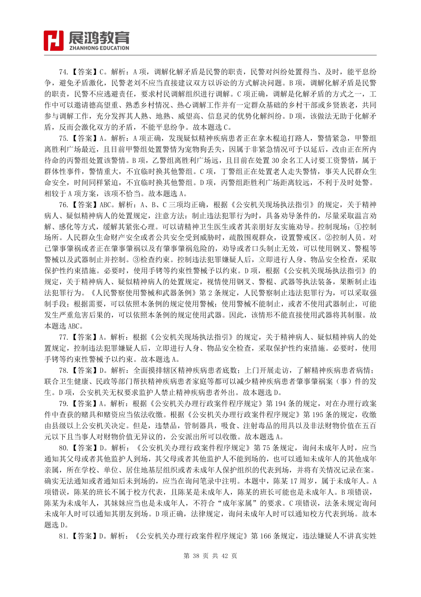

展开本页文字

第38 页共42 页
74.【答案】C。解析：A 项，调解化解矛盾是民警的职责，民警对纠纷处置得当、及时，能平息纷
争，避免矛盾激化，民警老刘不应当直接建议双方以诉讼的方式解决问题。B 项，调解化解矛盾是民警
的职责，民警不应逃避责任，要求村民调解组织进行调解。C 项正确，调解是化解矛盾的方式之一，工
作中可以邀请德高望重、熟悉乡村情况、热心调解工作并有一定群众基础的乡村干部或乡贤族老，共同
参与调解工作，充分发挥其人熟、地熟、威望高、信息灵的优势化解纠纷。D 项，该做法无助于化解矛
盾，反而会激化双方的矛盾，不能平息纷争。故本题选C。
75.【答案】A。解析：A 项正确，发现疑似精神疾病患者正在拿木棍追打路人，警情紧急，甲警组
离胜利广场最近，且目前甲警组处置警情为宠物狗丢失，因属于非紧急情况可予以延后，改由正在所内
待命的丙警组处置该警情。B 项，乙警组离胜利广场远，且目前在处置30 余名工人讨要工资警情，属于
群体性事件，警情重大，不宜临时换其他警组。C 项，丁警组正在处置老人走失警情，事关人民群众生
命安全，时间同样紧迫，不宜临时换其他警组。D 项，丙警组距胜利广场距离较远，不利于及时处警。
相较于A 项方案，该项不恰当。故本题选A。
76.【答案】ABC。解析：A、B、C 三项均正确，根据《公安机关现场执法指引》的规定，关于精神
病人、疑似精神病人的处置规定，注意方法：制止违法犯罪行为时，具备劝导条件的，尽量采取温言劝
解、感化等方式，缓解其紧张心理。可以请精神卫生医生或者其亲朋好友实施劝导。控制现场：①控制
场所。人民群众生命财产安全或者公共安全受到威胁时，疏散围观群众，设置警戒区。②控制人员。对
已肇事肇祸或者正在肇事肇祸以及有肇事肇祸危险的，劝导或者口头制止无效，可以使用钢叉、警棍等
警械以及武器制止并控制。③检查约束。控制违法犯罪嫌疑人后，立即进行人身、物品安全检查，采取
保护性约束措施。必要时，使用手铐等约束性警械予以约束。D 项，根据《公安机关现场执法指引》的
规定，关于精神病人、疑似精神病人的处置规定，视情使用钢叉、警棍、武器等执法装备，果断制止违
法犯罪行为。《人民警察使用警械和武器条例》第2 条规定，人民警察制止违法犯罪行为，可以采取强
制手段；根据需要，可以依照本条例的规定使用警械；使用警械不能制止，或者不使用武器制止，可能
发生严重危害后果的，可以依照本条例的规定使用武器。因此，该情形不能直接使用武器将其制服。故
本题选ABC。
77.【答案】A。解析：根据《公安机关现场执法指引》的规定，关于精神病人、疑似精神病人的处
置规定，控制违法犯罪嫌疑人后，立即进行人身、物品安全检查，采取保护性约束措施。必要时，使用
手铐等约束性警械予以约束。故本题选A。
78.【答案】D。解析：全面摸排辖区精神疾病患者底数；上门开展走访，了解精神疾病患者病情；
联合卫生健康、民政等部门帮扶精神疾病患者家庭等都可以减少精神疾病患者肇事肇祸案（事）件的发
生。D 项，公安机关无权要求监护人禁止精神疾病患者外出。故本题选D。
79.【答案】A。解析：根据《公安机关办理行政案件程序规定》第194 条的规定，对在办理行政案
件中查获的赌具和赌资应当依法收缴。根据《公安机关办理行政案件程序规定》第195 条的规定，收缴
由县级以上公安机关决定。但是，违禁品，管制器具，吸食、注射毒品的用具以及非法财物价值在五百
元以下且当事人对财物价值无异议的，公安派出所可以收缴。故本题选A。
80.【答案】D。解析：《公安机关办理行政案件程序规定》第75 条规定，询问未成年人时，应当
通知其父母或者其他监护人到场，其父母或者其他监护人不能到场的，也可以通知未成年人的其他成年
亲属，所在学校、单位、居住地基层组织或者未成年人保护组织的代表到场，并将有关情况记录在案。
确实无法通知或者通知后未到场的，应当在询问笔录中注明。本题中，陈某17 周岁，属于未成年人。A
项错误，陈某的班长不属于校方代表，且陈某是未成年人，陈某的班长可能也是未成年人。B 项错误，
陈某为未成年人，其妹妹应当也是未成年人，不符合“成年家属”的要求。C 项错误，法条未规定询问
未成年人时可以通知其朋友到场。D 项正确，法律规定，询问未成年人时可以通知校方代表到场。故本
题选D。
81.【答案】D。解析：《公安机关办理行政案件程序规定》第166 条规定，违法嫌疑人不讲真实姓

### 原第39页

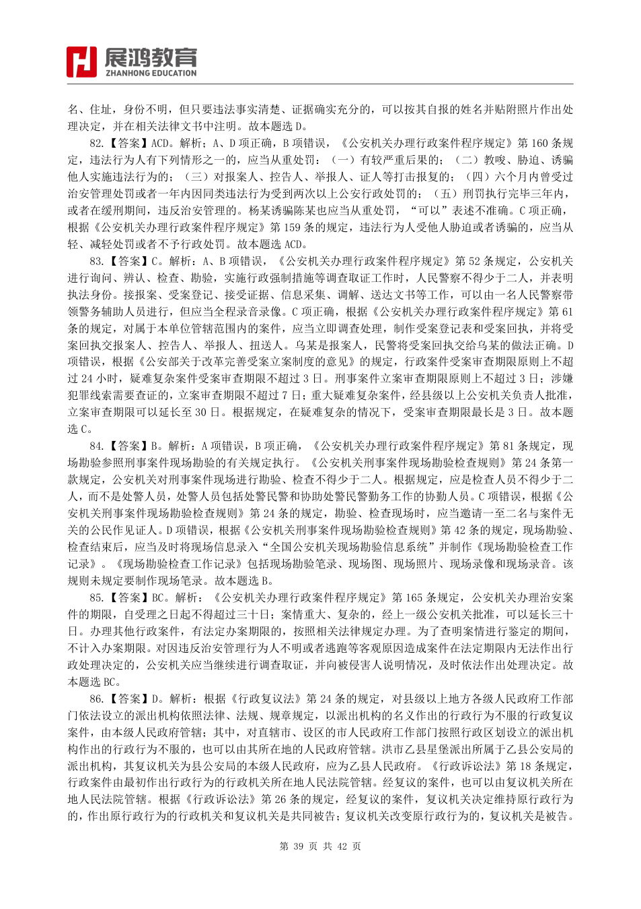

展开本页文字

第39 页共42 页
名、住址，身份不明，但只要违法事实清楚、证据确实充分的，可以按其自报的姓名并贴附照片作出处
理决定，并在相关法律文书中注明。故本题选D。
82.【答案】ACD。解析；A、D 项正确，B 项错误，《公安机关办理行政案件程序规定》第160 条规
定，违法行为人有下列情形之一的，应当从重处罚：（一）有较严重后果的；（二）教唆、胁迫、诱骗
他人实施违法行为的；（三）对报案人、控告人、举报人、证人等打击报复的；（四）六个月内曾受过
治安管理处罚或者一年内因同类违法行为受到两次以上公安行政处罚的；（五）刑罚执行完毕三年内，
或者在缓刑期间，违反治安管理的。杨某诱骗陈某也应当从重处罚，“可以”表述不准确。C 项正确，
根据《公安机关办理行政案件程序规定》第159 条的规定，违法行为人受他人胁迫或者诱骗的，应当从
轻、减轻处罚或者不予行政处罚。故本题选ACD。
83.【答案】C。解析：A、B 项错误，《公安机关办理行政案件程序规定》第52 条规定，公安机关
进行询问、辨认、检查、勘验，实施行政强制措施等调查取证工作时，人民警察不得少于二人，并表明
执法身份。接报案、受案登记、接受证据、信息采集、调解、送达文书等工作，可以由一名人民警察带
领警务辅助人员进行，但应当全程录音录像。C 项正确，根据《公安机关办理行政案件程序规定》第61
条的规定，对属于本单位管辖范围内的案件，应当立即调查处理，制作受案登记表和受案回执，并将受
案回执交报案人、控告人、举报人、扭送人。乌某是报案人，民警将受案回执交给乌某的做法正确。D
项错误，根据《公安部关于改革完善受案立案制度的意见》的规定，行政案件受案审查期限原则上不超
过24 小时，疑难复杂案件受案审查期限不超过3 日。刑事案件立案审查期限原则上不超过3 日；涉嫌
犯罪线索需要查证的，立案审查期限不超过7 日；重大疑难复杂案件，经县级以上公安机关负责人批准，
立案审查期限可以延长至30 日。根据规定，在疑难复杂的情况下，受案审查期限最长是3 日。故本题
选C。
84.【答案】B。解析：A 项错误，B 项正确，《公安机关办理行政案件程序规定》第81 条规定，现
场勘验参照刑事案件现场勘验的有关规定执行。《公安机关刑事案件现场勘验检查规则》第24 条第一
款规定，公安机关对刑事案件现场进行勘验、检查不得少于二人。根据规定，应是检查人员不得少于二
人，而不是处警人员，处警人员包括处警民警和协助处警民警勤务工作的协勤人员。C 项错误，根据《公
安机关刑事案件现场勘验检查规则》第24 条的规定，勘验、检查现场时，应当邀请一至二名与案件无
关的公民作见证人。D 项错误，根据《公安机关刑事案件现场勘验检查规则》第42 条的规定，现场勘验、
检查结束后，应当及时将现场信息录入“全国公安机关现场勘验信息系统”并制作《现场勘验检查工作
记录》。《现场勘验检查工作记录》包括现场勘验笔录、现场图、现场照片、现场录像和现场录音。该
规则未规定要制作现场笔录。故本题选B。
85.【答案】BC。解析：《公安机关办理行政案件程序规定》第165 条规定，公安机关办理治安案
件的期限，自受理之日起不得超过三十日；案情重大、复杂的，经上一级公安机关批准，可以延长三十
日。办理其他行政案件，有法定办案期限的，按照相关法律规定办理。为了查明案情进行鉴定的期间，
不计入办案期限。对因违反治安管理行为人不明或者逃跑等客观原因造成案件在法定期限内无法作出行
政处理决定的，公安机关应当继续进行调查取证，并向被侵害人说明情况，及时依法作出处理决定。故
本题选BC。
86.【答案】D。解析：根据《行政复议法》第24 条的规定，对县级以上地方各级人民政府工作部
门依法设立的派出机构依照法律、法规、规章规定，以派出机构的名义作出的行政行为不服的行政复议
案件，由本级人民政府管辖；其中，对直辖市、设区的市人民政府工作部门按照行政区划设立的派出机
构作出的行政行为不服的，也可以由其所在地的人民政府管辖。洪市乙县星堡派出所属于乙县公安局的
派出机构，其复议机关为县公安局的本级人民政府，应为乙县人民政府。《行政诉讼法》第18 条规定，
行政案件由最初作出行政行为的行政机关所在地人民法院管辖。经复议的案件，也可以由复议机关所在
地人民法院管辖。根据《行政诉讼法》第26 条的规定，经复议的案件，复议机关决定维持原行政行为
的，作出原行政行为的行政机关和复议机关是共同被告；复议机关改变原行政行为的，复议机关是被告。

### 原第40页

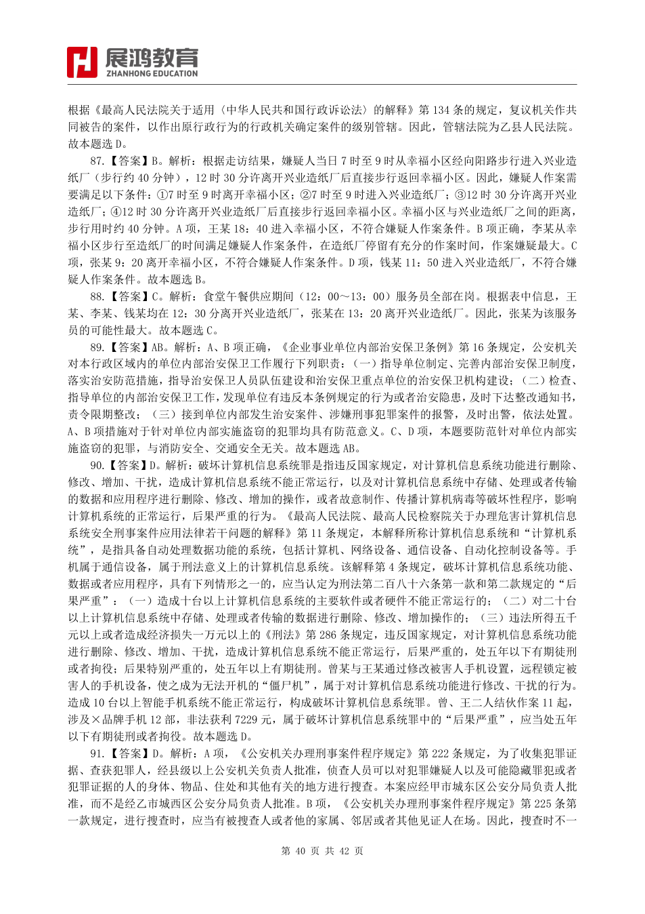

展开本页文字

第40 页共42 页
根据《最高人民法院关于适用〈中华人民共和国行政诉讼法〉的解释》第134 条的规定，复议机关作共
同被告的案件，以作出原行政行为的行政机关确定案件的级别管辖。因此，管辖法院为乙县人民法院。
故本题选D。
87.【答案】B。解析：根据走访结果，嫌疑人当日7 时至9 时从幸福小区经向阳路步行进入兴业造
纸厂（步行约40 分钟），12 时30 分许离开兴业造纸厂后直接步行返回幸福小区。因此，嫌疑人作案需
要满足以下条件：①7 时至9 时离开幸福小区；②7 时至9 时进入兴业造纸厂；③12 时30 分许离开兴业
造纸厂；④12 时30 分许离开兴业造纸厂后直接步行返回幸福小区。幸福小区与兴业造纸厂之间的距离，
步行用时约40 分钟。A 项，王某18：40 进入幸福小区，不符合嫌疑人作案条件。B 项正确，李某从幸
福小区步行至造纸厂的时间满足嫌疑人作案条件，在造纸厂停留有充分的作案时间，作案嫌疑最大。C
项，张某9：20 离开幸福小区，不符合嫌疑人作案条件。D 项，钱某11：50 进入兴业造纸厂，不符合嫌
疑人作案条件。故本题选B。
88.【答案】C。解析：食堂午餐供应期间（12：00～13：00）服务员全部在岗。根据表中信息，王
某、李某、钱某均在12：30 分离开兴业造纸厂，张某在13：20 离开兴业造纸厂。因此，张某为该服务
员的可能性最大。故本题选C。
89.【答案】AB。解析：A、B 项正确，《企业事业单位内部治安保卫条例》第16 条规定，公安机关
对本行政区域内的单位内部治安保卫工作履行下列职责：（一）指导单位制定、完善内部治安保卫制度，
落实治安防范措施，指导治安保卫人员队伍建设和治安保卫重点单位的治安保卫机构建设；（二）检查、
指导单位的内部治安保卫工作，发现单位有违反本条例规定的行为或者治安隐患，及时下达整改通知书，
责令限期整改；（三）接到单位内部发生治安案件、涉嫌刑事犯罪案件的报警，及时出警，依法处置。
A、B 项措施对于针对单位内部实施盗窃的犯罪均具有防范意义。C、D 项，本题要防范针对单位内部实
施盗窃的犯罪，与消防安全、交通安全无关。故本题选AB。
90.【答案】D。解析：破坏计算机信息系统罪是指违反国家规定，对计算机信息系统功能进行删除、
修改、增加、干扰，造成计算机信息系统不能正常运行，以及对计算机信息系统中存储、处理或者传输
的数据和应用程序进行删除、修改、增加的操作，或者故意制作、传播计算机病毒等破坏性程序，影响
计算机系统的正常运行，后果严重的行为。《最高人民法院、最高人民检察院关于办理危害计算机信息
系统安全刑事案件应用法律若干问题的解释》第11 条规定，本解释所称计算机信息系统和“计算机系
统”，是指具备自动处理数据功能的系统，包括计算机、网络设备、通信设备、自动化控制设备等。手
机属于通信设备，属于刑法意义上的计算机信息系统。该解释第4 条规定，破坏计算机信息系统功能、
数据或者应用程序，具有下列情形之一的，应当认定为刑法第二百八十六条第一款和第二款规定的“后
果严重”：（一）造成十台以上计算机信息系统的主要软件或者硬件不能正常运行的；（二）对二十台
以上计算机信息系统中存储、处理或者传输的数据进行删除、修改、增加操作的；（三）违法所得五千
元以上或者造成经济损失一万元以上的《刑法》第286 条规定，违反国家规定，对计算机信息系统功能
进行删除、修改、增加、干扰，造成计算机信息系统不能正常运行，后果严重的，处五年以下有期徒刑
或者拘役；后果特别严重的，处五年以上有期徒刑。曾某与王某通过修改被害人手机设置，远程锁定被
害人的手机设备，使之成为无法开机的“僵尸机”，属于对计算机信息系统功能进行修改、干扰的行为。
造成10 台以上智能手机系统不能正常运行，构成破坏计算机信息系统罪。曾、王二人结伙作案11 起，
涉及×品牌手机12 部，非法获利7229 元，属于破坏计算机信息系统罪中的“后果严重”，应当处五年
以下有期徒刑或者拘役。故本题选D。
91.【答案】D。解析：A 项，《公安机关办理刑事案件程序规定》第222 条规定，为了收集犯罪证
据、查获犯罪人，经县级以上公安机关负责人批准，侦查人员可以对犯罪嫌疑人以及可能隐藏罪犯或者
犯罪证据的人的身体、物品、住处和其他有关的地方进行搜查。本案应经甲市城东区公安分局负责人批
准，而不是经乙市城西区公安分局负责人批准。B 项，《公安机关办理刑事案件程序规定》第225 条第
一款规定，进行搜查时，应当有被搜查人或者他的家属、邻居或者其他见证人在场。因此，搜查时不一

### 原第41页

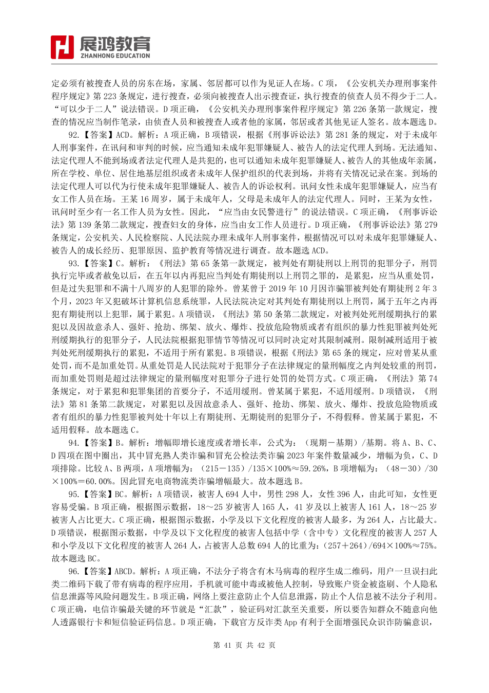

展开本页文字

第41 页共42 页
定必须有被搜查人员的房东在场，家属、邻居都可以作为见证人在场。C 项，《公安机关办理刑事案件
程序规定》第223 条规定，进行搜查，必须向被搜查人出示搜查证，执行搜查的侦查人员不得少于二人。
“可以少于二人”说法错误。D 项正确，《公安机关办理刑事案件程序规定》第226 条第一款规定，搜
查的情况应当制作笔录，由侦查人员和被搜查人或者他的家属，邻居或者其他见证人签名。故本题选D。
92.【答案】ACD。解析：A 项正确，B 项错误，根据《刑事诉讼法》第281 条的规定，对于未成年
人刑事案件，在讯问和审判的时候，应当通知未成年犯罪嫌疑人、被告人的法定代理人到场。无法通知、
法定代理人不能到场或者法定代理人是共犯的，也可以通知未成年犯罪嫌疑人、被告人的其他成年亲属，
所在学校、单位、居住地基层组织或者未成年人保护组织的代表到场，并将有关情况记录在案。到场的
法定代理人可以代为行使未成年犯罪嫌疑人、被告人的诉讼权利。讯问女性未成年犯罪嫌疑人，应当有
女工作人员在场。王某16 周岁，属于未成年人，父母是未成年人的法定代理人。同时，王某为女性，
讯问时至少有一名工作人员为女性。因此，“应当由女民警进行”的说法错误。C 项正确，《刑事诉讼
法》第139 条第二款规定，搜查妇女的身体，应当由女工作人员进行。D 项正确，《刑事诉讼法》第279
条规定，公安机关、人民检察院、人民法院办理未成年人刑事案件，根据情况可以对未成年犯罪嫌疑人、
被告人的成长经历、犯罪原因、监护教育等情况进行调查。故本题选ACD。
93.【答案】C。解析：《刑法》第65 条第一款规定，被判处有期徒刑以上刑罚的犯罪分子，刑罚
执行完毕或者赦免以后，在五年以内再犯应当判处有期徒刑以上刑罚之罪的，是累犯，应当从重处罚，
但是过失犯罪和不满十八周岁的人犯罪的除外。曾某曾于2019 年10 月因诈骗罪被判处有期徒刑2 年3
个月，2023 年又犯破坏计算机信息系统罪，人民法院决定对其判处有期徒刑以上刑罚，属于五年之内再
犯有期徒刑以上犯罪，属于累犯。A 项错误，《刑法》第50 条第二款规定，对被判处死刑缓期执行的累
犯以及因故意杀人、强奸、抢劫、绑架、放火、爆炸、投放危险物质或者有组织的暴力性犯罪被判处死
刑缓期执行的犯罪分子，人民法院根据犯罪情节等情况可以同时决定对其限制减刑。限制减刑适用于被
判处死刑缓期执行的累犯，不适用于所有累犯。B 项错误，根据《刑法》第65 条的规定，应对曾某从重
处罚，而不是加重处罚。从重处罚是人民法院对于犯罪分子在法律规定的量刑幅度之内判处较重的刑罚，
而加重处罚则是超过法律规定的量刑幅度对犯罪分子进行处罚的处罚方式。C 项正确，《刑法》第74
条规定，对于累犯和犯罪集团的首要分子，不适用缓刑。曾某属于累犯，不适用缓刑。D 项错误，《刑
法》第81 条第二款规定，对累犯以及因故意杀人、强奸、抢劫、绑架、放火、爆炸、投放危险物质或
者有组织的暴力性犯罪被判处十年以上有期徒刑、无期徒刑的犯罪分子，不得假释。曾某属于累犯，不
适用假释。故本题选C。
94.【答案】B。解析：增幅即增长速度或者增长率，公式为：（现期－基期）/基期。将A、B、C、
D 四项在图中圈出，其中冒充熟人类诈骗和冒充公检法类诈骗2023 年案件数量减少，增幅为负，C、D
项排除。比较A、B 两项，A 项增幅为：（215－135）/135×100%≈59.26%，B 项增幅为：（48－30）/30
×100%＝60.00%。因此冒充电商物流类诈骗增幅最大。故本题选B。
95.【答案】BC。解析：A 项错误，被害人694 人中，男性298 人，女性396 人，由此可知，女性更
容易受骗。B 项正确，根据图示数据，18～25 岁被害人165 人，41 岁及以上被害人161 人，18～25 岁
被害人占比更大。C 项正确，根据图示数据，小学及以下文化程度的被害人最多，为264 人，占比最大。
D 项错误，根据图示数据，中学及以下文化程度的被害人包括中学（含中专）文化程度的被害人257 人
和小学及以下文化程度的被害人264 人，占被害人总数694 人的比重为：（257＋264）/694×100%≈75%。
故本题选BC。
96.【答案】ABCD。解析：A 项正确，不法分子将含有木马病毒的程序生成二维码，用户一旦误扫此
类二维码下载了带有病毒的程序应用，手机就可能中毒或被他人控制，导致账户资金被盗刷、个人隐私
信息泄露等风险问题发生。B 项正确，网络上要注意防止个人信息泄露，防止个人信息被不法分子利用。
C 项正确，电信诈骗最关键的环节就是“汇款”，验证码对汇款至关重要，所以要告知群众不随意向他
人透露银行卡和短信验证码信息。D 项正确，下载官方反诈类App 有利于全面增强民众识诈防骗意识，

### 原第42页

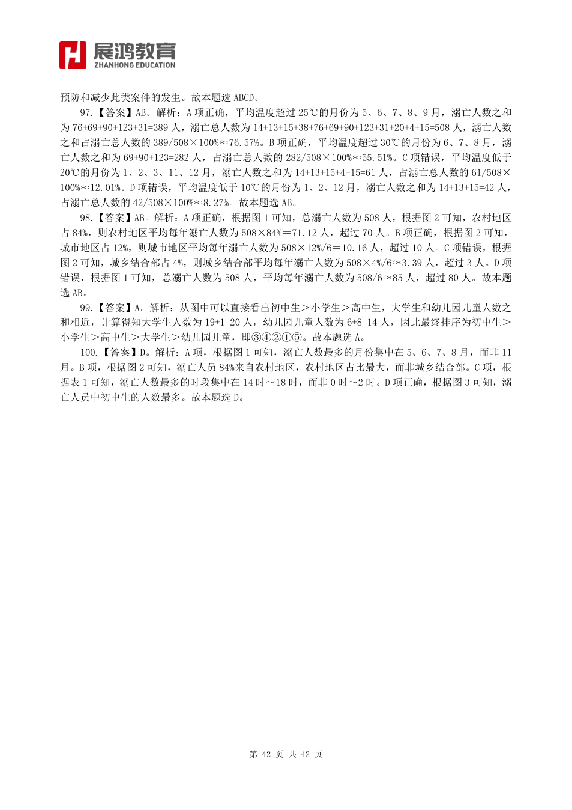

展开本页文字

第42 页共42 页
预防和减少此类案件的发生。故本题选ABCD。
97.【答案】AB。解析：A 项正确，平均温度超过25℃的月份为5、6、7、8、9 月，溺亡人数之和
为76+69+90+123+31=389 人，溺亡总人数为14+13+15+38+76+69+90+123+31+20+4+15=508 人，溺亡人数
之和占溺亡总人数的389/508×100%≈76.57%。B 项正确，平均温度超过30℃的月份为6、7、8 月，溺
亡人数之和为69+90+123=282 人，占溺亡总人数的282/508×100%≈55.51%。C 项错误，平均温度低于
20℃的月份为1、2、3、11、12 月，溺亡人数之和为14+13+15+4+15=61 人，占溺亡总人数的61/508×
100%≈12.01%。D 项错误，平均温度低于10℃的月份为1、2、12 月，溺亡人数之和为14+13+15=42 人，
占溺亡总人数的42/508×100%≈8.27%。故本题选AB。
98.【答案】AB。解析：A 项正确，根据图1 可知，总溺亡人数为508 人，根据图2 可知，农村地区
占84%，则农村地区平均每年溺亡人数为508×84%＝71.12 人，超过70 人。B 项正确，根据图2 可知，
城市地区占12%，则城市地区平均每年溺亡人数为508×12%/6＝10.16 人，超过10 人。C 项错误，根据
图2 可知，城乡结合部占4%，则城乡结合部平均每年溺亡人数为508×4%/6≈3.39 人，超过3 人。D 项
错误，根据图1 可知，总溺亡人数为508 人，平均每年溺亡人数为508/6≈85 人，超过80 人。故本题
选AB。
99.【答案】A。解析：从图中可以直接看出初中生＞小学生＞高中生，大学生和幼儿园儿童人数之
和相近，计算得知大学生人数为19+1=20 人，幼儿园儿童人数为6+8=14 人，因此最终排序为初中生＞
小学生＞高中生＞大学生＞幼儿园儿童，即③④②①⑤。故本题选A。
100.【答案】D。解析：A 项，根据图1 可知，溺亡人数最多的月份集中在5、6、7、8 月，而非11
月。B 项，根据图2 可知，溺亡人员84%来自农村地区，农村地区占比最大，而非城乡结合部。C 项，根
据表1 可知，溺亡人数最多的时段集中在14 时～18 时，而非0 时～2 时。D 项正确，根据图3 可知，溺
亡人员中初中生的人数最多。故本题选D。

